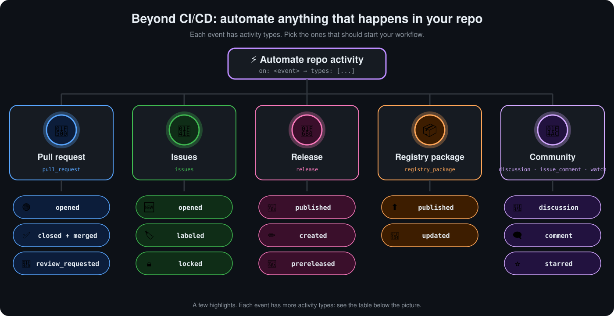

<p align="center">
  <a href="README.md">📂 <b>The Six Core Concepts</b></a> &nbsp;·&nbsp; Lesson 2 · Part 1 of 8 &nbsp;·&nbsp; ⏱️ 4 min
</p>

# 🔔 1. Event: the trigger

An event is *something that happened*. It's the reason a workflow starts.

```yaml
on: push
```

| Kind | Examples |
|---|---|
| 📝 Code activity | `push`, `pull_request` |
| 🗂️ Repository activity | `issues`, `release`, `fork` |
| ⏰ A clock | `schedule` (cron syntax) |
| 🔘 A human | `workflow_dispatch` (the "Run workflow" button) |
| 🔗 Another workflow | `workflow_call`, `workflow_run` |

📎 A fuller menu lives in [assets/snippets/triggers.yml](../../assets/snippets/triggers.yml).

## 🌳 Beyond CI/CD: automating the repository itself

GitHub Actions isn't only for building and testing code. Almost anything that happens in a repository can start a workflow: a pull request is opened, an issue is labelled, a release is published, a package is pushed to the registry, someone stars the repo.

<p align="center">
  
</p>

Each event has **activity types** that say *what* happened to it. Use `types:` to choose which ones start your workflow:

```yaml
on:
  issues:
    types: [opened, labeled]
  release:
    types: [published]
```

| Event | Common activity types | If you leave out `types:` | A typical automation |
|---|---|---|---|
| 🔀 `pull_request` | `opened`, `synchronize`, `reopened`, `closed`, `labeled`, `review_requested`, `ready_for_review` | Runs on `opened`, `synchronize`, `reopened` only | Run tests, request reviewers, clean up after merge |
| 🐞 `issues` | `opened`, `edited`, `closed`, `reopened`, `labeled`, `assigned`, `locked`, `pinned`, `milestoned` | Runs on every type | Triage, auto-label, add to a project board |
| 🚀 `release` | `published`, `created`, `released`, `prereleased`, `edited`, `unpublished`, `deleted` | Runs on every type | Build and upload binaries, post release notes |
| 📦 `registry_package` | `published`, `updated` | Runs on every type | Scan or promote a freshly pushed container image |
| 💭 `discussion` | `created`, `answered`, `labeled`, `category_changed` | Runs on every type | Route questions, thank whoever answered |
| 🗨️ `issue_comment` | `created`, `edited`, `deleted` | Runs on every type | ChatOps commands such as `/deploy` in a comment |
| ⭐ `watch` | `started` (someone starred the repo) | Runs on `started` | Thank new stargazers, update a counter |
| 🏷️ `label`, `milestone` | `created`, `edited`, `deleted` | Runs on every type | Keep labels in sync across repositories |
| 🌿 `create`, `delete` | No types: fires when a branch or tag is made or removed | n/a | Spin up or tear down preview environments |

> [!IMPORTANT]
> **There is no `merged` activity type.** A merged pull request fires `closed`. Check the payload to tell a merge from a plain close:
>
> ```yaml
> on:
>   pull_request:
>     types: [closed]
> jobs:
>   after-merge:
>     if: github.event.pull_request.merged == true
> ```

> [!TIP]
> When you only care about one or two activity types, always list them. Without `types:`, a workflow on `issues` runs for every edit, label and assignment, which uses minutes and clutters the Actions tab.

📚 Every event and activity type is listed in GitHub's [events that trigger workflows](https://docs.github.com/en/actions/reference/workflows-and-actions/events-that-trigger-workflows) reference.

---

<p align="center">
  <a href="README.md">⬅️ Overview</a>
  &nbsp;&nbsp;·&nbsp;&nbsp;
  <a href="README.md">📂 Topic overview</a>
  &nbsp;&nbsp;·&nbsp;&nbsp;
  <a href="02-2-workflow-the-recipe.md"><b>Next: 2. Workflow: the recipe ➡️</b></a>
</p>
