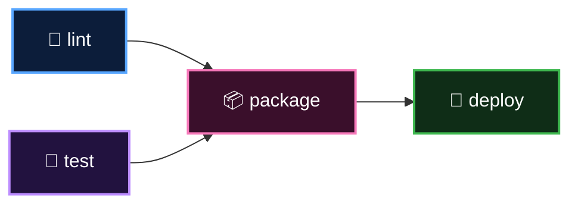

  <a href="README.md">📂 <b>The Six Core Concepts</b></a> &nbsp;·&nbsp; Lesson 2 · Part 3 of 8 &nbsp;·&nbsp; ⏱️ 2 min

# 📦 3. Job: a unit of work on one machine

A job is a group of steps that run **on the same runner**.

Two rules to memorise:

> [!IMPORTANT]
> 1. **Jobs run in parallel by default.** Add `needs:` to put them in order.
> 2. **Jobs do not share files.** Each one starts on a brand-new machine.

Here `lint` and `test` run side by side, `package` waits for both, and `deploy` waits for `package`. The YAML for exactly this shape is in [assets/snippets/job-dependencies.yml](../../assets/snippets/job-dependencies.yml).

---

  <a href="02-2-workflow-the-recipe.md">⬅️ 2. Workflow: the recipe</a>
  &nbsp;&nbsp;·&nbsp;&nbsp;
  <a href="README.md">📂 Topic overview</a>
  &nbsp;&nbsp;·&nbsp;&nbsp;
  <a href="04-4-step-one-thing-at-a-time.md"><b>Next: 4. Step: one thing at a time ➡️</b></a>

