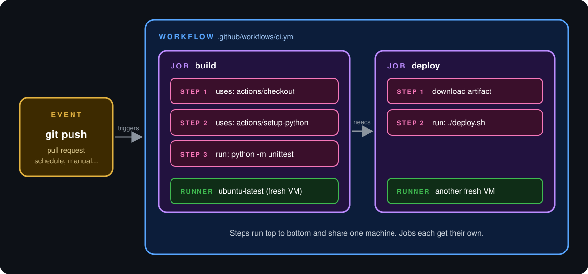

  <b>Lesson 2 of 5</b> &nbsp;·&nbsp; ⏱️ 11 min read &nbsp;·&nbsp; 🟢 Beginner

# 🧩 The Six Core Concepts

Learn six words and you can read any workflow on GitHub. Here they are in one picture:

  

And in one sentence:

> An **event** triggers a **workflow**, which contains **jobs**, which are made of **steps**, which either run a command or use an **action**, all on a **runner**.

Let's take them one at a time, from the outside in.

## 🗺️ In this topic

8 subtopics, about 14 minutes in all. Read them in order, or jump to the one you need.

| # | Subtopic | Time |
|---|---|---|
| 1 | 🔔 [**1. Event: the trigger**](01-1-event-the-trigger.md) | 4 min |
| 2 | 📜 [**2. Workflow: the recipe**](02-2-workflow-the-recipe.md) | 1 min |
| 3 | 📦 [**3. Job: a unit of work on one machine**](03-3-job-a-unit-of-work-on.md) | 2 min |
| 4 | 👣 [**4. Step: one thing at a time**](04-4-step-one-thing-at-a-time.md) | 1 min |
| 5 | 🧱 [**5. Action: a reusable building block**](05-5-action-a-reusable-building-block.md) | 2 min |
| 6 | 🖥️ [**6. Runner: the machine**](06-6-runner-the-machine.md) | 2 min |
| 7 | 🗺️ [**The whole family, one table**](07-the-whole-family-one-table.md) | 1 min |
| 8 | ✅ [**Checkpoint**](08-checkpoint.md) | 1 min |

  <a href="01-1-event-the-trigger.md"><b>▶️ Start with 1. Event: the trigger</b></a>

---

  <a href="../01-what-is-github-actions/README.md">⬅️ What is GitHub Actions?</a>
  &nbsp;&nbsp;·&nbsp;&nbsp;
  <a href="../index.md">📚 Chapter 1</a>
  &nbsp;&nbsp;·&nbsp;&nbsp;
  <a href="../03-anatomy-of-a-workflow/README.md"><b>Next: Anatomy of a Workflow ➡️</b></a>

