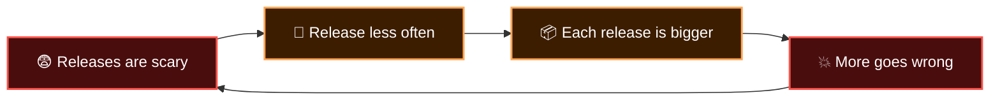

  <a href="README.md">📂 <b>What is CI/CD?</b></a> &nbsp;·&nbsp; Lesson 1 · Part 1 of 6 &nbsp;·&nbsp; ⏱️ 2 min

# 😱 Life before CI/CD

Meet a team of five, building an online shop the old way.

**Weeks 1 to 6.** Everyone works on their own branch. Nobody merges, because merging is painful. Life is peaceful.

**Week 7: "Integration week".** All five branches are merged at once. Asha renamed a function that Ben calls in forty places. Two people edited the same checkout page. The app doesn't even start. This has a name: **integration hell**.

**Week 8: "Release weekend".** Someone follows a 43-step document called `DEPLOY_FINAL_v3_REAL.docx`. Step 27 is out of date. The site is down from Saturday night to Sunday afternoon.

**Week 9.** Everyone agrees releases are dangerous, so they decide to do them *less often*. Which makes each one bigger. Which makes each one more dangerous.

That loop is the trap. CI/CD is the way out.

---

  <a href="README.md">⬅️ Overview</a>
  &nbsp;&nbsp;·&nbsp;&nbsp;
  <a href="README.md">📂 Topic overview</a>
  &nbsp;&nbsp;·&nbsp;&nbsp;
  <a href="02-the-big-idea.md"><b>Next: The big idea ➡️</b></a>

