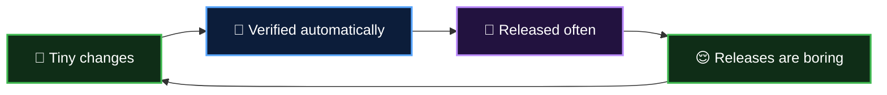

  <a href="README.md">📂 <b>What is CI/CD?</b></a> &nbsp;·&nbsp; Lesson 1 · Part 2 of 6 &nbsp;·&nbsp; ⏱️ 1 min

# 💡 The big idea

> [!IMPORTANT]
> **If it hurts, do it more often, and let a machine do it.**

It sounds backwards, but it works for the same reason washing one plate after dinner beats facing a week of dishes. Small things are easy. Merging ten lines is trivial; merging ten thousand is a project.

So we flip the loop:

**Boring releases are the goal.** A release so routine that nobody stays late for it.

---

  <a href="01-life-before-ci-cd.md">⬅️ Life before CI/CD</a>
  &nbsp;&nbsp;·&nbsp;&nbsp;
  <a href="README.md">📂 Topic overview</a>
  &nbsp;&nbsp;·&nbsp;&nbsp;
  <a href="03-decoding-the-letters.md"><b>Next: Decoding the letters ➡️</b></a>

