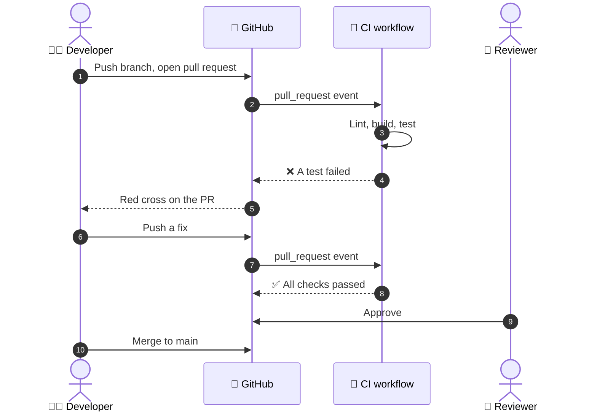

  <a href="README.md">📂 <b>Continuous Integration</b></a> &nbsp;·&nbsp; Lesson 2 · Part 2 of 8 &nbsp;·&nbsp; ⏱️ 1 min

# 🎬 A day in the life of a change

Notice step 4. The failure reached the author within minutes, while the change was still fresh in their head, and before a reviewer spent any time on it. That **fast feedback** is the whole value of CI.

---

  <a href="01-the-definition.md">⬅️ The definition</a>
  &nbsp;&nbsp;·&nbsp;&nbsp;
  <a href="README.md">📂 Topic overview</a>
  &nbsp;&nbsp;·&nbsp;&nbsp;
  <a href="03-two-developers-one-main.md"><b>Next: Two developers, one `main` ➡️</b></a>

