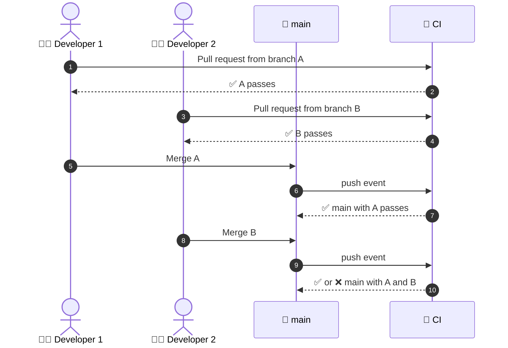

  <a href="README.md">📂 <b>Continuous Integration</b></a> &nbsp;·&nbsp; Lesson 2 · Part 3 of 8 &nbsp;·&nbsp; ⏱️ 2 min

# 👯 Two developers, one `main`

Real teams have several changes in flight at once. Follow two of them.

Every pull request was tested. So why does CI run **again** after each merge?

| | Run | What it actually tested |
|---|---|---|
| 1 | Pull request A | `main` as it was, plus A |
| 2 | Pull request B | `main` as it was, plus B |
| 3 | After both merges | `main` plus A **plus B**: a combination nobody has tested before |

Developer 1 renamed a function. Developer 2 added a new call to the old name. Each branch is green on its own. Together they're broken, and only the run on `main` can see it.

> [!IMPORTANT]
> **A pull request run tests one change. A run on `main` tests how the changes work together.** That second run is the "integration" in continuous integration, which is why the minimal workflow below listens for both `pull_request` and `push`.

---

  <a href="02-a-day-in-the-life-of-a.md">⬅️ A day in the life of a change</a>
  &nbsp;&nbsp;·&nbsp;&nbsp;
  <a href="README.md">📂 Topic overview</a>
  &nbsp;&nbsp;·&nbsp;&nbsp;
  <a href="04-what-does-a-ci-run-check.md"><b>Next: What does a CI run check? ➡️</b></a>

