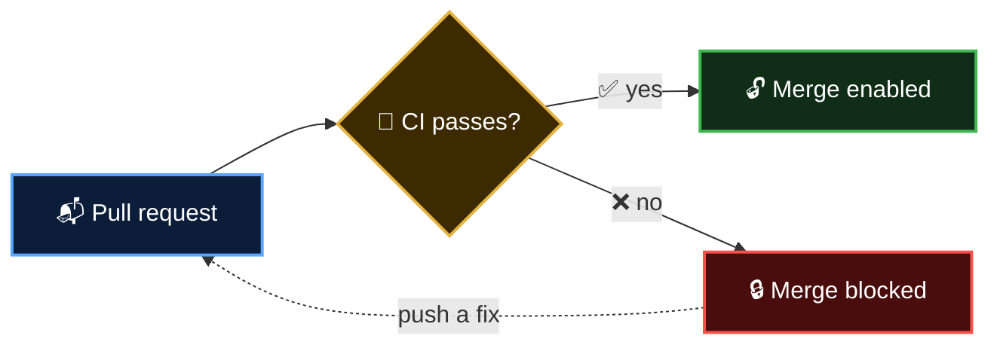

  <a href="README.md">📂 <b>Continuous Integration</b></a> &nbsp;·&nbsp; Lesson 2 · Part 5 of 8 &nbsp;·&nbsp; ⏱️ 2 min

# 🚦 The meaning of the tick

On every commit and pull request, GitHub shows the result:

| | Status | Means |
|---|---|---|
| 🟡 | Pending | Checks are running |
| ✅ | Success | Every check passed |
| ❌ | Failure | At least one check failed |

With a **branch protection rule** (or ruleset) you can make the tick mandatory: GitHub disables the **Merge** button until required checks pass. This turns CI from advice into a gate.

> [!NOTE]
> **📘 From the GitHub docs:** A tick can't wait forever. A job that sits in the queue for **24 hours** is cancelled automatically, and a job on a GitHub-hosted runner is stopped after **6 hours** of running. If a check stays 🟡 for ages, look for a missing runner or a hung step. ([Actions limits](https://docs.github.com/en/actions/reference/limits))

---

  <a href="04-what-does-a-ci-run-check.md">⬅️ What does a CI run check?</a>
  &nbsp;&nbsp;·&nbsp;&nbsp;
  <a href="README.md">📂 Topic overview</a>
  &nbsp;&nbsp;·&nbsp;&nbsp;
  <a href="06-the-five-habits-of-ci.md"><b>Next: The five habits of CI ➡️</b></a>

