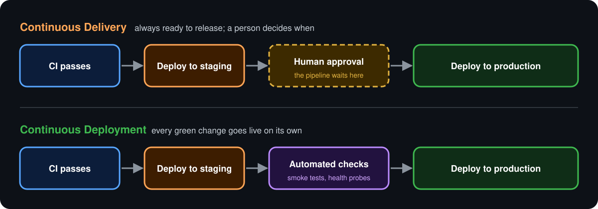

  <a href="README.md">📂 <b>Continuous Delivery vs Continuous Deployment</b></a> &nbsp;·&nbsp; Lesson 3 · Part 1 of 7 &nbsp;·&nbsp; ⏱️ 1 min

# 🎯 The difference in one picture

  

**The only difference is who presses the final button.**

| | 🚚 Continuous Delivery | 🚀 Continuous Deployment |
|---|---|---|
| **Promise** | Every change *could* go live at any moment | Every change *does* go live |
| **Final step to production** | A human clicks **Approve** | Fully automatic |
| **Release frequency** | When the business chooses | Many times a day |
| **What you need** | A reliable, automated deploy | That, plus great tests and monitoring |
| **Fits** | Regulated industries, mobile apps, scheduled launches | Web apps and services with strong test coverage |

> [!TIP]
> **Memory hook:** *Delivery* brings the parcel to your door and waits for a signature. *Deployment* leaves it inside the house.

---

  <a href="README.md">⬅️ Overview</a>
  &nbsp;&nbsp;·&nbsp;&nbsp;
  <a href="README.md">📂 Topic overview</a>
  &nbsp;&nbsp;·&nbsp;&nbsp;
  <a href="02-three-rungs-of-one-ladder.md"><b>Next: Three rungs of one ladder ➡️</b></a>

