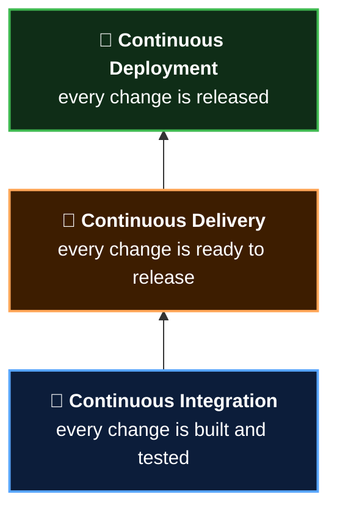

  <a href="README.md">📂 <b>Continuous Delivery vs Continuous Deployment</b></a> &nbsp;·&nbsp; Lesson 3 · Part 2 of 7 &nbsp;·&nbsp; ⏱️ 1 min

# 🪜 Three rungs of one ladder

Each practice builds on the one below it. You can't skip a rung.

> [!NOTE]
> Continuous deployment isn't "better" than continuous delivery. It's a choice. Many excellent teams deliberately stop at delivery because a regulator, an app store, or a marketing calendar decides when releases happen.

---

  <a href="01-the-difference-in-one-picture.md">⬅️ The difference in one picture</a>
  &nbsp;&nbsp;·&nbsp;&nbsp;
  <a href="README.md">📂 Topic overview</a>
  &nbsp;&nbsp;·&nbsp;&nbsp;
  <a href="03-environments-the-rehearsal-stages.md"><b>Next: Environments: the rehearsal stages ➡️</b></a>

