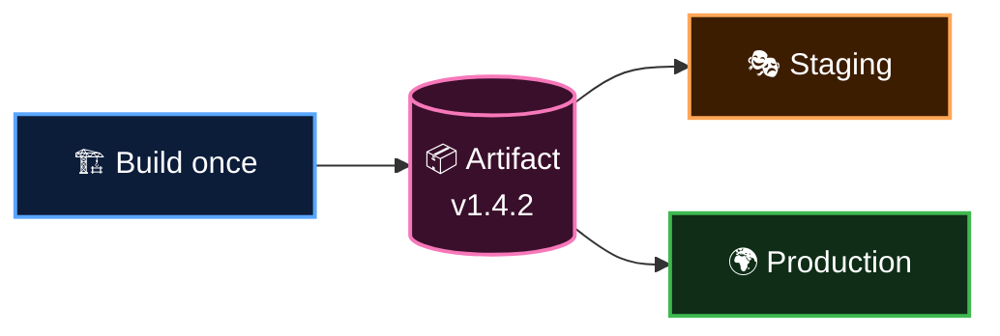

  <a href="README.md">📂 <b>Continuous Delivery vs Continuous Deployment</b></a> &nbsp;·&nbsp; Lesson 3 · Part 4 of 7 &nbsp;·&nbsp; ⏱️ 2 min

# 📦 Build once, deploy many

One rule separates trustworthy pipelines from hopeful ones:

> [!IMPORTANT]
> **Build the artifact once. Deploy that exact same artifact to every environment.**

An **artifact** is the packaged output of your build: a zip, a container image, a compiled binary.

If you rebuild for production, you are shipping something that was **never tested**. A dependency may have released a new version in between. Staging proved nothing.

Differences between environments (database URLs, API keys) belong in **configuration**, supplied at deploy time, never baked into the build.

---

  <a href="03-environments-the-rehearsal-stages.md">⬅️ Environments: the rehearsal stages</a>
  &nbsp;&nbsp;·&nbsp;&nbsp;
  <a href="README.md">📂 Topic overview</a>
  &nbsp;&nbsp;·&nbsp;&nbsp;
  <a href="05-deploying-without-fear.md"><b>Next: Deploying without fear ➡️</b></a>

