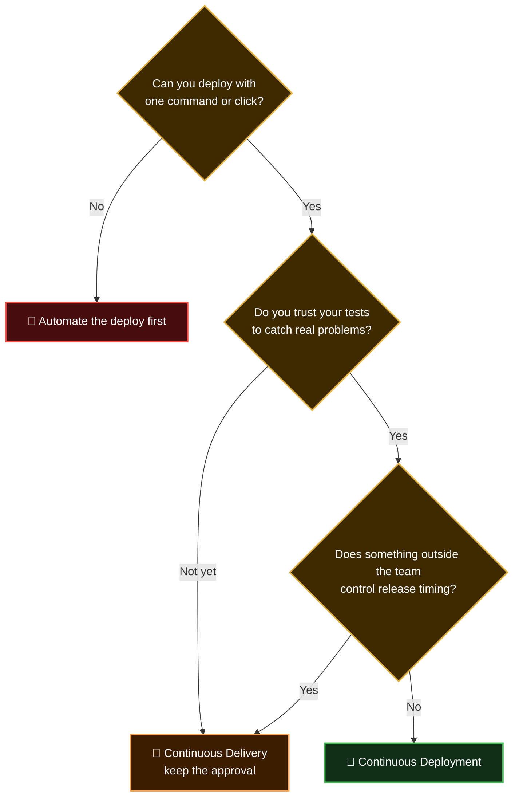

  <a href="README.md">📂 <b>Continuous Delivery vs Continuous Deployment</b></a> &nbsp;·&nbsp; Lesson 3 · Part 6 of 7 &nbsp;·&nbsp; ⏱️ 1 min

# 🧭 Which one should you choose?

---

  <a href="05-deploying-without-fear.md">⬅️ Deploying without fear</a>
  &nbsp;&nbsp;·&nbsp;&nbsp;
  <a href="README.md">📂 Topic overview</a>
  &nbsp;&nbsp;·&nbsp;&nbsp;
  <a href="07-checkpoint.md"><b>Next: Checkpoint ➡️</b></a>

