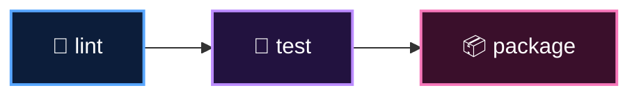

<p align="center">
  <a href="README.md">📂 <b>Anatomy of a Pipeline</b></a> &nbsp;·&nbsp; Lesson 4 · Part 2 of 7 &nbsp;·&nbsp; ⏱️ 2 min
</p>

# 🧩 Pipelines in GitHub Actions

GitHub Actions has no keyword called `pipeline` or `stage`. You build them from pieces you already know:

> [!IMPORTANT]
> **A stage is a job. The pipeline's order comes from `needs`.**

```yaml
jobs:
  lint:
    runs-on: ubuntu-latest
    steps: [...]

  test:
    needs: lint            # 👈 stage 2 waits for stage 1
    runs-on: ubuntu-latest
    steps: [...]

  package:
    needs: test            # 👈 stage 3 waits for stage 2
    runs-on: ubuntu-latest
    steps: [...]
```

GitHub draws that as a graph on the run page:



If `lint` fails, `test` and `package` are **skipped** automatically. That's the quality gate, for free.

---

<p align="center">
  <a href="01-the-five-stations.md">⬅️ The five stations</a>
  &nbsp;&nbsp;·&nbsp;&nbsp;
  <a href="README.md">📂 Topic overview</a>
  &nbsp;&nbsp;·&nbsp;&nbsp;
  <a href="03-fan-out-and-fan-in.md"><b>Next: Fan-out and fan-in ➡️</b></a>
</p>
