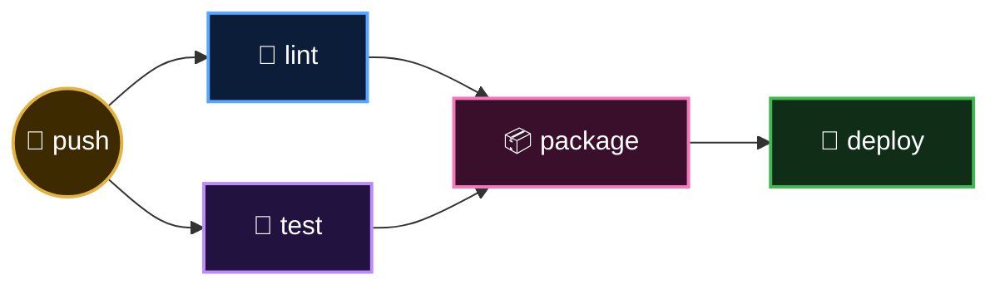

<p align="center">
  <a href="README.md">📂 <b>Anatomy of a Pipeline</b></a> &nbsp;·&nbsp; Lesson 4 · Part 3 of 7 &nbsp;·&nbsp; ⏱️ 2 min
</p>

# 🔀 Fan-out and fan-in

`needs` takes a list, so stages can run side by side and then join up.

```yaml
  package:
    needs: [lint, test]
```



| Shape | Good for | Trade-off |
|---|---|---|
| **Serial** (`lint → test`) | Failing fast, saving minutes | Slower when everything passes |
| **Parallel** (`lint` + `test`) | Fastest total time | Runs tests even when lint would fail |

Neither is right in general. Fast checks first in serial, slow checks in parallel, is a sensible default.

📎 Full example: [assets/snippets/job-dependencies.yml](../../assets/snippets/job-dependencies.yml)

---

<p align="center">
  <a href="02-pipelines-in-github-actions.md">⬅️ Pipelines in GitHub Actions</a>
  &nbsp;&nbsp;·&nbsp;&nbsp;
  <a href="README.md">📂 Topic overview</a>
  &nbsp;&nbsp;·&nbsp;&nbsp;
  <a href="04-the-matrix-one-job-many-variations.md"><b>Next: The matrix: one job, many variations ➡️</b></a>
</p>
