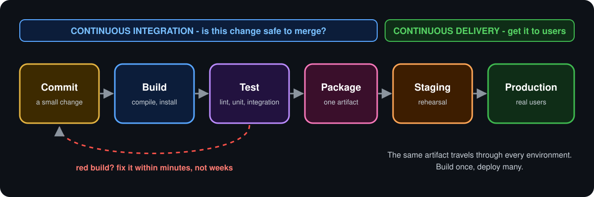

  <b>Lesson 4 of 6</b> &nbsp;·&nbsp; ⏱️ 9 min read &nbsp;·&nbsp; 🟡 Builds on Chapter 1

# 🏭 Anatomy of a Pipeline

A **pipeline** is the automated path a change takes from "pushed" to "running in production". Tools differ, languages differ, but the stages are remarkably consistent.

  

## 🗺️ In this topic

7 subtopics, about 10 minutes in all. Read them in order, or jump to the one you need.

| # | Subtopic | Time |
|---|---|---|
| 1 | 🚉 [**The five stations**](01-the-five-stations.md) | 1 min |
| 2 | 🧩 [**Pipelines in GitHub Actions**](02-pipelines-in-github-actions.md) | 2 min |
| 3 | 🔀 [**Fan-out and fan-in**](03-fan-out-and-fan-in.md) | 2 min |
| 4 | 🧮 [**The matrix: one job, many variations**](04-the-matrix-one-job-many-variations.md) | 1 min |
| 5 | 🎒 [**Carrying things between stages**](05-carrying-things-between-stages.md) | 2 min |
| 6 | ⏱️ [**What makes a pipeline good?**](06-what-makes-a-pipeline-good.md) | 1 min |
| 7 | ✅ [**Checkpoint**](07-checkpoint.md) | 1 min |

  <a href="01-the-five-stations.md"><b>▶️ Start with The five stations</b></a>

---

  <a href="../03-delivery-vs-deployment/README.md">⬅️ Delivery vs Deployment</a>
  &nbsp;&nbsp;·&nbsp;&nbsp;
  <a href="../index.md">📚 Chapter 2</a>
  &nbsp;&nbsp;·&nbsp;&nbsp;
  <a href="../05-your-first-ci-pipeline/README.md"><b>Next: Your First CI Pipeline ➡️</b></a>

