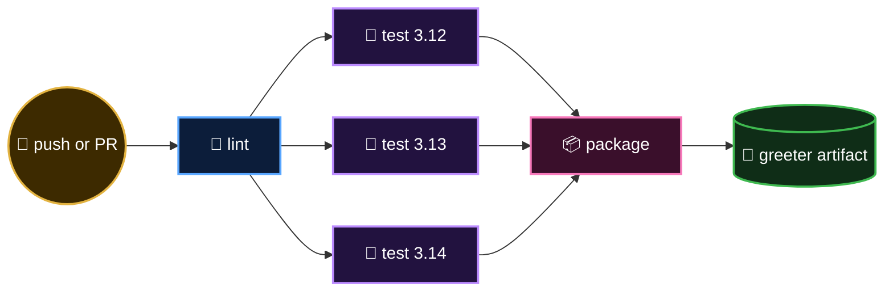

  <a href="README.md">📂 <b>Your First CI Pipeline</b></a> &nbsp;·&nbsp; Lesson 5 · Part 2 of 9 &nbsp;·&nbsp; ⏱️ 1 min

# 🗺️ The pipeline you're about to run

Three stages, five jobs, one artifact.

---

  <a href="01-the-cast.md">⬅️ The cast</a>
  &nbsp;&nbsp;·&nbsp;&nbsp;
  <a href="README.md">📂 Topic overview</a>
  &nbsp;&nbsp;·&nbsp;&nbsp;
  <a href="03-the-workflow-piece-by-piece.md"><b>Next: The workflow, piece by piece ➡️</b></a>

