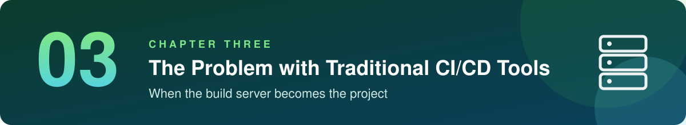
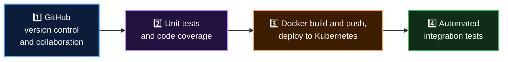
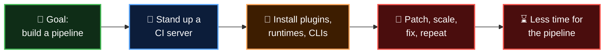

  

  <b>Lesson 1 of 4</b> &nbsp;·&nbsp; ⏱️ 7 min read &nbsp;·&nbsp; 🟢 No experience needed

# 🧯 The Problem Statement

Chapter 2 convinced you that CI/CD is worth doing. It skipped one awkward question: **what does the pipeline run on?**

For years the answer was "a server we look after ourselves". This chapter is about what that costs. To make it concrete, we'll follow one person through the decision.

## 🏢 Meet Tessaloop Technologies

> [!NOTE]
> Tessaloop Technologies is a made-up company. Its situation is not: you'll find this story inside most software teams.

Tessaloop is a software provider. Its platform connects data, applications and devices for businesses that run their systems on-premises.

Its R&D team wants to move those services to the **cloud** and run them in **containers**. They'll start small, with one **Node.js** project, and roll the same approach out to the rest once it works.

To make that happen, Tessaloop has formed a DevOps team, led by **Abhijeet**. His brief:

| | His brief | In practice |
|---|---|---|
| 🏗️ | Build the pipeline from day one | No legacy to inherit, and no excuses either |
| 📏 | Follow industry good practice | Automated, repeatable, reviewed |
| ☁️ | Work across more than one cloud | AWS and Azure are both on the roadmap |
| 🐳 | Package with Docker | Every service ships as a container image |
| ☸️ | Run on Kubernetes | Containers are deployed and managed there |

## 🔎 What Abhijeet found

Before designing anything, he takes a quick look at how the Node.js project has been built so far.

| | What he found | What it leads to |
|---|---|---|
| 📂 | No shared version control. Code is combined by hand | Nobody is sure which copy is the real one |
| 🧪 | Tests are run by hand | They are slow, so they get skipped |
| 🏝️ | Developers work alone for long stretches | Their changes collide when they finally meet |
| 📦 | Integration and testing happen rarely | Every release is large, and risky |
| 🖐️ | Deployments to dev, staging and production are manual | Each environment ends up slightly different |

If that sounds like "life before CI/CD" from [Chapter 2](../02-basics-of-ci-cd/01-what-is-ci-cd.md), it is. Same disease, different company.

## 🗺️ His four-step plan

Abhijeet writes down a plan that addresses every finding:

| | Step | Fixes |
|---|---|---|
| 1️⃣ | **GitHub** for version control and collaboration | Hand-merged code, isolated developers |
| 2️⃣ | **Unit tests and code coverage** on every change | Slow manual testing, bugs found late |
| 3️⃣ | **Docker build and push**, then **deploy to Kubernetes** | Manual, inconsistent deployments |
| 4️⃣ | **Automated integration tests** as the final gate | Risky releases |

It's a good plan. It leaves one question open.

## 🤔 Which tool will run all this?

Something has to execute those four steps every time code changes. There is no shortage of candidates: Jenkins, Travis CI, Bamboo, Spinnaker, CircleCI and more.

After comparing a few, Abhijeet leans towards **Jenkins**. It is open source, hugely popular, and can be extended to do almost anything. A sensible first choice.

Then he lists what he'd have to do before the first build could run.

## 🧾 The bill before the first build

| | Task | Why it's needed |
|---|---|---|
| 1 | Provision and maintain a **virtual machine** with enough CPU, memory and disk | Jenkins has to live somewhere |
| 2 | Install a **Java JDK**, open **firewall rules**, install **Jenkins plugins** | Jenkins runs on Java and does little without plugins |
| 3 | Install **Node.js and npm** | The project is a Node.js app |
| 4 | Install **several Node.js versions** side by side, without conflicts | Unit tests must pass on every supported version |
| 5 | Install **Docker** | To build and push container images |
| 6 | Install **kubectl, Helm** and friends | To deploy to Kubernetes |
| 7 | Install the **CLIs for testing and reporting tools** | Integration tests call external tools |

And that is only the first project.

| | When this arrives... | ...the machine also needs |
|---|---|---|
| ☕ | Java projects | A JDK for the apps, plus Maven |
| 🐍 | Python projects | Python and its package tooling |
| ☁️ | Deployments to AWS and Azure | The AWS CLI and the Azure CLI |
| 🛡️ | DevSecOps scanning | Tools such as Trivy and kubesec |

One more fact makes the list heavier: **the team is new**. Most of its members haven't worked with half of these tools, never mind kept them all running on one server.

## 🧱 What "traditional CI/CD tool" means here

In this guide, a **traditional CI/CD tool** is a CI server that you install and operate yourself. Jenkins is the best-known example. TeamCity and Bamboo are in the same family when run on your own machines.

They share a shape:

| | Part | Job |
|---|---|---|
| 🧠 | **A central server** | Stores the pipeline configuration, schedules builds, shows the dashboard |
| 💪 | **Build agents** | The machines that actually run your builds |
| 🧩 | **Plugins** | Add-ons that teach the server to talk to Git, Docker, Slack, your cloud |

Every one of those parts is software running on a machine that **somebody on your team has to keep alive**.

> [!NOTE]
> This is not a claim that these tools are bad. They are powerful, flexible and proven at enormous scale. The problem is the amount of care they need, and who ends up providing it.

## 📝 The problem statement

Put Abhijeet's list into one sentence and you get this:

> [!IMPORTANT]
> **Before the team can automate a single test, it has to build, secure and maintain the system that does the automating.**

He was asked to deliver a pipeline. The tool is asking him to run a small build farm first.

## 🎯 Abhijeet's two criteria

So he goes looking again, this time with two requirements written at the top of the page:

| | Criterion | What it rules out |
|---|---|---|
| 1️⃣ | **Simple to set up and start**, with no long list of services to install and configure | The seven-task list above |
| 2️⃣ | **Lets the team focus on building pipelines**, not on managing infrastructure or worrying about scale | Owning servers and agents |

After evaluating several tools against those two lines, he decides to explore and adopt **GitHub Actions**.

The next two lessons explain why. [Lesson 2](02-hidden-costs-of-self-hosted-ci.md) shows that his list was only the down payment. [Lesson 3](03-how-github-actions-answers.md) holds GitHub Actions up against it, line by line.

## ✅ Checkpoint

<b>What do we mean by a "traditional CI/CD tool" in this guide?</b>

 

A CI server that you install and run on your own machines, made of a central server, build agents and plugins. Jenkins is the classic example.

<b>Was anything wrong with Abhijeet's four-step plan?</b>

 

No. Version control, automated tests, containerised deploys and integration tests are exactly right. The problem was the cost of the tool that would run the plan.

<b>Why did the install list keep growing?</b>

 

Every new language, cloud and security tool the company adopts has to be installed and maintained on the build machine: Java and Maven, Python, cloud CLIs, scanners.

<b>What were Abhijeet's two criteria for a better tool?</b>

 

Simple to set up without installing and configuring many services, and a focus on building pipelines instead of managing infrastructure and scale.

## 🎯 What you learned

- A traditional CI/CD tool is a **server you operate**: central server, build agents, plugins
- A good pipeline plan can still stall on **the cost of the tool that runs it**
- The setup list grows with **every language, cloud and scanner** you add
- The practice of CI/CD was never the problem; **running the infrastructure** is
- Abhijeet's criteria: **easy to start**, and **pipelines, not infrastructure**

---

  <a href="../02-basics-of-ci-cd/06-cheat-sheet-and-quiz.md">⬅️ Chapter 2 Quiz</a>
  &nbsp;&nbsp;·&nbsp;&nbsp;
  <a href="index.md">📚 Chapter 3</a>
  &nbsp;&nbsp;·&nbsp;&nbsp;
  <a href="02-hidden-costs-of-self-hosted-ci.md"><b>Next: The Hidden Costs ➡️</b></a>

