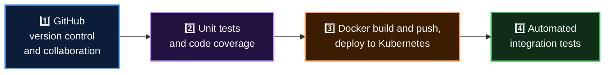

  <a href="README.md">📂 <b>The Problem Statement</b></a> &nbsp;·&nbsp; Lesson 1 · Part 3 of 9 &nbsp;·&nbsp; ⏱️ 2 min

# 🗺️ His four-step plan

Abhijeet writes down a plan that addresses every finding:

| | Step | Fixes |
|---|---|---|
| 1️⃣ | **GitHub** for version control and collaboration | Hand-merged code, isolated developers |
| 2️⃣ | **Unit tests and code coverage** on every change | Slow manual testing, bugs found late |
| 3️⃣ | **Docker build and push**, then **deploy to Kubernetes** | Manual, inconsistent deployments |
| 4️⃣ | **Automated integration tests** as the final gate | Risky releases |

It's a good plan. It leaves one question open.

---

  <a href="02-what-abhijeet-found.md">⬅️ What Abhijeet found</a>
  &nbsp;&nbsp;·&nbsp;&nbsp;
  <a href="README.md">📂 Topic overview</a>
  &nbsp;&nbsp;·&nbsp;&nbsp;
  <a href="04-which-tool-will-run-all-this.md"><b>Next: Which tool will run all this? ➡️</b></a>

