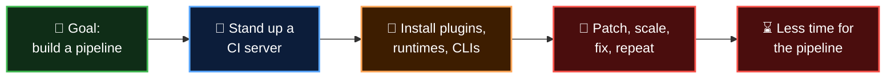

  <a href="README.md">📂 <b>The Problem Statement</b></a> &nbsp;·&nbsp; Lesson 1 · Part 5 of 9 &nbsp;·&nbsp; ⏱️ 3 min

# 🧾 The bill before the first build

| | Task | Why it's needed |
|---|---|---|
| 1 | Provision and maintain a **virtual machine** with enough CPU, memory and disk | Jenkins has to live somewhere |
| 2 | Install a **Java JDK**, open **firewall rules**, install **Jenkins plugins** | Jenkins runs on Java and does little without plugins |
| 3 | Install **Node.js and npm** | The project is a Node.js app |
| 4 | Install **several Node.js versions** side by side, without conflicts | Unit tests must pass on every supported version |
| 5 | Install **Docker** | To build and push container images |
| 6 | Install **kubectl, Helm** and friends | To deploy to Kubernetes |
| 7 | Install the **CLIs for testing and reporting tools** | Integration tests call external tools |

And that is only the first project.

| | When this arrives... | ...the machine also needs |
|---|---|---|
| ☕ | Java projects | A JDK for the apps, plus Maven |
| 🐍 | Python projects | Python and its package tooling |
| ☁️ | Deployments to AWS and Azure | The AWS CLI and the Azure CLI |
| 🛡️ | DevSecOps scanning | Tools such as Trivy and kubesec |

One more fact makes the list heavier: **the team is new**. Most of its members haven't worked with half of these tools, never mind kept them all running on one server.

---

  <a href="04-which-tool-will-run-all-this.md">⬅️ Which tool will run all this?</a>
  &nbsp;&nbsp;·&nbsp;&nbsp;
  <a href="README.md">📂 Topic overview</a>
  &nbsp;&nbsp;·&nbsp;&nbsp;
  <a href="06-what-traditional-ci-cd-tool-means-here.md"><b>Next: What "traditional CI/CD tool" means here ➡️</b></a>

