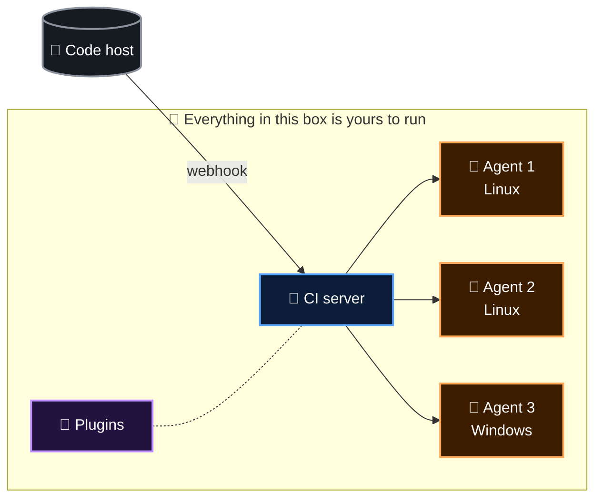

  <a href="README.md">📂 <b>The Hidden Costs of Running Your Own CI Server</b></a> &nbsp;·&nbsp; Lesson 2 · Part 1 of 10 &nbsp;·&nbsp; ⏱️ 2 min

# 🏗️ How a traditional setup is built

The **CI server** decides what should run. The **agents** do the running. **Plugins** extend the server. Your code lives somewhere else and pokes the server with a **webhook** when something changes.

Now the six pains, one box at a time.

---

  <a href="README.md">⬅️ Overview</a>
  &nbsp;&nbsp;·&nbsp;&nbsp;
  <a href="README.md">📂 Topic overview</a>
  &nbsp;&nbsp;·&nbsp;&nbsp;
  <a href="02-1-you-own-a-server.md"><b>Next: 1️⃣ You own a server ➡️</b></a>

