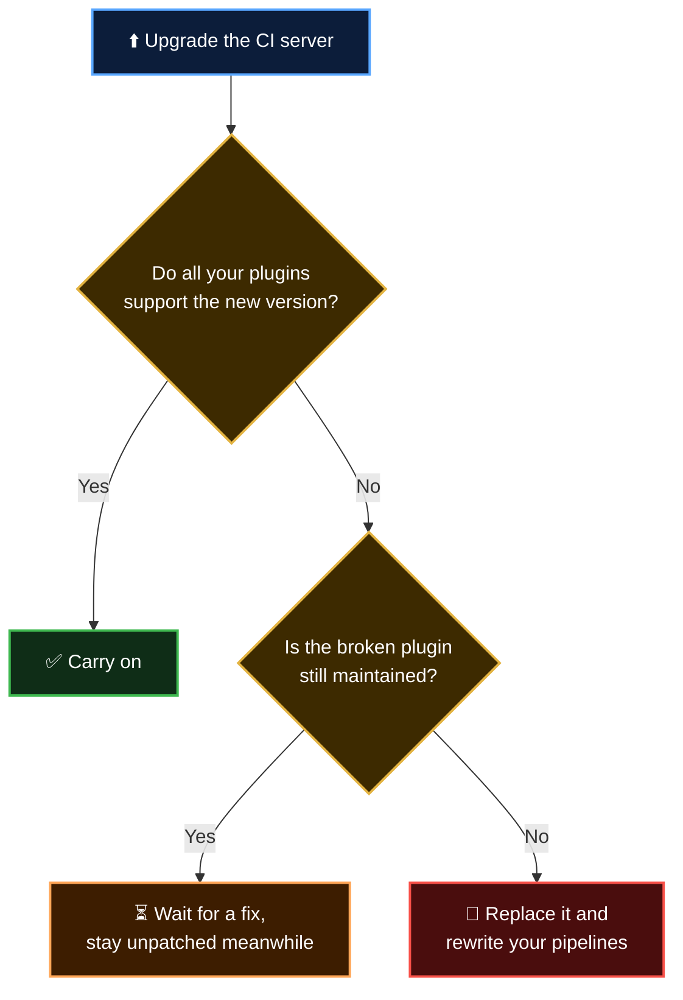

  <a href="README.md">📂 <b>The Hidden Costs of Running Your Own CI Server</b></a> &nbsp;·&nbsp; Lesson 2 · Part 5 of 10 &nbsp;·&nbsp; ⏱️ 2 min

# 4️⃣ Plugins: the superpower and the weak point

Traditional CI servers do very little on their own. Talking to Git is a plugin. Storing credentials is a plugin. Sending a Slack message is a plugin. Jenkins has well over a thousand of them, written by many different volunteers and vendors.

That openness is why these tools can do almost anything. It is also where a lot of the fragility comes from.

| | Plugin problem | Why it bites |
|---|---|---|
| 🕸️ | **Dependency chains** | Plugins depend on other plugins. Updating one can force updates to five |
| 🌍 | **Server-wide scope** | A plugin is installed once for everyone. One team's upgrade can break another team's pipeline |
| 🛡️ | **Security advisories** | Plugins run inside the server, so a flaw in one is a flaw in the server |
| 🪦 | **Abandonment** | Volunteer maintainers move on. The plugin stays in your pipeline |

---

  <a href="04-3-capacity-is-always-the-wrong-size.md">⬅️ 3️⃣ Capacity is always the wrong size</a>
  &nbsp;&nbsp;·&nbsp;&nbsp;
  <a href="README.md">📂 Topic overview</a>
  &nbsp;&nbsp;·&nbsp;&nbsp;
  <a href="06-5-glue-between-the-tool-and-your.md"><b>Next: 5️⃣ Glue between the tool and your code ➡️</b></a>

