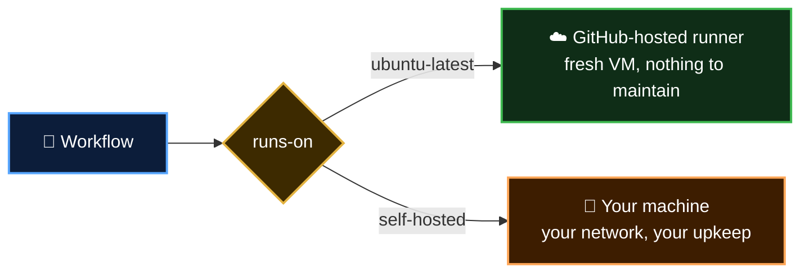

  <a href="README.md">📂 <b>How GitHub Actions Answers the Problem</b></a> &nbsp;·&nbsp; Lesson 3 · Part 8 of 11 &nbsp;·&nbsp; ⏱️ 2 min

# 🌉 The middle path: self-hosted runners

GitHub Actions also lets you bring your own machines, called **self-hosted runners**. GitHub still does the scheduling, the UI and the logs. Your machine does the running.

They solve the private-network and special-hardware problems. They also bring back pains 1 to 3 from Lesson 2 for those machines: you patch them, you keep them clean and you decide how many to run.

> [!TIP]
> Start with GitHub-hosted runners. Reach for self-hosted ones only when you hit a specific wall, such as needing a GPU or access to an internal system.

---

  <a href="07-the-honest-trade-offs.md">⬅️ The honest trade-offs</a>
  &nbsp;&nbsp;·&nbsp;&nbsp;
  <a href="README.md">📂 Topic overview</a>
  &nbsp;&nbsp;·&nbsp;&nbsp;
  <a href="09-so-which-should-you-use.md"><b>Next: So which should you use? ➡️</b></a>

