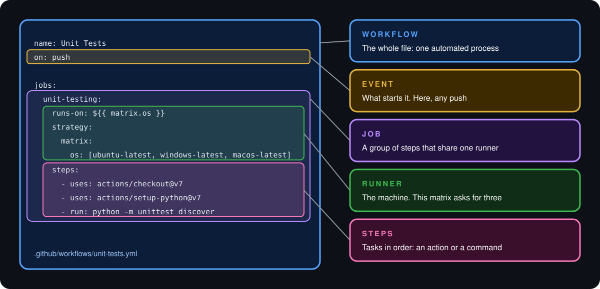
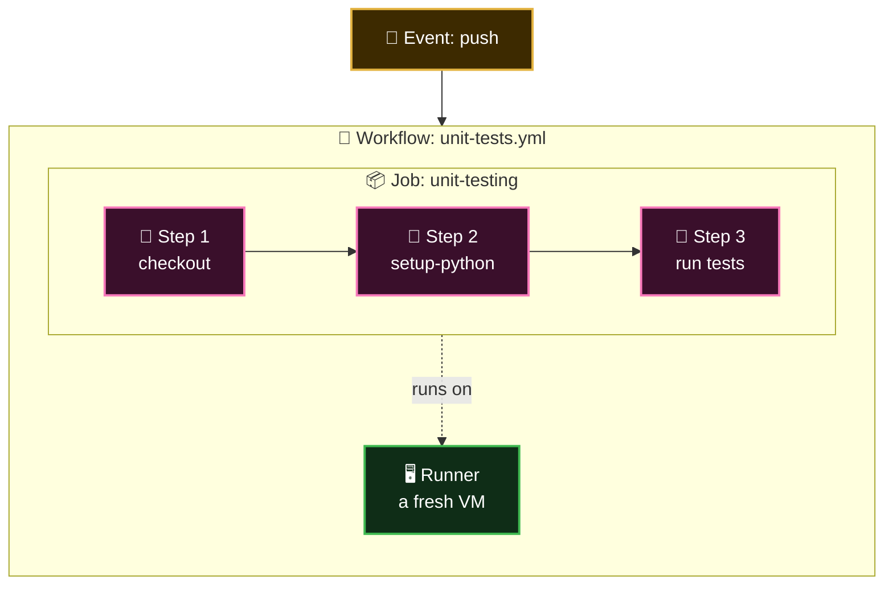
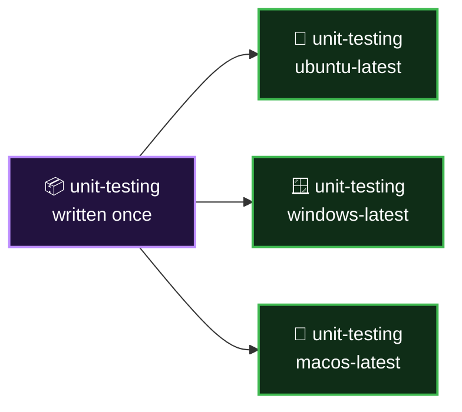

<p align="center">
  
</p>

<p align="center">
  <b>Lesson 1 of 5</b> &nbsp;·&nbsp; ⏱️ 7 min read &nbsp;·&nbsp; 🟢 Beginner
</p>

# 🧱 The Core Components

In [Chapter 3](../03-problem-with-traditional-ci-cd-tools/01-the-problem-statement.md), Abhijeet chose GitHub Actions because it let his team build pipelines without running servers. Now it's time to open the box.

You met the vocabulary in [Lesson 1.2](../01-introduction-to-github-actions/02-core-concepts.md). This chapter puts it in motion. We'll take **one small workflow** and follow it for three lessons: what it's made of, what happens when it runs, and what kind of machine runs it.

## 🎯 Four components, one picture

<p align="center">
  
</p>

Four components do the work. An **event** sets them off.

| | Component | In one line | In the file |
|---|---|---|---|
| 📜 | **Workflow** | An automated process, written as one YAML file | The whole file |
| 📦 | **Job** | A group of steps that share one machine | An entry under `jobs:` |
| 👣 | **Step** | A single task: an action or a command | An item under `steps:` |
| 🖥️ | **Runner** | The machine that executes a job | Chosen by `runs-on:` |

## 🪆 They nest like boxes



| A... | contains... | How many |
|---|---|---|
| 🗂️ Repository | Workflows | As many as you like |
| 📜 Workflow | Jobs | One or more |
| 📦 Job | Steps | One or more |
| 📦 Job | A runner | Exactly one |

## 📜 Workflow: the process

A workflow is an automated process that carries out one or more jobs. It lives in a YAML file inside `.github/workflows/`.

- A repository can hold **many workflows**: one for tests, one for deployments, one for labelling issues
- Each workflow says **which events it listens for**
- The file name is yours to choose. The folder is not

```text
.github/
└── workflows/
    ├── unit-tests.yml      👈 runs on every push
    ├── deploy.yml          👈 runs when a release is published
    └── triage.yml          👈 runs when an issue is opened
```

## 📦 Job: work for one machine

Inside a workflow you define one or more jobs. A job is a list of steps that all run **on the same runner**.

```yaml
jobs:
  unit-testing:          # the job's id, chosen by you
    runs-on: ubuntu-latest
    steps:
      - ...
```

> [!IMPORTANT]
> **Jobs run in parallel unless you say otherwise**, and each one starts on its own clean machine. Nothing is shared between jobs by default.

## 👣 Step: one task

Steps are the individual tasks inside a job. They run **one after another, top to bottom**, on the same machine, so each step can use what the previous one left behind.

| | Our workflow's steps | Kind | Why it's there |
|---|---|---|---|
| 1 | `uses: actions/checkout@v7` | Action | Copies the repository onto the runner |
| 2 | `uses: actions/setup-python@v7` | Action | Installs the Python version we asked for |
| 3 | `run: python -m unittest discover` | Command | Runs the tests |

Order matters. Step 3 can only test the code because step 1 fetched it.

## 🖥️ Runner: the machine

A runner is a virtual machine that executes a job. You never create it. You **ask for one** with `runs-on`, and GitHub provisions it when the job starts.

```yaml
runs-on: ubuntu-latest      # or windows-latest, macos-latest
```

Because GitHub is doing the hosting, these are called **GitHub-hosted runners**. [Lesson 3](03-github-hosted-vs-self-hosted-runners.md) compares them with machines you host yourself.

## ✖️ One job, three machines

Look again at the picture. The job doesn't name one operating system. It names a **matrix** of three:

```yaml
jobs:
  unit-testing:
    runs-on: ${{ matrix.os }}
    strategy:
      matrix:
        os: [ubuntu-latest, windows-latest, macos-latest]
```

GitHub reads that as three jobs, identical except for the value of `matrix.os`:



You wrote the job once. GitHub provisions **three virtual machines** and runs the same three steps on each.

> [!TIP]
> This is Abhijeet's "several versions without conflicts" problem from Chapter 3, solved in four lines. Swap `os` for `node-version` and the same idea tests three Node.js releases.

## ✅ Checkpoint

<details>
<summary><b>What is the relationship between a job and a runner?</b></summary>

<br>

One to one. Every job runs on exactly one runner, and all of that job's steps share it.

</details>

<details>
<summary><b>Steps run in series, jobs run in parallel. Why the difference?</b></summary>

<br>

Steps share a machine and build on each other's results, so order matters. Jobs are on separate machines with nothing in common, so there is no reason to make them wait.

</details>

<details>
<summary><b>A job has a matrix with three operating systems. How many runners does GitHub provision?</b></summary>

<br>

Three. The matrix expands one job definition into three jobs, and each job gets its own runner.

</details>

<details>
<summary><b>Where must a workflow file be saved?</b></summary>

<br>

In `.github/workflows/` in the repository, with a `.yml` or `.yaml` extension.

</details>

## 🎯 What you learned

- The core components are **workflow, job, step and runner**, set off by an **event**
- They nest: a workflow holds jobs, a job holds steps, and each job has one runner
- **Jobs run in parallel; steps run in series**
- You don't create runners. You **ask for them** with `runs-on`
- A **matrix** turns one job definition into several jobs on several machines

---

<p align="center">
  <a href="../03-problem-with-traditional-ci-cd-tools/04-cheat-sheet-and-quiz.md">⬅️ Chapter 3 Quiz</a>
  &nbsp;&nbsp;·&nbsp;&nbsp;
  <a href="index.md">📚 Chapter 4</a>
  &nbsp;&nbsp;·&nbsp;&nbsp;
  <a href="02-life-of-a-workflow-run.md"><b>Next: Life of a Workflow Run ➡️</b></a>
</p>
