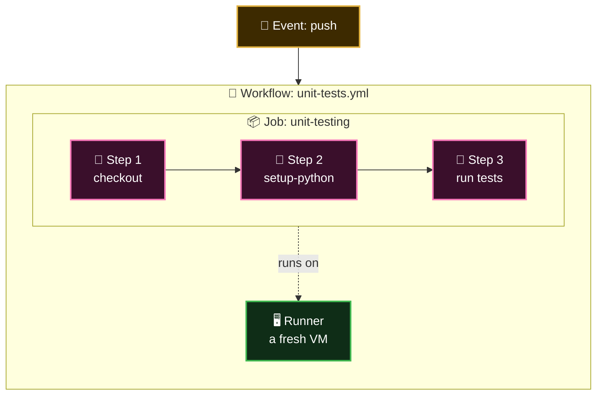

  <a href="README.md">📂 <b>The Core Components</b></a> &nbsp;·&nbsp; Lesson 1 · Part 2 of 8 &nbsp;·&nbsp; ⏱️ 1 min

# 🪆 They nest like boxes

| A... | contains... | How many |
|---|---|---|
| 🗂️ Repository | Workflows | As many as you like |
| 📜 Workflow | Jobs | One or more |
| 📦 Job | Steps | One or more |
| 📦 Job | A runner | Exactly one |

---

  <a href="01-four-components-one-picture.md">⬅️ Four components, one picture</a>
  &nbsp;&nbsp;·&nbsp;&nbsp;
  <a href="README.md">📂 Topic overview</a>
  &nbsp;&nbsp;·&nbsp;&nbsp;
  <a href="03-workflow-the-process.md"><b>Next: Workflow: the process ➡️</b></a>

