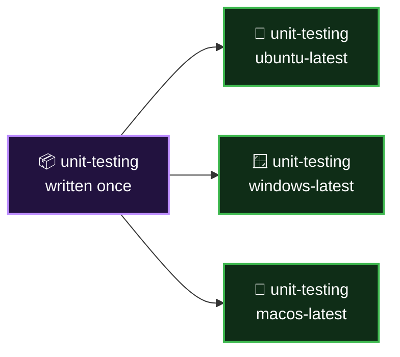

<p align="center">
  <a href="README.md">📂 <b>The Core Components</b></a> &nbsp;·&nbsp; Lesson 1 · Part 7 of 8 &nbsp;·&nbsp; ⏱️ 2 min
</p>

# ✖️ One job, three machines

Look again at the picture. The job doesn't name one operating system. It names a **matrix** of three:

```yaml
jobs:
  unit-testing:
    runs-on: ${{ matrix.os }}
    strategy:
      matrix:
        os: [ubuntu-latest, windows-latest, macos-latest]
```

GitHub reads that as three jobs, identical except for the value of `matrix.os`:



You wrote the job once. GitHub provisions **three virtual machines** and runs the same three steps on each.

> [!TIP]
> This is Abhijeet's "several versions without conflicts" problem from Chapter 3, solved in four lines. Swap `os` for `node-version` and the same idea tests three Node.js releases.

---

<p align="center">
  <a href="06-runner-the-machine.md">⬅️ Runner: the machine</a>
  &nbsp;&nbsp;·&nbsp;&nbsp;
  <a href="README.md">📂 Topic overview</a>
  &nbsp;&nbsp;·&nbsp;&nbsp;
  <a href="08-checkpoint.md"><b>Next: Checkpoint ➡️</b></a>
</p>
