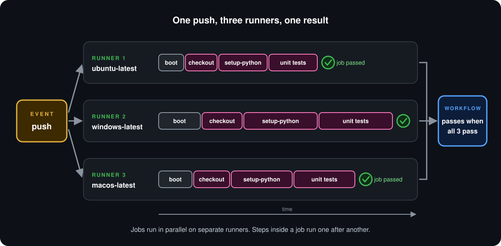
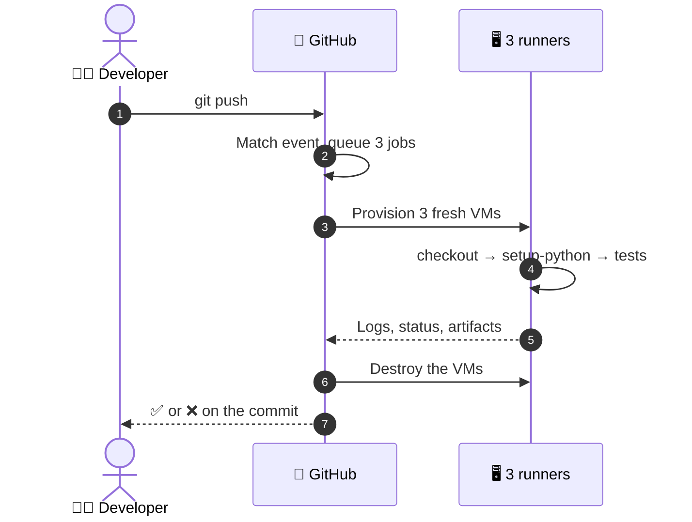

<p align="center">
  <b>Lesson 2 of 6</b> &nbsp;·&nbsp; ⏱️ 20 min &nbsp;·&nbsp; 🛠️ Hands-on
</p>

# 🎬 Life of a Workflow Run

[Lesson 1](01-the-core-components.md) showed the parts standing still. Now someone pushes a commit. What happens, in what order, and where do you look to see it?

## 🎯 The whole run in one picture

<p align="center">
  
</p>

## 🪜 Six stages

| | Stage | What happens |
|---|---|---|
| 1 | 🔔 **Event** | A push arrives. GitHub finds every workflow whose `on:` matches it |
| 2 | 📋 **Queue** | A workflow run is created. The matrix expands into three jobs |
| 3 | 🖥️ **Provision** | GitHub starts one fresh VM per job, all at the same time |
| 4 | 👣 **Execute** | Each runner works through its steps, one after another |
| 5 | 📡 **Report** | Logs stream back to GitHub live, step by step |
| 6 | 🧹 **Clean up** | Each runner is destroyed. Only logs and artifacts survive |



## ⏱️ Parallel outside, serial inside

Two rules explain the shape of the picture.

| | Rule | In the picture |
|---|---|---|
| ↔️ | **Jobs run in parallel** | Three lanes start together |
| ➡️ | **Steps run in series** | Boxes in a lane follow one another |

The three runners don't wait for each other and don't finish together. Windows usually takes the longest to start. That's fine: each job is judged on its own.

## 🚦 How results roll up

Every level gets its own verdict.


| | If... | Then... |
|---|---|---|
| 👣 | A step fails | The steps after it are skipped and its job fails |
| 📦 | The Ubuntu job finishes first | It is marked ✅ straight away, while the others are still running |
| 📜 | All three jobs pass | The workflow run is marked ✅ |
| ❌ | Any one job fails | The workflow run is marked ❌ |

> [!NOTE]
> **Matrix jobs have one extra habit.** By default, when one matrix job fails, GitHub cancels the others that are still running, to save time. That setting is called `fail-fast`. The workflow in this lesson sets `fail-fast: false` so that you always see a result for all three operating systems.

## 🛠️ Run it yourself

This repository ships the workflow from the picture: [`04-core-components.yml`](../.github/workflows/04-core-components.yml). It tests the [sample app](../sample-app/) on Ubuntu, Windows and macOS.

```yaml
jobs:
  unit-testing:
    name: unit-testing (${{ matrix.os }})
    runs-on: ${{ matrix.os }}
    strategy:
      fail-fast: false
      matrix:
        os: [ubuntu-latest, windows-latest, macos-latest]
    steps:
      - name: Check out the repository
        uses: actions/checkout@v7

      - name: Set up Python
        uses: actions/setup-python@v7
        with:
          python-version: '3.13'

      - name: Run unit tests
        run: python -m unittest discover -v 2>&1 | tee test-report.txt

      - name: Upload the test report
        uses: actions/upload-artifact@v7
        with:
          name: test-report-${{ runner.os }}
          path: sample-app/test-report.txt
          retention-days: 7
```

It has one more step than the picture: the last one saves the test output as an **artifact**, so there's something to download afterwards.

### 1️⃣ Start a run

In your fork, open the **Actions** tab, choose **04 - Core Components** in the left sidebar, then **Run workflow** → **Run workflow**.

### 2️⃣ Watch three runners start

Click the new run. On the left you'll see three jobs:

```text
unit-testing (ubuntu-latest)     🟡
unit-testing (windows-latest)    🟡
unit-testing (macos-latest)      🟡
```

They turn green one at a time, not together. Note which one finishes first.

### 3️⃣ Read a job's logs

Click **unit-testing (ubuntu-latest)**. Each step is a collapsible section.

| | Section | What to look for |
|---|---|---|
| ⚙️ | **Set up job** | The runner image and its version. This is GitHub telling you which machine you got |
| 📥 | **Check out the repository** | The commit that was fetched |
| 🐍 | **Set up Python** | The exact Python version installed |
| 🧪 | **Run unit tests** | Five tests, each ending in `ok` |
| 🧹 | **Complete job** | Clean-up before the machine is destroyed |

Now open the same step in the **Windows** job and compare. Same steps, same result, a completely different machine.

### 4️⃣ Download the artifacts

Go back to the run's **Summary** page and scroll to **Artifacts**. There are three, one per runner:

```text
test-report-Linux
test-report-Windows
test-report-macOS
```

Download one and open it. It's the output you just read in the log, saved as a file. The runner that produced it no longer exists, but the artifact does.

### 5️⃣ Break it on purpose

Edit [`sample-app/greeter/core.py`](../sample-app/greeter/core.py) in your fork so that a test fails (change `Hello` to `Hi`), commit, then run the workflow again by hand.

| | Watch for | Why |
|---|---|---|
| ❌ | All three jobs fail | The bug isn't specific to one operating system |
| ⏭️ | **Upload the test report** is skipped | Steps after a failed step don't run |
| 📭 | No artifacts on the summary page | The upload step never happened |
| ❌ | The run is marked failed | One failed job is enough |

Put `Hello` back when you're done.

> [!TIP]
> When a workflow misbehaves, the fastest route is always the same: **run → failed job → red step → last lines of its log**. The error is almost always in the final screenful.

## 🗺️ Where everything lives

| | You want | Go to |
|---|---|---|
| 📋 | Every run of every workflow | **Actions** tab |
| 🔎 | One run's jobs and overall status | Click the run |
| 📜 | One step's output | Click the job, expand the step |
| 📦 | Files a run produced | **Artifacts**, at the bottom of the run's Summary |
| 🔁 | To try again | **Re-run jobs**, top right of the run |

## ✅ Checkpoint

<details>
<summary><b>The Ubuntu job has finished and is green. Is the workflow run green?</b></summary>

<br>

Not yet. The run is only marked successful once every job has finished successfully. Until then it shows as in progress.

</details>

<details>
<summary><b>Why did the artifacts disappear when you broke the test?</b></summary>

<br>

The test step failed, so the steps after it were skipped, including the upload. No upload, no artifact.

</details>

<details>
<summary><b>A runner is destroyed when its job ends. How can you still read its output an hour later?</b></summary>

<br>

Logs are streamed to GitHub while the job runs, and artifacts are uploaded to GitHub's storage. Both are kept after the machine is gone.

</details>

<details>
<summary><b>What does <code>fail-fast: false</code> change?</b></summary>

<br>

With the default (`true`), one failing matrix job cancels the others still in progress. With `false`, every matrix job runs to the end, so you see results for all of them.

</details>

## 🎯 What you learned

- A run goes through six stages: **event, queue, provision, execute, report, clean up**
- **Jobs in parallel, steps in series**, so runners finish at different times
- A job passes when all its steps pass; **a run passes when all its jobs pass**
- **Logs and artifacts outlive the runner** and are found in the Actions tab
- Matrix jobs cancel each other on failure unless you set `fail-fast: false`

---

<p align="center">
  <a href="01-the-core-components.md">⬅️ The Core Components</a>
  &nbsp;&nbsp;·&nbsp;&nbsp;
  <a href="index.md">📚 Chapter 4</a>
  &nbsp;&nbsp;·&nbsp;&nbsp;
  <a href="03-github-hosted-vs-self-hosted-runners.md"><b>Next: Hosted vs Self-Hosted Runners ➡️</b></a>
</p>
