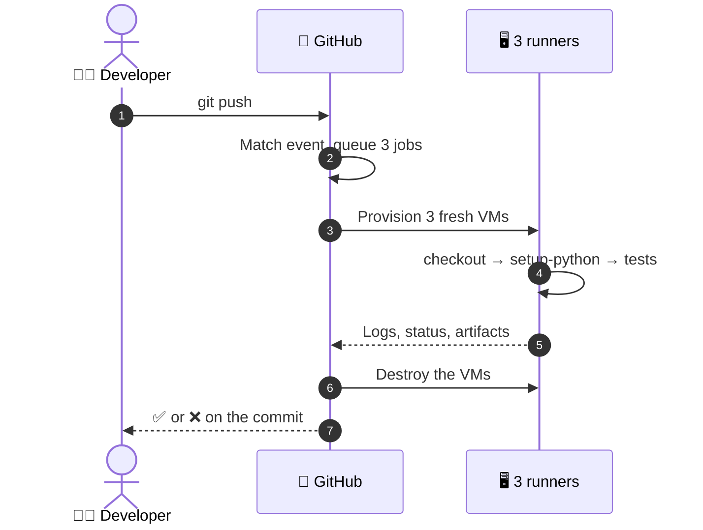

  <a href="README.md">📂 <b>Life of a Workflow Run</b></a> &nbsp;·&nbsp; Lesson 2 · Part 2 of 7 &nbsp;·&nbsp; ⏱️ 2 min

# 🪜 Six stages

| | Stage | What happens |
|---|---|---|
| 1 | 🔔 **Event** | A push arrives. GitHub finds every workflow whose `on:` matches it |
| 2 | 📋 **Queue** | A workflow run is created. The matrix expands into three jobs |
| 3 | 🖥️ **Provision** | GitHub starts one fresh VM per job, all at the same time |
| 4 | 👣 **Execute** | Each runner works through its steps, one after another |
| 5 | 📡 **Report** | Logs stream back to GitHub live, step by step |
| 6 | 🧹 **Clean up** | Each runner is destroyed. Only logs and artifacts survive |

---

  <a href="01-the-whole-run-in-one-picture.md">⬅️ The whole run in one picture</a>
  &nbsp;&nbsp;·&nbsp;&nbsp;
  <a href="README.md">📂 Topic overview</a>
  &nbsp;&nbsp;·&nbsp;&nbsp;
  <a href="03-parallel-outside-serial-inside.md"><b>Next: Parallel outside, serial inside ➡️</b></a>

