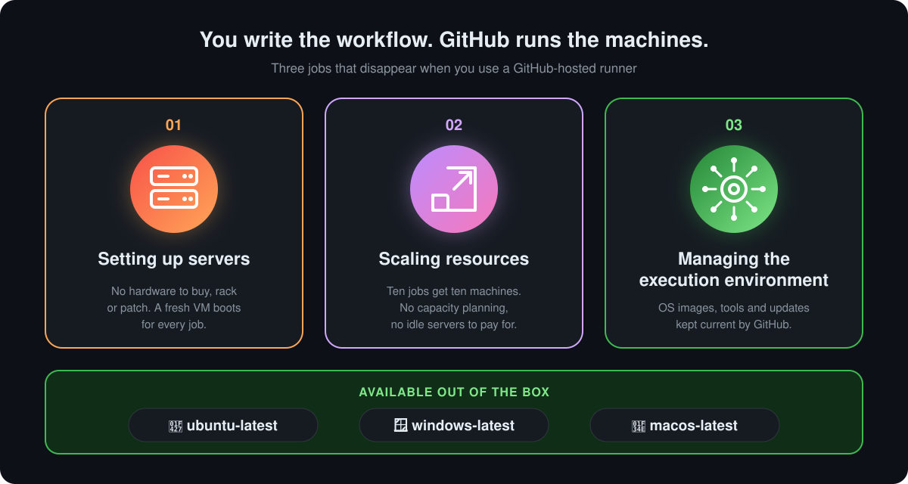
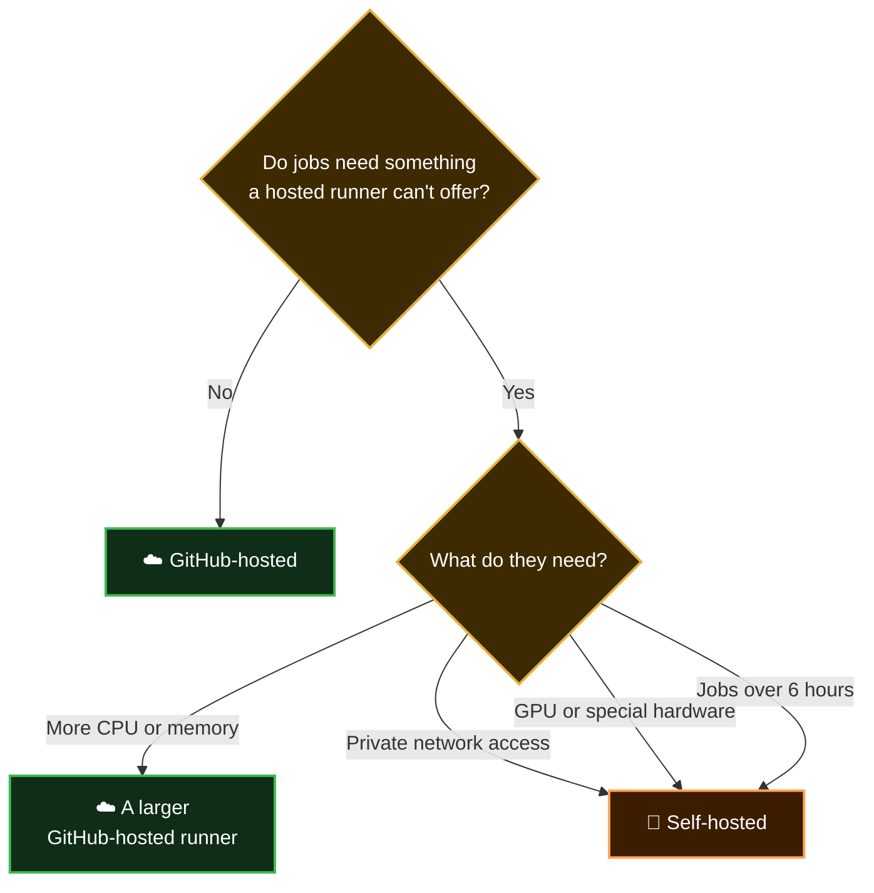

<p align="center">
  <b>Lesson 3 of 10</b> &nbsp;·&nbsp; ⏱️ 8 min read &nbsp;·&nbsp; 🟢 Beginner
</p>

# 🖥️ GitHub-Hosted vs Self-Hosted Runners

Every job needs a machine. So far GitHub has supplied it. You can also supply your own. This lesson is about the difference, and how to choose.

## 🎯 The difference in one picture

<p align="center">
  
</p>

In the workflow file, the whole decision is one line:

```yaml
runs-on: ubuntu-latest     # GitHub-hosted
```

```yaml
runs-on: self-hosted       # a machine you registered
```

Everything else about the workflow stays the same.

## ☁️ GitHub-hosted runners

GitHub owns the machine, starts it for your job and throws it away afterwards.

### 🎁 What GitHub takes off your plate

This is one of the biggest advantages of GitHub Actions. With a traditional CI server, someone on your team had three standing jobs (see [Chapter 3](../03-problem-with-traditional-ci-cd-tools/02-hidden-costs-of-self-hosted-ci.md)). With GitHub-hosted runners, GitHub does all three:

<p align="center">
  
</p>

| # | Job | Who did it before | Who does it now |
|---|---|---|---|
| 01 | 🖥️ **Setting up servers** | You: buy, install, patch | GitHub boots a fresh VM per job |
| 02 | 📈 **Scaling resources** | You: guess capacity, queue builds | GitHub adds machines as jobs arrive |
| 03 | ⚙️ **Managing the execution environment** | You: install and update tools | GitHub maintains the OS images |

All three major operating systems work **out of the box**. Pick one with a single label: `ubuntu-latest`, `windows-latest` or `macos-latest`.

| | What you get | Detail |
|---|---|---|
| 🧼 | **A clean VM for every job** | Nothing is left over from anyone's previous run, including your own |
| 🧰 | **A stocked toolbox** | Git, Docker, Node.js, Python, Java, cloud CLIs and much more are preinstalled |
| 🖼️ | **A choice of systems** | `ubuntu-latest`, `windows-latest`, `macos-latest`, plus specific versions |
| 🔧 | **Zero maintenance** | GitHub patches and updates the images |
| 📈 | **Scale without planning** | Ten jobs get ten machines |

> [!NOTE]
> GitHub runs its Linux and Windows runners as virtual machines in Microsoft Azure. You never see or manage that infrastructure. You only see the label you asked for.

## 🏢 Self-hosted runners

You install GitHub's small runner application on a machine you control: a server, a VM, a cloud instance, even a laptop. It connects to GitHub and waits for jobs.

| | What you get | Detail |
|---|---|---|
| 🎛️ | **Full control** | Your operating system, your tools, your hardware |
| 🌐 | **Your network** | Jobs can reach internal databases and services directly |
| 💪 | **Special hardware** | GPUs, large memory, unusual CPU architectures |
| 💾 | **A machine that remembers** | Files and caches stay between jobs |
| 🧹 | **All the upkeep** | Patching, cleaning, monitoring and scaling are yours |

That last pair is two sides of one coin. A machine that keeps its state is faster to warm up, and it is also how builds start to depend on leftovers.

## ⚖️ Side by side

| | | ☁️ GitHub-hosted | 🏢 Self-hosted |
|---|---|---|---|
| 🔧 | **Maintained by** | GitHub | You |
| 🧼 | **State** | New, clean VM for every job | Same machine reused, unless you rebuild it |
| 🎛️ | **Customising** | Choose image and size; install extras during the job | Unlimited |
| 🌐 | **Network** | Public cloud | Wherever you put it |
| 💰 | **Cost** | Free on public repositories; metered on private ones | You pay for and operate the machines |
| ⏱️ | **Longest job** | 6 hours | 5 days |
| 🏷️ | **`runs-on`** | `ubuntu-latest` and friends | `self-hosted`, plus your own labels |

Cost details change. The [billing page](https://docs.github.com/en/billing/concepts/product-billing/github-actions) is the source of truth.

## 🚫 Two myths

<details>
<summary><b>"You can't install anything on a GitHub-hosted runner"</b></summary>

<br>

You can. A step can install whatever it needs, and on Linux you even have passwordless `sudo`:

```yaml
- run: sudo apt-get update && sudo apt-get install -y graphviz
```

What you can't do is make it **stick**. The machine is destroyed after the job, so the next run installs it again. That is the price of a clean start, and caching usually makes it cheap.

</details>

<details>
<summary><b>"Self-hosted runners are free"</b></summary>

<br>

You still pay for the machine, its electricity or cloud bill, and the time someone spends looking after it. It's the same iceberg you met in [Chapter 3](../03-problem-with-traditional-ci-cd-tools/02-hidden-costs-of-self-hosted-ci.md#-the-iceberg), on a smaller scale.

</details>

## 🛡️ One security rule

> [!WARNING]
> **Be very careful with self-hosted runners on public repositories.** Anyone can open a pull request against a public repository. If that pull request's workflow runs on your machine, a stranger's code is executing inside your network, on a machine that doesn't reset afterwards. GitHub recommends using self-hosted runners with private repositories.

## 🧭 Which should you choose?



> [!TIP]
> **Start hosted.** Nearly every project can. Move a job to a self-hosted runner only when you can name the specific thing it needs. You can also mix them: most jobs hosted, one deploy job self-hosted.

Everything in this guide uses GitHub-hosted runners, so there is nothing for you to set up.

## ✅ Checkpoint

<details>
<summary><b>Which line of a workflow decides between a hosted and a self-hosted runner?</b></summary>

<br>

`runs-on`. A GitHub label such as `ubuntu-latest` requests a hosted runner. `self-hosted`, or a label you defined, sends the job to your own machine.

</details>

<details>
<summary><b>Your job needs a tool that isn't preinstalled on <code>ubuntu-latest</code>. Do you need a self-hosted runner?</b></summary>

<br>

No. Add a step that installs it. You only need a self-hosted runner for things a step can't provide: private network access, special hardware, or very long jobs.

</details>

<details>
<summary><b>What is the main risk of a runner that keeps its state between jobs?</b></summary>

<br>

Leftovers. Files, caches or processes from an earlier job can change the result of a later one, so builds stop being repeatable. On a public repository it is also a security risk.

</details>

## 🎯 What you learned

- **`runs-on`** is the single switch between the two kinds of runner
- **GitHub-hosted**: clean VM per job, preinstalled tools, no upkeep
- **Self-hosted**: your network and hardware, persistent state, all the upkeep
- You **can** install software on a hosted runner; it just doesn't persist
- Avoid self-hosted runners on **public repositories**
- **Start hosted**, and switch only for a named reason

---

<p align="center">
  <a href="02-life-of-a-workflow-run.md">⬅️ Life of a Workflow Run</a>
  &nbsp;&nbsp;·&nbsp;&nbsp;
  <a href="index.md">📚 Chapter 4</a>
  &nbsp;&nbsp;·&nbsp;&nbsp;
  <a href="04-what-are-actions.md"><b>Next: What Are Actions? ➡️</b></a>
</p>
