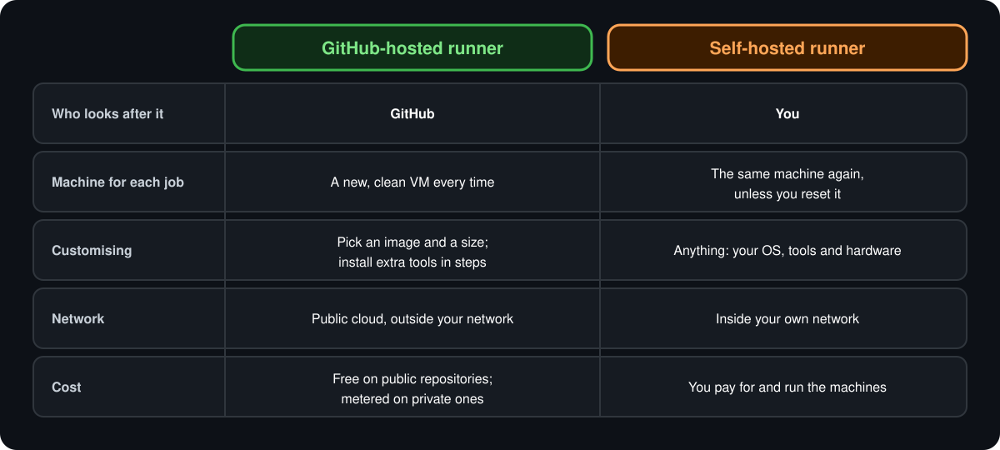

<p align="center">
  <a href="README.md">📂 <b>GitHub-Hosted vs Self-Hosted Runners</b></a> &nbsp;·&nbsp; Lesson 3 · Part 1 of 8 &nbsp;·&nbsp; ⏱️ 1 min
</p>

# 🎯 The difference in one picture

<p align="center">
  
</p>

In the workflow file, the whole decision is one line:

```yaml
runs-on: ubuntu-latest     # GitHub-hosted
```

```yaml
runs-on: self-hosted       # a machine you registered
```

Everything else about the workflow stays the same.

---

<p align="center">
  <a href="README.md">⬅️ Overview</a>
  &nbsp;&nbsp;·&nbsp;&nbsp;
  <a href="README.md">📂 Topic overview</a>
  &nbsp;&nbsp;·&nbsp;&nbsp;
  <a href="02-github-hosted-runners.md"><b>Next: GitHub-hosted runners ➡️</b></a>
</p>
