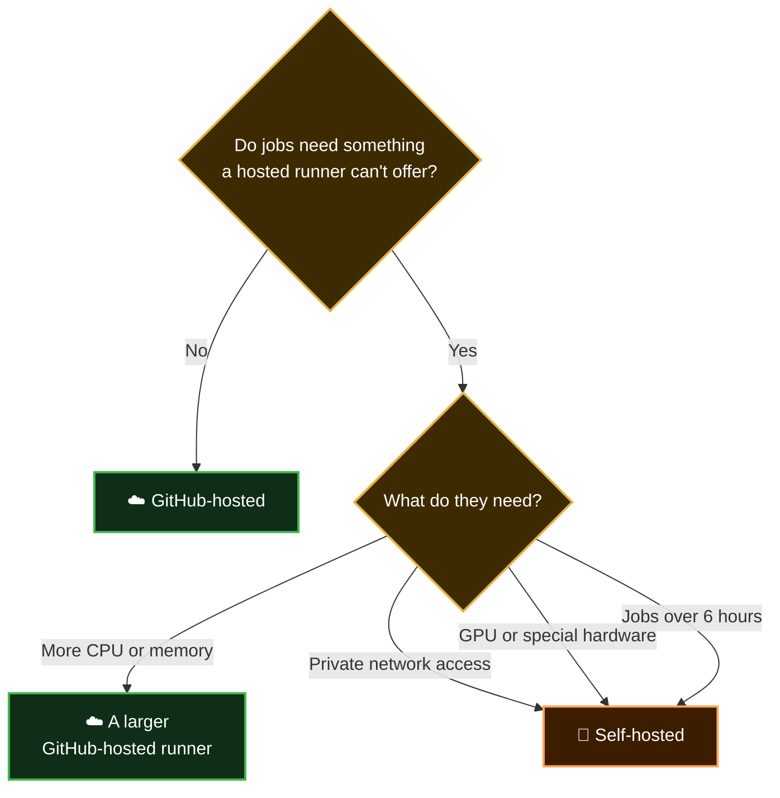

  <a href="README.md">📂 <b>GitHub-Hosted vs Self-Hosted Runners</b></a> &nbsp;·&nbsp; Lesson 3 · Part 7 of 8 &nbsp;·&nbsp; ⏱️ 2 min

# 🧭 Which should you choose?

> [!TIP]
> **Start hosted.** Nearly every project can. Move a job to a self-hosted runner only when you can name the specific thing it needs. You can also mix them: most jobs hosted, one deploy job self-hosted.

Everything in this guide uses GitHub-hosted runners, so there is nothing for you to set up.

---

  <a href="06-one-security-rule.md">⬅️ One security rule</a>
  &nbsp;&nbsp;·&nbsp;&nbsp;
  <a href="README.md">📂 Topic overview</a>
  &nbsp;&nbsp;·&nbsp;&nbsp;
  <a href="08-checkpoint.md"><b>Next: Checkpoint ➡️</b></a>

