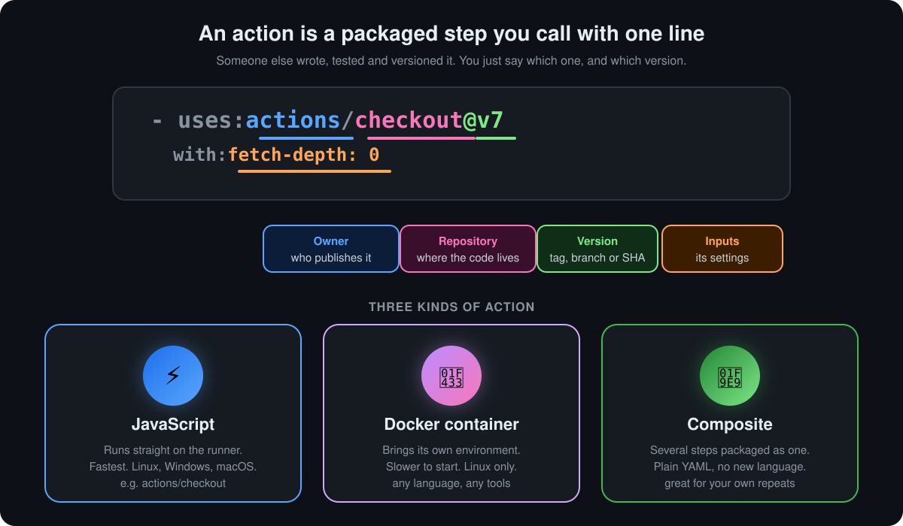

<p align="center">
  <b>Lesson 4 of 13</b> &nbsp;·&nbsp; ⏱️ 9 min read &nbsp;·&nbsp; 🟢 Beginner
</p>

# 🧩 What Are Actions?

The product is called GitHub *Actions*, yet so far we've talked about workflows, jobs, steps and runners. This lesson is about the piece that gives the product its name.

## 💡 The one-sentence definition

> **An action is a reusable, packaged step.** Someone writes it once, versions it, and anyone can call it with a single `uses:` line.

Think of actions as **LEGO bricks** 🧱. You don't mould your own plastic to build a house. You snap together bricks that already exist. Checking out code, installing Node.js, caching dependencies, logging in to a cloud: each of these is a ready-made brick.

## 🔬 Reading a `uses:` line

<p align="center">
  
</p>

| Part | Example | What it means |
|---|---|---|
| 🔵 **Owner** | `actions` | The GitHub user or organisation that publishes it. `actions` is GitHub's own |
| 🩷 **Repository** | `checkout` | The repo holding the action's code and its `action.yml` |
| 🟢 **Version** | `@v7` | A tag, a branch or a full commit SHA. Decides exactly which code runs |
| 🟠 **Inputs** | `with: fetch-depth: 0` | Settings the action accepts, like arguments to a function |

Actions can also hand **outputs** back, which later steps read through `steps.<id>.outputs.<name>`.

## ⚖️ Action vs command: the two kinds of step

Every step does exactly one of two things:

```yaml
steps:
  - uses: actions/setup-node@v5     # 🧩 call an action
    with:
      node-version: 22
  - run: npm test                   # ⌨️ run a shell command
```

| | `uses:` (action) | `run:` (command) |
|---|---|---|
| What it is | Someone's packaged, tested code | Your own shell line |
| Best for | Common jobs everyone needs | Things specific to your project |
| Takes settings via | `with:` inputs | Environment variables, arguments |
| Rule of thumb | Don't reinvent setup, caching, login | Don't wrap one-liners in an action |

Without actions, "check out the code" would be a dozen lines of `git` commands, tokens and edge cases, copied into every workflow you write. With actions it's one line, maintained by someone else.

## 🧱 The three kinds of action

| | Kind | How it runs | Runs on | Pick it when |
|---|---|---|---|---|
| ⚡ | **JavaScript** | Node.js, directly on the runner | Linux, Windows, macOS | You want speed and every OS |
| 🐳 | **Docker container** | Inside a container image it brings | Linux only | You need specific tools, or another language |
| 🧩 | **Composite** | A list of steps, written in YAML | Wherever its steps can run | You keep copy-pasting the same steps |

Every action, whatever its kind, has a metadata file called `action.yml` at its root. It declares the name, inputs, outputs and how to run it. Here's a tiny composite action:

```yaml
# action.yml
name: Greet
description: Say hello to someone
inputs:
  who:
    description: Who to greet
    default: world
runs:
  using: composite
  steps:
    - run: echo "Hello, ${{ inputs.who }}!"
      shell: bash
```

## 🛒 Where actions come from

| | Source | How you write it | Example |
|---|---|---|---|
| 🏪 | **GitHub Marketplace**, a public repository | `owner/repo@version` | `actions/checkout@v7` |
| 📁 | **A subfolder** of a public repository | `owner/repo/path@version` | `github/codeql-action/init@v4` |
| 🏠 | **Your own repository** | `./path/to/action` | `./.github/actions/greet` |
| 🐳 | **A Docker image** on a registry | `docker://image:tag` | `docker://alpine:3.20` |

The [GitHub Marketplace](https://github.com/marketplace?type=actions) lists tens of thousands of actions. A few you will meet almost everywhere:

| Action | What it does |
|---|---|
| `actions/checkout` | Copies your repository onto the runner |
| `actions/setup-node`, `setup-python`, `setup-java`, `setup-go` | Installs a language at the version you ask for |
| `actions/cache` | Saves dependencies between runs, so builds get faster |
| `actions/upload-artifact`, `download-artifact` | Keeps files after the runner is destroyed |
| `docker/build-push-action` | Builds and pushes a container image |
| `aws-actions/configure-aws-credentials`, `azure/login`, `google-github-actions/auth` | Signs in to a cloud |

> [!TIP]
> A ✅ **verified creator** badge on the Marketplace means GitHub has confirmed who the publisher is. It is a signal of identity, not a code review.

## 🔐 Pinning: which version should you use?

An action is **someone else's code running with your repository's token and secrets.** The version you pin decides how much you trust them.

| Pin | Example | Updates automatically? | Safety |
|---|---|---|---|
| Branch | `@main` | Every commit | 🔴 Anything can change, any time |
| Major tag | `@v7` | Bug fixes and features | 🟡 Convenient. Fine for trusted publishers |
| Exact tag | `@v7.0.1` | No, but tags can be moved | 🟡 Better, still not immutable |
| Full commit SHA | `@8e5e7e5ab8b370d6c329ec480221332ada57f0ab` | Never | 🟢 The only truly immutable choice |

> [!IMPORTANT]
> **Pin third-party actions to a full commit SHA**, with the version in a comment so humans can read it:
>
> ```yaml
> - uses: some-org/some-action@8e5e7e5ab8b370d6c329ec480221332ada57f0ab  # v2.3.1
> ```
>
> Then let **Dependabot** propose updates. Tags can be moved to point at new code; a SHA cannot. For GitHub's own `actions/*`, a major tag is a common, reasonable trade-off.

## ✅ Checkpoint

<details>
<summary><b>In <code>uses: docker/login-action@v3</code>, what are the owner, the repository and the version?</b></summary>

<br>

The owner is `docker`, the repository is `login-action` and the version is `v3`, a major tag.

</details>

<details>
<summary><b>You need a tool that only runs on Linux, packaged with its dependencies. Which kind of action fits?</b></summary>

<br>

A Docker container action. It brings its own environment, but it only runs on Linux runners.

</details>

<details>
<summary><b>Three of your workflows repeat the same five setup steps. What would you build?</b></summary>

<br>

A composite action in your repository, for example at `.github/actions/setup/action.yml`, called with `uses: ./.github/actions/setup`.

</details>

<details>
<summary><b>Why is <code>@main</code> a risky way to reference a third-party action?</b></summary>

<br>

Whatever is pushed to that branch runs in your workflow next time, with access to your token and secrets. You'd be trusting every future commit sight unseen.

</details>

## 🎯 What you learned

- An **action** is a reusable, packaged step called with **`uses:`**
- A reference reads **owner / repository @ version**, and **`with:`** passes inputs
- Steps either **call an action** (`uses:`) or **run a command** (`run:`)
- Three kinds: **JavaScript** (fast, every OS), **Docker** (own environment, Linux), **composite** (bundled YAML steps)
- Actions come from the **Marketplace**, other repositories, **your own repo**, or Docker images
- **Pin third-party actions to a full commit SHA**, and let Dependabot keep them fresh

---

<p align="center">
  <a href="03-github-hosted-vs-self-hosted-runners.md">⬅️ Hosted vs Self-Hosted Runners</a>
  &nbsp;&nbsp;·&nbsp;&nbsp;
  <a href="index.md">📚 Chapter 4</a>
  &nbsp;&nbsp;·&nbsp;&nbsp;
  <a href="05-configuring-the-checkout-action.md"><b>Next: Configuring Checkout ➡️</b></a>
</p>
