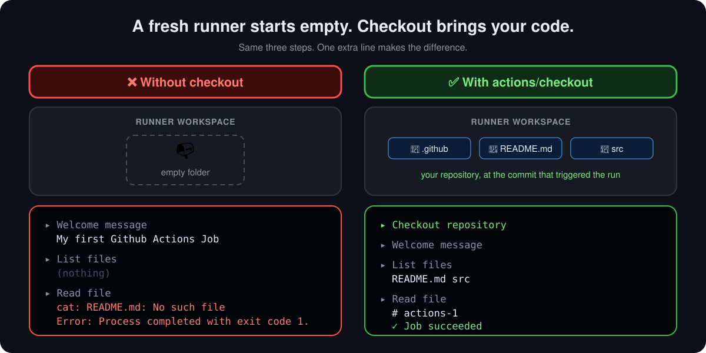

<p align="center">
  <b>Lesson 5 of 13</b> &nbsp;·&nbsp; ⏱️ 15 min &nbsp;·&nbsp; 🛠️ Hands-on
</p>

# 📥 Configuring the Checkout Action

You've seen `actions/checkout` at the top of almost every workflow. This lesson shows what goes wrong without it, and how to configure it.

## 🧪 A workflow that looks right

Here is a first workflow many people write. It greets you, lists the files and prints the README:

```yaml
name: My First Workflow

on: push

jobs:
  first_job:
    runs-on: ubuntu-latest
    steps:
      - name: Welcome message
        run: echo "My first GitHub Actions job"

      - name: List files
        run: ls

      - name: Read file
        run: cat README.md
```

Push it, and the run goes ❌ red on the last step.

## 🔎 Why it fails

<p align="center">
  
</p>

| Step | What happened | Why |
|---|---|---|
| 👋 Welcome message | ✅ Printed the text | `echo` doesn't need any files |
| 📂 List files | ✅ Printed **nothing** | The workspace folder exists, but it's empty |
| 📄 Read file | ❌ `No such file or directory` | There is no `README.md` on this machine |

> [!IMPORTANT]
> **The runner does not have your code.** It's a brand-new virtual machine. Your workflow file was read by GitHub to *plan* the run, but the repository itself is never copied onto the runner unless a step does it. That step is `actions/checkout`.

## ✅ The fix: one line

```yaml
    steps:
      - name: Checkout repository
        uses: actions/checkout@v7       # 👈 add this first

      - name: Welcome message
        run: echo "My first GitHub Actions job"

      - name: List files
        run: ls

      - name: Read file
        run: cat README.md
```

Now `ls` shows your files and `cat` prints the README.

What checkout does by default:

| | Default behaviour |
|---|---|
| 📍 **Where** | Into `$GITHUB_WORKSPACE`, the job's working folder |
| 🎯 **Which commit** | The one that triggered the run (`github.sha`) |
| 📏 **How much history** | Just that **one commit** (`fetch-depth: 1`), which is fast |
| 🔑 **Credentials** | Uses the job's `GITHUB_TOKEN`, and leaves it in git config so later `git` commands work |

> [!TIP]
> **Use the GitHub Actions extension in VS Code** (or the web editor at `github.dev`). It autocompletes action names and their `with:` inputs, and underlines typos before you push.

## ⚙️ Configuring it with `with:`

Checkout takes inputs. These are the ones you'll actually use:

| Input | Default | Set it when you need to... | Example |
|---|---|---|---|
| `fetch-depth` | `1` | Get full history for tags, changelogs or `git describe` | `fetch-depth: 0` (everything) |
| `ref` | The triggering commit | Build a different branch, tag or SHA | `ref: release/2.0` |
| `path` | Workspace root | Put the code in a subfolder | `path: app` |
| `repository` | This repo | Check out **another** repository | `repository: my-org/shared-config` |
| `token` | `GITHUB_TOKEN` | Read a **private** other repo, or push changes that start new workflows | `token: ${{ secrets.MY_PAT }}` |
| `submodules` | `false` | Include git submodules | `submodules: recursive` |
| `lfs` | `false` | Download Git LFS files | `lfs: true` |
| `sparse-checkout` | Off | Fetch only some folders of a large monorepo | see below |
| `fetch-tags` | `false` | Get tags without full history | `fetch-tags: true` |
| `persist-credentials` | `true` | **Not** leave the token behind for later steps | `persist-credentials: false` |
| `clean` | `true` | Keep files from earlier jobs (self-hosted runners) | `clean: false` |

### 🍳 Recipes

**Full history, for versioning or changelogs**

```yaml
- uses: actions/checkout@v7
  with:
    fetch-depth: 0
```

**Two repositories side by side**

```yaml
- uses: actions/checkout@v7          # this repo → ./
- uses: actions/checkout@v7
  with:
    repository: my-org/shared-config # another repo → ./config
    path: config
    token: ${{ secrets.CONFIG_REPO_TOKEN }}   # needed only if it's private
```

**Just the folders you need from a monorepo**

```yaml
- uses: actions/checkout@v7
  with:
    sparse-checkout: |
      services/payments
      shared/lib
```

**Safer default for jobs that never push**

```yaml
- uses: actions/checkout@v7
  with:
    persist-credentials: false   # later steps can't reuse the token
```

> [!WARNING]
> **Only check out what you trust.** With `pull_request_target`, checking out the pull request's code (`ref: ${{ github.event.pull_request.head.sha }}`) runs a stranger's code with your secrets. Use plain `pull_request` for running tests on contributions.

## 🛠️ Try it yourself

This repository ships the before-and-after as a live workflow: [`04-checkout.yml`](../.github/workflows/04-checkout.yml).

1. Open the **Actions** tab and pick **04 - Checkout**
2. Click **Run workflow**
3. Open **without-checkout**: `ls -la` shows an empty folder, and **Read file** fails (the job is allowed to fail with `continue-on-error`)
4. Open **with-checkout**: the same steps list your files and print the README
5. **Stretch:** fork the repo, add `fetch-depth: 0` and a step running `git log --oneline | wc -l`. Compare the count with and without it.

## 🧯 Something went wrong?

| Symptom | Likely cause | Fix |
|---|---|---|
| `No such file or directory` | No checkout step, or it comes after the step that needs files | Make checkout the **first** step |
| `git describe` or changelog tools find no tags | Shallow clone | `fetch-depth: 0` |
| `Repository not found` for another repo | `GITHUB_TOKEN` can only read this repo | Pass a `token:` with access to the other repo |
| Files from the last job are gone (self-hosted) | `clean: true` wiped them | That's intended. Use artifacts to pass files between jobs |
| A push from the workflow doesn't trigger other workflows | Pushes made with `GITHUB_TOKEN` don't start new runs | Use a GitHub App token or PAT in `token:` |

## ✅ Checkpoint

<details>
<summary><b>The workflow ran <code>ls</code> and printed nothing, without an error. Why no error?</b></summary>

<br>

The workspace folder exists, it's just empty. Listing an empty folder is not an error. Only reading a file that isn't there fails.

</details>

<details>
<summary><b>How many commits does checkout fetch by default, and how do you get all of them?</b></summary>

<br>

One, the commit that triggered the run. Set `fetch-depth: 0` to get the full history.

</details>

<details>
<summary><b>You need code from a private repository in your organisation as well as this one. Which three inputs do you set on the second checkout?</b></summary>

<br>

`repository` (which repo), `path` (so it doesn't overwrite the first checkout) and `token` (a credential that can read the private repo).

</details>

## 🎯 What you learned

- A fresh runner is **empty**. Your code arrives only through **`actions/checkout`**
- Put checkout **first** in any job that reads your files
- By default it fetches **one commit**, at the **triggering ref**, into the **workspace root**
- Configure it with **`with:`**: `fetch-depth`, `ref`, `path`, `repository`, `token`, `sparse-checkout` and more
- Prefer **`persist-credentials: false`** when later steps don't need git auth

---

<p align="center">
  <a href="04-what-are-actions.md">⬅️ What Are Actions?</a>
  &nbsp;&nbsp;·&nbsp;&nbsp;
  <a href="index.md">📚 Chapter 4</a>
  &nbsp;&nbsp;·&nbsp;&nbsp;
  <a href="06-multiline-commands-and-third-party-tools.md"><b>Next: Multi-line Commands ➡️</b></a>
</p>
