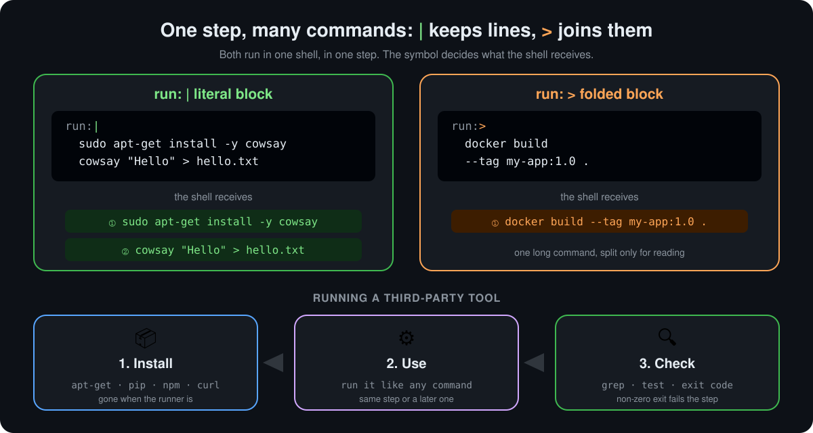

<p align="center">
  <a href="README.md">📂 <b>Multi-line Commands and Third-Party Tools</b></a> &nbsp;·&nbsp; Lesson 6 · Part 2 of 6 &nbsp;·&nbsp; ⏱️ 2 min
</p>

# ✍️ Two ways to write a multi-line `run:`

<p align="center">
  
</p>

| | Symbol | YAML name | What the shell receives | Use it for |
|---|---|---|---|---|
| 🟢 | **`\|`** | Literal block | Each line as its own command, in order | ✅ Almost always: a small script |
| 🟠 | **`>`** | Folded block | All lines joined by spaces into one command | One very long command you want to read easily |

```yaml
- name: Install and use a tool      # | : two commands
  run: |
    sudo apt-get install -y cowsay
    cowsay "Hello" > hello.txt

- name: Build an image                # > : one command, wrapped for reading
  run: >
    docker build
    --tag my-app:1.0
    --label team=payments
    .
```

> [!TIP]
> Prefer `|` with a backslash `\` at the end of a line when you need to wrap one command inside a script. It's what most people expect, and it keeps working when you add more lines.

---

<p align="center">
  <a href="01-one-command-per-step-gets-noisy.md">⬅️ One command per step gets noisy</a>
  &nbsp;&nbsp;·&nbsp;&nbsp;
  <a href="README.md">📂 Topic overview</a>
  &nbsp;&nbsp;·&nbsp;&nbsp;
  <a href="03-how-the-shell-runs-your-lines.md"><b>Next: How the shell runs your lines ➡️</b></a>
</p>
