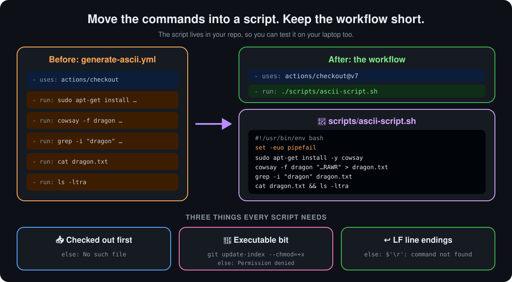

<p align="center">
  <b>Lesson 7 of 11</b> &nbsp;·&nbsp; ⏱️ 18 min &nbsp;·&nbsp; 🛠️ Hands-on
</p>

# 🐚 Executing Shell Scripts in a Workflow

In the last lesson the dragon took a step per command. That's fine for five lines. When a job grows to fifty, the YAML gets hard to read, and you can't run any of it on your own machine. The fix is to put the commands in a **shell script** in your repository and have the workflow run it.

## 🧩 Where we left off

```yaml
name: Generate ASCII Artwork

on: push

jobs:
  ascii_job:
    runs-on: ubuntu-latest
    steps:
      - name: Checkout Repo
        uses: actions/checkout@v4

      - name: Install Cowsay Program
        run: sudo apt-get install cowsay -y

      - name: Execute Cowsay CMD
        run: cowsay -f dragon "Run for cover, I am a DRAGON....RAWR" >> dragon.txt

      - name: Test File Exists
        run: grep -i "dragon" dragon.txt

      - name: Read File
        run: cat dragon.txt

      - name: List Repo Files
        run: ls -ltra
```

Six steps, each a single command. It works, and the log is easy to follow. But the logic lives *only* in YAML.

## 🔄 Move the commands into a script

<p align="center">
  
</p>

**1. Write the script** at [`scripts/ascii-script.sh`](../scripts/ascii-script.sh):

```bash
#!/usr/bin/env bash
set -euo pipefail

echo "::group::Install cowsay"
sudo apt-get install -y -qq cowsay
echo "::endgroup::"

cowsay -f dragon "Run for cover, I am a DRAGON....RAWR" > dragon.txt

grep -i "dragon" dragon.txt > /dev/null
echo "✅ dragon.txt contains a dragon"

cat dragon.txt
ls -ltra
```

**2. Make it executable, and commit that**

```bash
chmod +x scripts/ascii-script.sh
git add scripts/ascii-script.sh
git update-index --chmod=+x scripts/ascii-script.sh   # needed on Windows, harmless elsewhere
git commit -m "Add ASCII art script"
```

**3. Run it from the workflow**

```yaml
steps:
  - name: Checkout repo
    uses: actions/checkout@v7          # 👈 the script is in the repo, so check out first

  - name: Execute the script
    run: ./scripts/ascii-script.sh
```

Six steps became two, and you can now run `./scripts/ascii-script.sh` on any Linux machine to test it.

## 👀 Watching the script run

Push the change and open the run. Here's a run whose commit message was *"added permissions"*, the commit that set the executable bit, caught while the script is still running:

```text
🟡 added permissions #3                        [ Cancel workflow ]

   ascii_job · Started 27s ago
   ✅ Set up job                      2s
   ✅ Checkout Repo                   5s
   ✅ List Repo Files                 0s
   🟡 Executing Shell Script         21s   ← running now
   ⚪ Post Checkout Repo                   ← waiting
```

| What you see | What it means |
|---|---|
| **added permissions #3** | The run is named after the commit message. `#3` is this workflow's third run |
| 🟡 next to the run, the job and a step | In progress. The step's timer keeps counting until it finishes |
| ⚪ hollow circle | Queued. It runs when the steps above it finish |
| **Executing Shell Script** takes about 20s | It's one step, but it does a lot: the whole `apt-get` install happens inside the script |
| **Post Checkout Repo** | A step you never wrote. `actions/checkout` registers a **post step** that runs at the end of the job to remove the credentials it saved. Many actions do this. It always runs last, in reverse order |
| **Cancel workflow** | Stops the run now. Steps still waiting are skipped |

> [!TIP]
> **Click the running step to watch its log live.** With one big script step, everything lands in one log section, so the `::group::` lines in the script are what keep it readable.

> [!NOTE]
> If run #2 failed with `Permission denied` and run #3 is green, the only change between them was the executable bit. Comparing two runs like this is one of the quickest ways to debug.

## 🔬 What each line of the script does

| Line | Why it's there |
|---|---|
| `#!/usr/bin/env bash` | The **shebang**. Tells the OS to run this file with bash, wherever bash is installed |
| `set -e` | Stop at the first command that fails, just like a `run:` step does |
| `set -u` | Treat an unset variable as an error, instead of silently using an empty string |
| `set -o pipefail` | Fail if *any* command in a pipe fails, not just the last one |
| `echo "::group::…"` / `"::endgroup::"` | **Workflow commands**: fold the noisy install output into one collapsible section in the log |
| `> /dev/null` | Hide `grep`'s output; only its exit code matters here |

> [!IMPORTANT]
> **A script that hides its failures makes a green run that's lying.** Without `set -e`, a script carries on after errors, and only the *last* command's exit code decides whether the step passes. Always start with `set -euo pipefail`.

## 🔀 Three ways to run a script

| Command | Needs the executable bit? | Needs a shebang? | When to use it |
|---|---|---|---|
| `./scripts/ascii-script.sh` | ✅ Yes | ✅ Yes | The normal way. The script decides its own interpreter |
| `bash scripts/ascii-script.sh` | ❌ No | ❌ No | Quick fix when the executable bit is missing |
| `run: \|` with `source scripts/env.sh` | ❌ No | ❌ No | To load variables or functions into the step's shell |

Scripts can take **arguments** and read **environment variables**, just like on your laptop:

```yaml
- name: Execute the script
  env:
    MESSAGE: "Run for cover!"            # read as $MESSAGE inside the script
  run: ./scripts/ascii-script.sh dragon  # read as $1 inside the script
```

Other interpreters work the same way. Change the shebang or call the interpreter: `python scripts/report.py`, `pwsh scripts/deploy.ps1`, `node scripts/build.mjs`.

## 🧯 Something went wrong?

| Error in the log | Cause | Fix |
|---|---|---|
| `./scripts/ascii-script.sh: No such file or directory` | No checkout step, or the wrong path | Check out first. Paths are relative to the repository root |
| `./scripts/ascii-script.sh: Permission denied` | The executable bit wasn't committed. Common when the file was made on Windows or in the web editor | `git update-index --chmod=+x scripts/ascii-script.sh`, commit, push. Or run it with `bash` |
| `/usr/bin/env: 'bash\r': No such file or directory` or `$'\r': command not found` | The file has Windows **CRLF** line endings | Save as LF, and add `*.sh text eol=lf` to `.gitattributes` |
| The run is ✅ green but the output is wrong | Missing `set -e`, so failures were ignored | Add `set -euo pipefail` at the top |

> [!TIP]
> Look at the bottom-right of your editor. If it says **CRLF**, a `.sh` file will break on a Linux runner. Click it and switch to **LF**. This repository's [`.gitattributes`](../.gitattributes) forces LF for every `.sh` file, so Git fixes it for you on commit.

## ⚖️ Inline `run:` or a script file?

| Keep it inline when... | Move it to a script when... |
|---|---|
| It's one to five short lines | It's long, or has loops, functions or `if`s |
| It's specific to this one workflow | Several workflows, or developers, run the same thing |
| You want each command as its own log section | You want to test it locally, or lint it with **ShellCheck** |

## 🛠️ Try it yourself

This repository ships the script and a live workflow: [`scripts/ascii-script.sh`](../scripts/ascii-script.sh) and [`04-shell-script.yml`](../.github/workflows/04-shell-script.yml).

1. Open the **Actions** tab, pick **04 - Shell Script** and click **Run workflow**
2. Open **Execute the script**. The install output is folded under **Install cowsay**; the dragon and the file listing follow it
3. **Break it:** in a fork, remove the executable bit with `git update-index --chmod=-x scripts/ascii-script.sh` and push. Read the `Permission denied` error, then fix it by changing the step to `bash ./scripts/ascii-script.sh`
4. **Stretch:** make the script take the cow as an argument (`${1:-dragon}`) and pass `tux` from the workflow

## ✅ Checkpoint

<details>
<summary><b>The script step fails with <code>No such file or directory</code>, but the file is in the repo. What's missing?</b></summary>

<br>

Most likely the `actions/checkout` step. The runner starts empty, so the script isn't there until the repository is checked out.

</details>

<details>
<summary><b>What does <code>Permission denied</code> mean when running <code>./script.sh</code>, and what are two fixes?</b></summary>

<br>

The file isn't marked executable in Git. Either commit the bit with `git update-index --chmod=+x script.sh`, or run it as `bash script.sh`, which doesn't need the bit.

</details>

<details>
<summary><b>A script's second command fails, yet the step is green. Why?</b></summary>

<br>

Without `set -e`, bash carries on after a failure, and the step's result comes from the last command only. Start scripts with `set -euo pipefail`.

</details>

## 🎯 What you learned

- Put long or reused logic in a **script in the repo**; keep the workflow to **checkout + run**
- Start every bash script with a **shebang** and **`set -euo pipefail`**
- Commit the **executable bit**, or call the script with **`bash`**
- Keep **LF line endings** for `.sh` files, enforced by **`.gitattributes`**
- Pass data with **arguments** and **`env:`**; tidy logs with **`::group::`**

---

<p align="center">
  <a href="06-multiline-commands-and-third-party-tools.md">⬅️ Multi-line Commands</a>
  &nbsp;&nbsp;·&nbsp;&nbsp;
  <a href="index.md">📚 Chapter 4</a>
  &nbsp;&nbsp;·&nbsp;&nbsp;
  <a href="08-workflows-with-multiple-jobs.md"><b>Next: Multiple Jobs ➡️</b></a>
</p>
