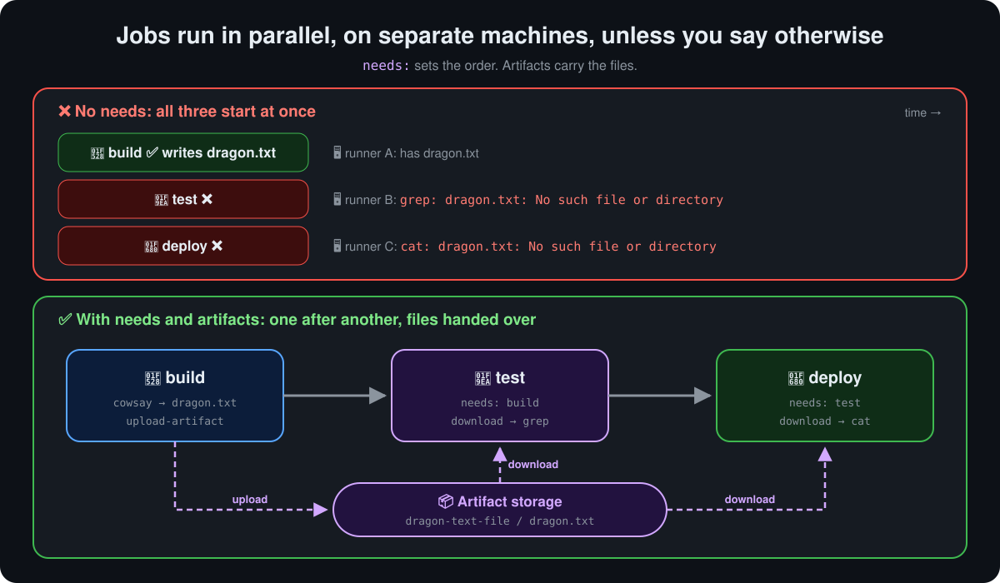
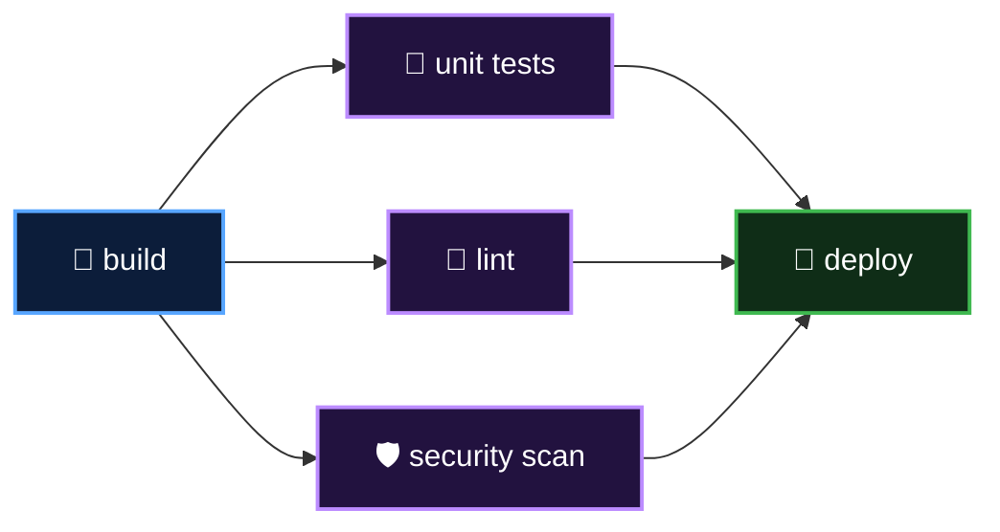

<p align="center">
  <b>Lesson 8 of 12</b> &nbsp;·&nbsp; ⏱️ 18 min &nbsp;·&nbsp; 🛠️ Hands-on
</p>

# 🔗 Workflows with Multiple Jobs

Every dragon so far lived in a single job. Real pipelines have stages: **build** something, **test** it, then **deploy** it. In GitHub Actions each stage is usually its own job. This lesson splits the dragon workflow into three jobs, watches it break, and fixes it.

## ✂️ Why split into jobs?

| | One big job | Several jobs |
|---|---|---|
| 👀 Reading the run | One long log | A job per stage, each with its own ✅ or ❌ |
| ⚡ Speed | Everything in series | Independent jobs run **at the same time** |
| 🔁 Re-running | Start from scratch | **Re-run failed jobs** only |
| 🖥️ Machines | One runner | Different runners per job (Linux build, Windows test, ...) |
| 🔐 Control | Same permissions throughout | Per-job `permissions`, `environment`, approvals |

## 💥 Attempt 1: just split it

```yaml
name: Generate ASCII Artwork

on: push

jobs:
  build_job:
    runs-on: ubuntu-latest
    steps:
      - name: Install cowsay
        run: sudo apt-get install -y cowsay
      - name: Generate ASCII art
        run: cowsay -f dragon "Run for cover, I am a DRAGON....RAWR" > dragon.txt

  test_job:
    runs-on: ubuntu-latest
    steps:
      - name: Test the file contains a dragon
        run: grep -i "dragon" dragon.txt

  deploy_job:
    runs-on: ubuntu-latest
    steps:
      - name: Deploy (print the file)
        run: cat dragon.txt
```

Push it, and two of the three jobs fail **within seconds**:

<p align="center">
  
</p>

Two separate problems caused this:

| | Problem | Rule |
|---|---|---|
| ⏱️ | `test_job` and `deploy_job` didn't **wait** for `build_job` | **Jobs run in parallel by default** |
| 📂 | Even if they had waited, `dragon.txt` was on a **different machine** | **Each job gets its own fresh runner. Jobs share no files** |

## ⏩ Fix 1: put the jobs in order with `needs`

```yaml
  test_job:
    needs: build_job          # wait for build_job to succeed
    runs-on: ubuntu-latest
    ...

  deploy_job:
    needs: test_job           # wait for test_job to succeed
    runs-on: ubuntu-latest
    ...
```

`needs:` takes one job ID or a list:

| You write | What happens |
|---|---|
| *(nothing)* | Starts immediately, in parallel with the others |
| `needs: build_job` | Starts after `build_job` **succeeds** |
| `needs: [lint, unit_tests]` | Starts after **both** succeed. A **fan-in** |
| Two jobs each with `needs: build_job` | Both start together after build. A **fan-out** |

> [!IMPORTANT]
> **If a needed job fails, the jobs after it are skipped**, not failed. That's the whole point: never deploy something whose tests didn't pass. To run a job anyway, for example to send a failure alert, add `if: ${{ always() }}` or `if: ${{ failure() }}` to it.

👉 [Lesson 9](09-executing-jobs-in-sequence.md) goes deeper into `needs`: failure handling, status functions and job results.

Now the jobs run in order, but `test_job` still fails. It waited for build, then started on a **new** runner that has never seen `dragon.txt`.

## 📦 Fix 2: carry the file with artifacts

An **artifact** is a file or folder a job uploads to storage attached to the workflow run. Any later job in the same run can download it.

```yaml
jobs:
  build_job:
    runs-on: ubuntu-latest
    steps:
      - name: Install cowsay
        run: sudo apt-get install -y -qq cowsay
      - name: Generate ASCII art
        run: cowsay -f dragon "Run for cover, I am a DRAGON....RAWR" > dragon.txt
      - name: Upload dragon.txt
        uses: actions/upload-artifact@v7      # 📤
        with:
          name: dragon-text-file
          path: dragon.txt
          retention-days: 3

  test_job:
    needs: build_job
    runs-on: ubuntu-latest
    steps:
      - name: Download dragon.txt
        uses: actions/download-artifact@v8    # 📥
        with:
          name: dragon-text-file
      - name: Test the file contains a dragon
        run: grep -i "dragon" dragon.txt

  deploy_job:
    needs: test_job
    runs-on: ubuntu-latest
    steps:
      - name: Download dragon.txt
        uses: actions/download-artifact@v8
        with:
          name: dragon-text-file
      - name: Deploy (print the file)
        run: cat dragon.txt
```

| Input | On | Meaning |
|---|---|---|
| `name` | upload and download | The label that links them. Must match exactly |
| `path` | upload | File, folder or glob to save, e.g. `dist/` or `reports/*.xml` |
| `path` | download | Where to put it. Defaults to the workspace root |
| `retention-days` | upload | How long GitHub keeps it. Default 90 days, or your repo's setting |

👉 [Lesson 10](10-storing-workflow-data-as-artifacts.md) covers artifacts in depth: naming, patterns, retention and downloading from other runs.

> [!TIP]
> Artifacts also appear on the run's **Summary** page as downloadable zip files. That's handy for build outputs, test reports and screenshots, even after the runners are long gone.

## 🗺️ Reading the job graph

Open the run's **Summary** and GitHub draws the jobs as a graph:


| You see | Meaning |
|---|---|
| Boxes side by side in one column | They run in parallel |
| A line between two boxes | A `needs:` relationship |
| ⚪ greyed-out box | Waiting on the job before it |
| ⊘ skipped box | A job it needed failed |
| 📦 **Artifacts** section below | Files uploaded during the run |

A more realistic pipeline mixes both shapes, fanning out to parallel checks and back in before deploying:



```yaml
  deploy:
    needs: [unit_tests, lint, security_scan]
```

## 🔀 Artifacts, outputs or cache?

Three ways to pass something from one job to another, or from one run to the next:

| | Use for | Lives for | Example |
|---|---|---|---|
| 📦 **Artifact** | Files produced by this run | The run, plus retention days | `dist/`, `dragon.txt`, test reports |
| 🏷️ **Job output** | Small strings | This run | A version number, an image tag |
| 🗄️ **Cache** | Files that rarely change, to save time | Across runs, up to 7 days unused | `node_modules`, `~/.cache/pip` |

A job output looks like this:

```yaml
jobs:
  build_job:
    runs-on: ubuntu-latest
    outputs:
      version: ${{ steps.v.outputs.version }}
    steps:
      - id: v
        run: echo "version=1.4.$GITHUB_RUN_NUMBER" >> "$GITHUB_OUTPUT"

  deploy_job:
    needs: build_job
    runs-on: ubuntu-latest
    steps:
      - run: echo "Deploying ${{ needs.build_job.outputs.version }}"
```

## 🛠️ Try it yourself

This repository ships the finished three-job workflow: [`04-multiple-jobs.yml`](../.github/workflows/04-multiple-jobs.yml).

1. Open the **Actions** tab, pick **04 - Multiple Jobs** and click **Run workflow**
2. Watch the graph: `build_job` runs while the other two wait ⚪
3. When it finishes, scroll the Summary to **Artifacts** and download `dragon-text-file`
4. **Break it (order):** in a fork, delete the two `needs:` lines. All three jobs start together; test and deploy fail
5. **Break it (files):** put `needs:` back but delete the download steps. Jobs wait correctly, and still fail with `No such file or directory`
6. **Stretch:** add a `lint_job` that also `needs: build_job`, and make `deploy_job` need `[test_job, lint_job]`

## ✅ Checkpoint

<details>
<summary><b>A workflow has three jobs and no <code>needs:</code>. In what order do they run?</b></summary>

<br>

All at the same time, each on its own runner. There is no order.

</details>

<details>
<summary><b><code>test_job</code> has <code>needs: build_job</code> but still can't find the file <code>build_job</code> created. Why?</b></summary>

<br>

`needs:` only controls timing. Each job runs on a fresh machine, so the file must be passed with `upload-artifact` and `download-artifact`.

</details>

<details>
<summary><b><code>test_job</code> fails. What happens to <code>deploy_job</code>, which needs it?</b></summary>

<br>

It's skipped, and the workflow run is marked as failed. Add `if: ${{ always() }}` to a job only if it must run regardless.

</details>

<details>
<summary><b>You need to pass a version string like <code>1.4.27</code> from build to deploy. Artifact or output?</b></summary>

<br>

A job output. Artifacts are for files; outputs are for small strings, read as `needs.<job>.outputs.<name>`.

</details>

## 🎯 What you learned

- Split stages into **jobs** for clearer logs, parallel speed and re-running only what failed
- Jobs run **in parallel** by default; **`needs:`** puts them in order
- A failed job **skips** the jobs that need it, unless they use `if: always()`
- Each job has its **own runner**, so files travel by **artifact**: upload, then download by the same name
- Use **outputs** for small strings and **cache** for slow-to-rebuild files

---

<p align="center">
  <a href="07-executing-shell-scripts.md">⬅️ Executing Shell Scripts</a>
  &nbsp;&nbsp;·&nbsp;&nbsp;
  <a href="index.md">📚 Chapter 4</a>
  &nbsp;&nbsp;·&nbsp;&nbsp;
  <a href="09-executing-jobs-in-sequence.md"><b>Next: Jobs in Sequence ➡️</b></a>
</p>
