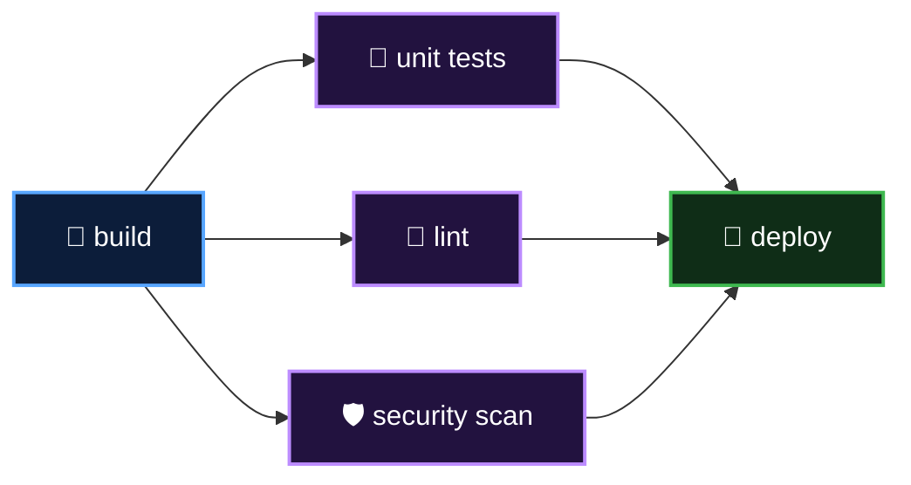

<p align="center">
  <a href="README.md">📂 <b>Workflows with Multiple Jobs</b></a> &nbsp;·&nbsp; Lesson 8 · Part 5 of 8 &nbsp;·&nbsp; ⏱️ 2 min
</p>

# 🗺️ Reading the job graph

Open the run's **Summary** and GitHub draws the jobs as a graph:


| You see | Meaning |
|---|---|
| Boxes side by side in one column | They run in parallel |
| A line between two boxes | A `needs:` relationship |
| ⚪ greyed-out box | Waiting on the job before it |
| ⊘ skipped box | A job it needed failed |
| 📦 **Artifacts** section below | Files uploaded during the run |

A more realistic pipeline mixes both shapes, fanning out to parallel checks and back in before deploying:



```yaml
  deploy:
    needs: [unit_tests, lint, security_scan]
```

---

<p align="center">
  <a href="04-fix-2-carry-the-file-with-artifacts.md">⬅️ Fix 2: carry the file with artifacts</a>
  &nbsp;&nbsp;·&nbsp;&nbsp;
  <a href="README.md">📂 Topic overview</a>
  &nbsp;&nbsp;·&nbsp;&nbsp;
  <a href="06-artifacts-outputs-or-cache.md"><b>Next: Artifacts, outputs or cache? ➡️</b></a>
</p>
