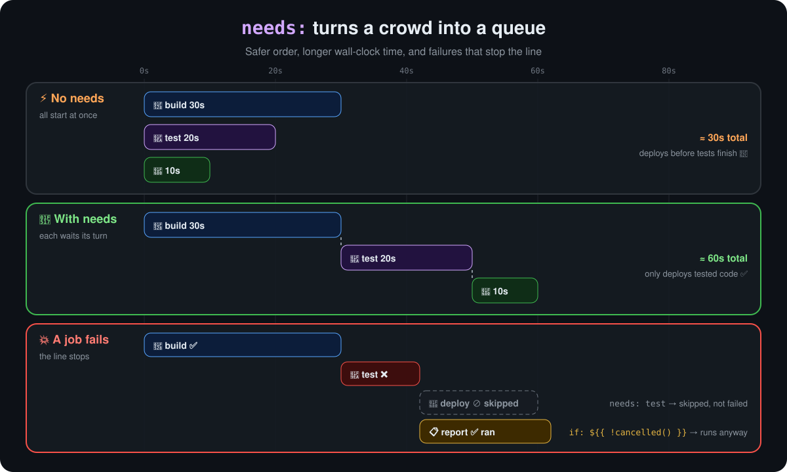
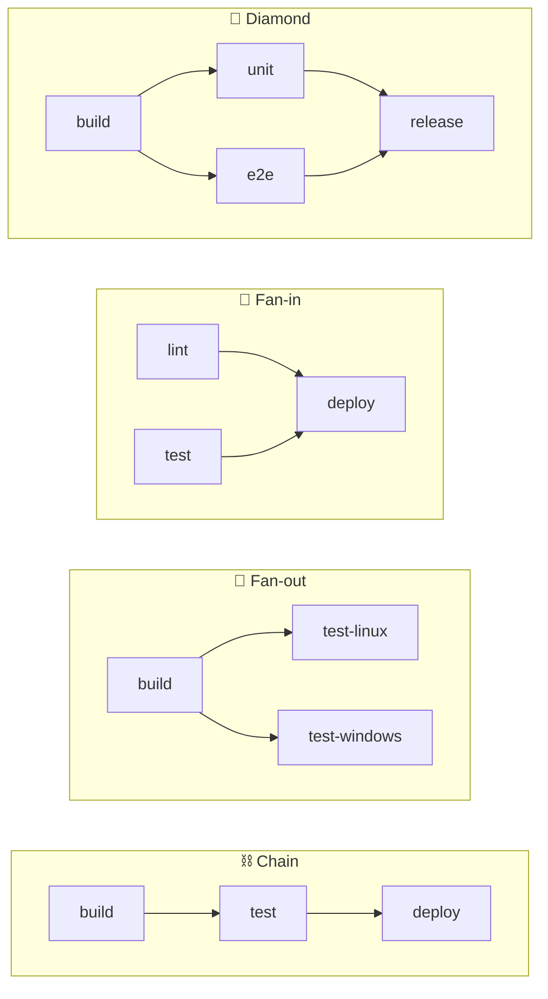
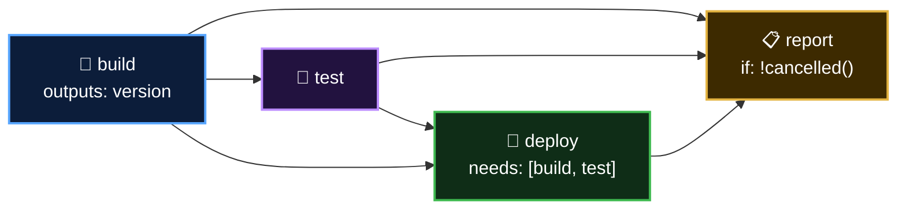

<p align="center">
  <b>Lesson 9 of 13</b> &nbsp;·&nbsp; ⏱️ 16 min &nbsp;·&nbsp; 🛠️ Hands-on
</p>

# ⛓️ Executing Jobs in Sequence with `needs`

In the last lesson `needs:` fixed a race in one line. It deserves a closer look, because that one keyword decides **when** jobs start, **what happens when one fails**, and **which data** each job can see. Get it right and your pipeline can't deploy untested code. Get it wrong and jobs get silently skipped, or wait for no reason.

## 🎯 The rule in one sentence

> **A job with `needs:` waits until every job it lists has finished successfully. If any of them fails or is skipped, it is skipped too.**

```yaml
jobs:
  build:
    runs-on: ubuntu-latest
    steps: [...]

  test:
    needs: build              # one job: a string
    runs-on: ubuntu-latest
    steps: [...]

  deploy:
    needs: [build, test]      # several jobs: a list
    runs-on: ubuntu-latest
    steps: [...]
```

## ⏱️ What sequencing costs, and buys

<p align="center">
  
</p>

| | No `needs` | With `needs` |
|---|---|---|
| ⏱️ Wall-clock time | The **longest** job | The **sum** of the chain |
| 🛡️ Safety | Deploy may run before or despite failed tests | Deploy runs only after tests pass |
| 🧾 Minutes billed | Same | Same: you pay for job time, not waiting time |

> [!TIP]
> **Sequence only what truly depends on something else.** Lint, unit tests and a security scan don't depend on each other, so let them run side by side, and put `needs:` only on the job that must wait for all of them. The run takes as long as its **longest chain**, often called the critical path.

## 🧩 Four shapes you can build



| Shape | YAML | Use it for |
|---|---|---|
| ⛓️ Chain | each job `needs:` the one before | Strict stages: build → test → deploy |
| 🌿 Fan-out | several jobs `needs: build` | Testing one build on many platforms at once |
| 🎯 Fan-in | `needs: [lint, test]` | A gate that waits for every check |
| 💎 Diamond | fan-out, then fan-in | Most real pipelines |

## 💥 When a job fails: skipped, not failed

Failure spreads **down** the graph as **skipped**:

| Job | Result | Why |
|---|---|---|
| 🔨 build | ✅ success | |
| 🧪 test | ❌ failure | A step exited non-zero |
| 🚀 deploy (`needs: test`) | ⊘ skipped | Something it needed didn't succeed |
| 📣 announce (`needs: deploy`) | ⊘ skipped | Something *it* needed was skipped. Skips spread too |
| **The workflow run** | ❌ failure | Any failed job fails the run |

> [!NOTE]
> **Re-run failed jobs** re-runs `test` *and* every job downstream of it. `build` keeps its earlier result and its artifacts, so you don't pay to rebuild.

## 🚦 Overriding the rule with `if:`

Sometimes a job **should** run after a failure: a report, a Slack alert, a cleanup. Add a job-level `if:` with a **status function**:

| `if:` | Runs when the jobs it needs... | Typical use |
|---|---|---|
| *(nothing)* = `success()` | all succeeded | Normal stages |
| `${{ failure() }}` | at least one **failed** | 🔔 Alert the team |
| `${{ !cancelled() }}` | finished any way, unless the run was **cancelled** | 📋 Reports, test summaries |
| `${{ always() }}` | finished any way, **even when cancelled** | 🧹 Must-run cleanup |
| `${{ cancelled() }}` | the run was cancelled | Releasing a lock |

> [!IMPORTANT]
> **Prefer `!cancelled()` over `always()`.** A job with `always()` still runs after you press **Cancel workflow**, which is rarely what you meant when you cancelled.

To react to **one particular** job, read its result from the `needs` context:

```yaml
  notify:
    needs: [test, deploy]
    if: ${{ !cancelled() && needs.test.result == 'failure' }}
    runs-on: ubuntu-latest
    steps:
      - run: echo "Tests failed. Deploy was ${{ needs.deploy.result }}."
```

`needs.<job>.result` is one of `success`, `failure`, `cancelled` or `skipped`.

## 📤 Outputs only flow from direct `needs`

A job can read `needs.<job>.outputs` **only for jobs it lists in its own `needs:`**. Being further down the chain isn't enough:

```yaml
  build:
    outputs:
      version: ${{ steps.v.outputs.version }}
    ...
  test:
    needs: build
    ...
  deploy:
    needs: test                                     # ❌ needs.build is empty here
    steps:
      - run: echo "${{ needs.build.outputs.version }}"
```

```yaml
  deploy:
    needs: [build, test]                            # ✅ list build too
    steps:
      - run: echo "${{ needs.build.outputs.version }}"
```

Listing `build` adds no waiting, since `test` already waited for it. It just opens the door to its outputs.

## 🪤 Common mistakes

| Mistake | What you see | Fix |
|---|---|---|
| Typo in a job ID, e.g. `needs: buidl` | The workflow is **invalid** and never starts. The Actions tab names the unknown job | Use the job's **ID** (the YAML key), not its `name:` |
| Two jobs that need each other | Invalid workflow: a dependency cycle | Draw the graph; it must flow one way |
| A report job without `if:` | It's skipped exactly when you need it | Add `if: ${{ !cancelled() }}` |
| Reading outputs from a grandparent job | An empty string, no error | List that job in `needs:` too |
| Sequencing independent checks | Slow pipelines | Run them in parallel and fan in |

## 🛠️ Try it yourself

This repository ships a four-job pipeline with a "break it" switch: [`04-needs-sequence.yml`](../.github/workflows/04-needs-sequence.yml).



1. **Actions** tab → **04 - Jobs in Sequence** → **Run workflow**, leaving the box unticked
2. Watch the graph fill in one box at a time. Open **deploy**: it prints `Deploying version 1.0.<run number>`, an output read from `build`
3. Scroll down the **Summary** page to the results table that `report` wrote: all `success`
4. Run it again with **Make the tests fail** ticked. `test` goes ❌, `deploy` is ⊘ skipped, and `report` still runs and records `failure` and `skipped`
5. Click **Re-run failed jobs**. Notice `build` is not re-run
6. **Stretch:** in a fork, add a `notify` job that runs only when `needs.test.result == 'failure'`

## ✅ Checkpoint

<details>
<summary><b><code>deploy</code> has <code>needs: test</code>, and <code>test</code> was skipped. What happens to <code>deploy</code>?</b></summary>

<br>

It's skipped too. A job runs only if everything it needs **succeeded**, and skipped isn't success.

</details>

<details>
<summary><b>Build takes 2 minutes, then lint (1 min) and tests (4 min) both need build, and deploy needs both. Roughly how long is the run?</b></summary>

<br>

About 2 + 4 + deploy time. Lint and tests run side by side after build, so the longest branch (tests) decides. Lint adds nothing.

</details>

<details>
<summary><b>Your summary job should run after failures, but not if someone cancels the run. Which <code>if:</code>?</b></summary>

<br>

`if: ${{ !cancelled() }}`. `always()` would also run after a cancel.

</details>

<details>
<summary><b><code>deploy</code> has <code>needs: test</code> and prints <code>needs.build.outputs.version</code>, but gets an empty string. Why?</b></summary>

<br>

Outputs are only visible from jobs listed directly in `needs:`. Change it to `needs: [build, test]`.

</details>

## 🎯 What you learned

- **`needs:`** makes a job wait for others to **succeed**; take a string for one job or a list for several
- Sequencing adds wall-clock time. A run is as fast as its **longest chain**, so keep independent jobs parallel
- Failure spreads down the graph as **skipped**, and so do skips
- Status functions override that: **`failure()`**, **`!cancelled()`** (preferred) and **`always()`**
- **`needs.<job>.result`** tells you exactly what happened to each job
- Job outputs are visible only from **direct** `needs`

---

<p align="center">
  <a href="08-workflows-with-multiple-jobs.md">⬅️ Multiple Jobs</a>
  &nbsp;&nbsp;·&nbsp;&nbsp;
  <a href="index.md">📚 Chapter 4</a>
  &nbsp;&nbsp;·&nbsp;&nbsp;
  <a href="10-storing-workflow-data-as-artifacts.md"><b>Next: Storing Data as Artifacts ➡️</b></a>
</p>
