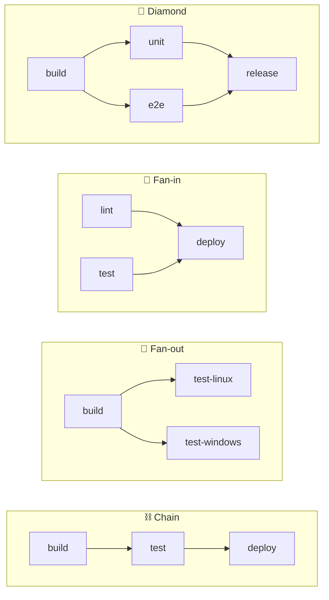

  <a href="README.md">📂 <b>Executing Jobs in Sequence with needs</b></a> &nbsp;·&nbsp; Lesson 9 · Part 3 of 9 &nbsp;·&nbsp; ⏱️ 1 min

# 🧩 Four shapes you can build

| Shape | YAML | Use it for |
|---|---|---|
| ⛓️ Chain | each job `needs:` the one before | Strict stages: build → test → deploy |
| 🌿 Fan-out | several jobs `needs: build` | Testing one build on many platforms at once |
| 🎯 Fan-in | `needs: [lint, test]` | A gate that waits for every check |
| 💎 Diamond | fan-out, then fan-in | Most real pipelines |

---

  <a href="02-what-sequencing-costs-and-buys.md">⬅️ What sequencing costs, and buys</a>
  &nbsp;&nbsp;·&nbsp;&nbsp;
  <a href="README.md">📂 Topic overview</a>
  &nbsp;&nbsp;·&nbsp;&nbsp;
  <a href="04-when-a-job-fails-skipped-not-failed.md"><b>Next: When a job fails: skipped, not failed ➡️</b></a>

