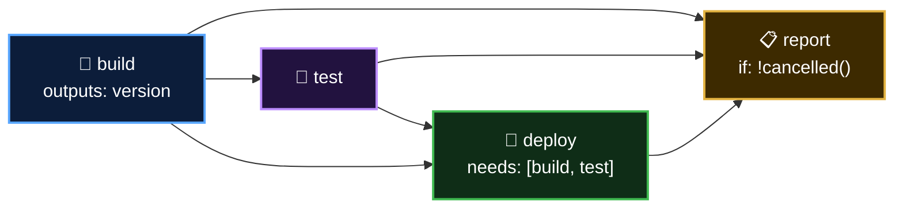

  <a href="README.md">📂 <b>Executing Jobs in Sequence with needs</b></a> &nbsp;·&nbsp; Lesson 9 · Part 8 of 9 &nbsp;·&nbsp; ⏱️ 2 min

# 🛠️ Try it yourself

This repository ships a four-job pipeline with a "break it" switch: [`04-needs-sequence.yml`](../../.github/workflows/04-needs-sequence.yml).

1. **Actions** tab → **04 - Jobs in Sequence** → **Run workflow**, leaving the box unticked
2. Watch the graph fill in one box at a time. Open **deploy**: it prints `Deploying version 1.0.<run number>`, an output read from `build`
3. Scroll down the **Summary** page to the results table that `report` wrote: all `success`
4. Run it again with **Make the tests fail** ticked. `test` goes ❌, `deploy` is ⊘ skipped, and `report` still runs and records `failure` and `skipped`
5. Click **Re-run failed jobs**. Notice `build` is not re-run
6. **Stretch:** in a fork, add a `notify` job that runs only when `needs.test.result == 'failure'`

---

  <a href="07-common-mistakes.md">⬅️ Common mistakes</a>
  &nbsp;&nbsp;·&nbsp;&nbsp;
  <a href="README.md">📂 Topic overview</a>
  &nbsp;&nbsp;·&nbsp;&nbsp;
  <a href="09-checkpoint.md"><b>Next: Checkpoint ➡️</b></a>

