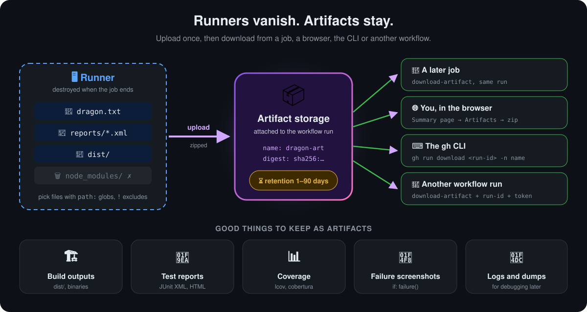
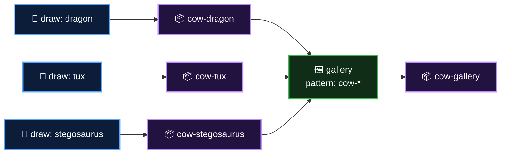

<p align="center">
  <b>Lesson 10 of 13</b> &nbsp;·&nbsp; ⏱️ 16 min &nbsp;·&nbsp; 🛠️ Hands-on
</p>

# 📦 Storing Workflow Data as Artifacts

A runner is wiped the moment its job ends. Your build output, your test report, the screenshot of the failing page: all gone, unless you **store them as artifacts**. In [Lesson 8](08-workflows-with-multiple-jobs.md) you used an artifact to hand one file to the next job. This lesson covers everything else: what to keep, how to name it, how long it lives and how to get it back.

## 💡 What an artifact is

> **An artifact is a set of files a job uploads to storage attached to its workflow run.** It outlives the runner, and it can be downloaded by later jobs, by people, by the CLI, or by other workflows.

<p align="center">
  
</p>

| | Fact |
|---|---|
| 🗜️ **Format** | Zipped on upload. Downloaded from the browser as a `.zip` |
| 🔗 **Belongs to** | One workflow run. Listed at the bottom of the run's **Summary** page |
| ⏳ **Lifetime** | 90 days by default, or what your repository or organisation sets. Lower it per upload with `retention-days` |
| 👀 **Who can download** | Anyone with **read** access to the repository. On a public repo, that's everyone |
| 💰 **Cost** | Counts toward your account's GitHub Actions **storage** quota until it expires or is deleted |

## 📤 Uploading: the inputs worth knowing

```yaml
- name: Upload test results
  uses: actions/upload-artifact@v7
  with:
    name: test-results               # what people and jobs will ask for
    path: |                          # one path per line; globs allowed
      reports/**/*.xml
      coverage/
      !coverage/**/*.tmp             # ! excludes
    if-no-files-found: error         # fail loudly if nothing matched
    retention-days: 7                # 1-90, can't exceed the repo setting
    compression-level: 6             # 0 = none (fast), 9 = smallest
```

| Input | Default | What it does |
|---|---|---|
| `name` | `artifact` | The artifact's name. **Must be unique within the run** |
| `path` | *(required)* | Files, folders or globs, one per line. Start a line with `!` to exclude |
| `if-no-files-found` | `warn` | `warn`, `error` or `ignore` when `path` matches nothing |
| `retention-days` | Repo setting | How long to keep it |
| `compression-level` | `6` | `0` for already-compressed files like images or `.zip`, `9` for big text files |
| `overwrite` | `false` | `true` replaces an existing artifact with the same name in this run |
| `include-hidden-files` | `false` | Include dot-files such as `.env.example`. Off by default so secrets in hidden files don't leak |

It also returns **outputs** you can use in later steps:

| Output | Example use |
|---|---|
| `artifact-id` | Call the REST API to fetch or delete it |
| `artifact-url` | Post a direct download link in a PR comment or the job summary |
| `artifact-digest` | A SHA-256 checksum, to prove the file wasn't changed |

> [!TIP]
> **Make `if-no-files-found: error` your habit for anything important.** The default only warns, so a typo in `path` gives you a green run with an empty or missing artifact.

## 🏷️ Names are unique and artifacts are immutable

Since `upload-artifact@v4`, an artifact **can't be changed after upload**, and two uploads with the same name in one run **fail**. This bites hardest in a matrix:

```yaml
strategy:
  matrix:
    cow: [dragon, tux, stegosaurus]
steps:
  - uses: actions/upload-artifact@v7
    with:
      name: drawing                    # ❌ three jobs, one name: two of them fail
      path: art/
```

```yaml
  - uses: actions/upload-artifact@v7
    with:
      name: cow-${{ matrix.cow }}      # ✅ cow-dragon, cow-tux, cow-stegosaurus
      path: art/
```

Then collect them in a later job with a **pattern**:

```yaml
- uses: actions/download-artifact@v8
  with:
    pattern: cow-*         # every artifact whose name matches
    merge-multiple: true   # put all their files in one folder
    path: gallery
```

| Download input | Default | What it does |
|---|---|---|
| `name` | *(all)* | One artifact by name. Leave out `name` and `pattern` to download **every** artifact in the run |
| `pattern` | | A glob over artifact names, e.g. `cow-*` |
| `merge-multiple` | `false` | `false`: one subfolder per artifact. `true`: everything in one folder |
| `path` | Workspace root | Where to put the files |
| `run-id` + `github-token` | This run | Download from a **different** run (needs `actions: read`) |

## 📥 Four ways to get an artifact back

| Who | How |
|---|---|
| 🔗 **A later job in the same run** | `actions/download-artifact` with `name` or `pattern` |
| 🌐 **You, in the browser** | Run → **Summary** → scroll to **Artifacts** → click the name to download a `.zip` |
| ⌨️ **You, in a terminal** | `gh run download <run-id> -n cow-gallery` or `gh run download <run-id> -p 'cow-*'` |
| 🔁 **Another workflow** | `download-artifact` with `run-id` and `github-token`, e.g. a deploy workflow fetching a build from CI |

Downloading from another run:

```yaml
permissions:
  actions: read
steps:
  - uses: actions/download-artifact@v8
    with:
      name: dist
      run-id: ${{ github.event.workflow_run.id }}   # e.g. from a workflow_run trigger
      github-token: ${{ secrets.GITHUB_TOKEN }}
```

## 📸 Keep evidence when things break

The most valuable artifacts are often the ones you only need on a bad day:

```yaml
- name: Run end-to-end tests
  run: npx playwright test

- name: Upload screenshots and traces
  if: ${{ failure() }}                 # only when a step above failed
  uses: actions/upload-artifact@v7
  with:
    name: e2e-evidence-${{ github.run_attempt }}
    path: test-results/
    retention-days: 14
```

Adding `run_attempt` to the name stops a **re-run** from clashing with the first attempt's artifact.

## ⏳ Retention and storage

| Setting | Where | Range |
|---|---|---|
| Per upload | `retention-days:` | 1 up to the repository's maximum |
| Repository default | **Settings → Actions → General → Artifact and log retention** | Up to 90 days on public repos, up to 400 on private ones |
| Organisation or enterprise | Org or enterprise settings | Sets the ceiling for every repository |

> [!NOTE]
> Expired artifacts are deleted automatically. You can delete one early from the run's Summary page (🗑️ next to its name) or through the REST API, which frees the storage at once.

## 🔐 Security: assume anyone can read it

> [!WARNING]
> **Never put secrets in an artifact.** Everyone with read access can download it, which on a public repository means the whole internet. Watch out for `.env` files, kubeconfigs, cloud credential files and debug dumps that print environment variables. Keep `include-hidden-files` off unless you have checked what the hidden files contain.

## 🔀 Artifact, cache, release or package?

| | 📦 Artifact | 🗄️ Cache | 🏷️ Release asset | 📚 Package |
|---|---|---|---|---|
| **Purpose** | Output of **this run** | Speed up **future runs** | Ship a version to users | Publish for other projects to install |
| **Typical content** | Build output, reports, logs | Dependencies (`node_modules`, pip) | Installers, binaries | npm, Maven, container images |
| **Lives** | Retention days | 7 days unused, size-capped | Until you delete it | Until you delete it |
| **Downloaded by** | Jobs, people, CLI | Only `actions/cache` | Anyone who can see the release | Package managers |

## 🛠️ Try it yourself

This repository ships a matrix-and-gallery workflow: [`04-artifacts.yml`](../.github/workflows/04-artifacts.yml).



1. **Actions** tab → **04 - Artifacts** → **Run workflow**
2. Open a **draw** job and its **Show what was stored** step: the artifact's ID, URL and SHA-256 digest
3. On the **Summary** page, find **four** artifacts: three cows and the gallery. Download `cow-gallery` and unzip it
4. If you have the GitHub CLI: `gh run download <run-id> -p 'cow-*'` and look at the folders it creates
5. **Break it:** in a fork, change the upload name to a fixed `drawing`. Two of the three draw jobs fail with a "conflict" error
6. **Stretch:** set `merge-multiple: false` in the gallery job and see how the folder layout changes

## ✅ Checkpoint

<details>
<summary><b>A matrix of four jobs all upload an artifact named <code>results</code>. What happens?</b></summary>

<br>

The first upload succeeds and the others fail, because artifact names must be unique in a run. Include a matrix value in the name, such as `results-${{ matrix.os }}`.

</details>

<details>
<summary><b>The upload step is green, but the artifact isn't on the Summary page. What's the likely cause, and the fix?</b></summary>

<br>

`path` matched nothing, and the default `if-no-files-found: warn` only printed a warning. Fix the path, and set `if-no-files-found: error` so it can't happen silently.

</details>

<details>
<summary><b>You want to save Playwright screenshots, but only when the tests fail. How?</b></summary>

<br>

Put `if: ${{ failure() }}` on the upload step, after the test step.

</details>

<details>
<summary><b>Should <code>node_modules</code> be an artifact or a cache?</b></summary>

<br>

A cache. It exists to make future runs faster, not to keep this run's output.

</details>

## 🎯 What you learned

- An **artifact** is a zipped set of files attached to a run, kept after the runner is gone
- Choose files with **`path`** (globs, `!` excludes) and fail loudly with **`if-no-files-found: error`**
- Names are **unique per run** and artifacts are **immutable**: in a matrix, put the matrix value in the name
- Collect many with **`pattern`** and **`merge-multiple`**; fetch from other runs with **`run-id`**
- Get them back from a **job**, the **browser**, **`gh run download`** or **another workflow**
- Set **`retention-days`**, keep **secrets** out, and use **cache** for dependencies

---

<p align="center">
  <a href="09-executing-jobs-in-sequence.md">⬅️ Jobs in Sequence</a>
  &nbsp;&nbsp;·&nbsp;&nbsp;
  <a href="index.md">📚 Chapter 4</a>
  &nbsp;&nbsp;·&nbsp;&nbsp;
  <a href="11-working-with-variables.md"><b>Next: Working with Variables ➡️</b></a>
</p>
