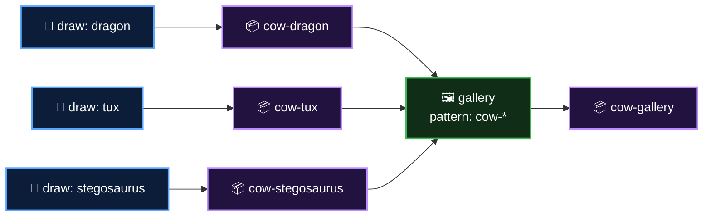

  <a href="README.md">📂 <b>Storing Workflow Data as Artifacts</b></a> &nbsp;·&nbsp; Lesson 10 · Part 9 of 10 &nbsp;·&nbsp; ⏱️ 2 min

# 🛠️ Try it yourself

This repository ships a matrix-and-gallery workflow: [`04-artifacts.yml`](../../.github/workflows/04-artifacts.yml).

1. **Actions** tab → **04 - Artifacts** → **Run workflow**
2. Open a **draw** job and its **Show what was stored** step: the artifact's ID, URL and SHA-256 digest
3. On the **Summary** page, find **four** artifacts: three cows and the gallery. Download `cow-gallery` and unzip it
4. If you have the GitHub CLI: `gh run download <run-id> -p 'cow-*'` and look at the folders it creates
5. **Break it:** in a fork, change the upload name to a fixed `drawing`. Two of the three draw jobs fail with a "conflict" error
6. **Stretch:** set `merge-multiple: false` in the gallery job and see how the folder layout changes

---

  <a href="08-artifact-cache-release-or-package.md">⬅️ Artifact, cache, release or package?</a>
  &nbsp;&nbsp;·&nbsp;&nbsp;
  <a href="README.md">📂 Topic overview</a>
  &nbsp;&nbsp;·&nbsp;&nbsp;
  <a href="10-checkpoint.md"><b>Next: Checkpoint ➡️</b></a>

