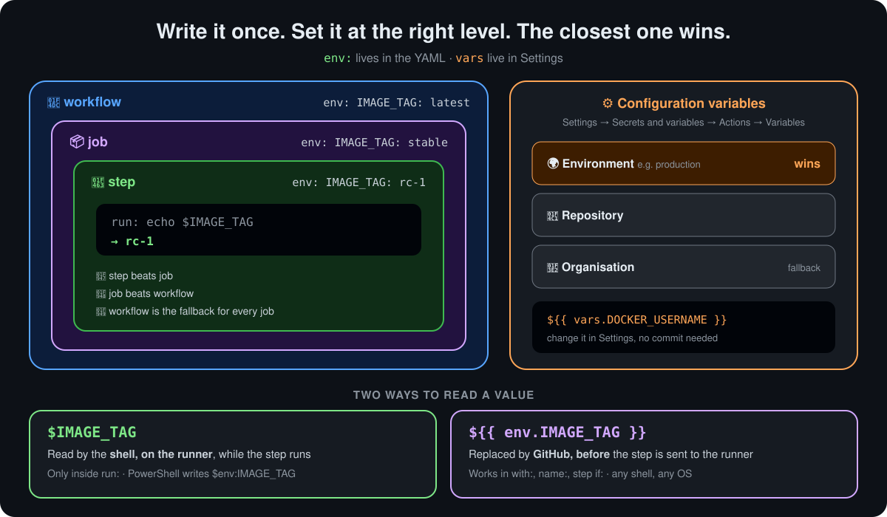
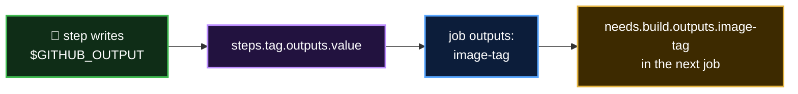

<p align="center">
  <b>Lesson 11 of 13</b> &nbsp;·&nbsp; ⏱️ 32 min &nbsp;·&nbsp; 🛠️ Hands-on &nbsp;·&nbsp; ⭐ Fundamental
</p>

# 🔤 Working with Variables

> [!IMPORTANT]
> **Almost every real workflow uses variables.** Image names, registries, versions, URLs, feature flags: they're what turn a demo into something you can reuse, change safely and share with a team. Learn this lesson properly and the rest of GitHub Actions gets easier.

## 🕵️ Spot the problems

Here is a workflow that builds a Docker image, pushes it, and runs it. It works. Before reading on, see how many problems you can find.

```yaml
name: Exploring Variables and Secrets

on:
  push

jobs:
  docker:
    runs-on: ubuntu-latest
    steps:
    - name: Docker Build
      run: docker build -t docker.io/dockerUsername/imageName:latest

    - name: Docker Login
      run: docker login --username=dockerUsername --password=s3cUrePaSsw0rd

    - name: Docker Publish
      run: docker push docker.io/dockerUsername/imageName:latest

  deploy:
    needs: docker
    runs-on: ubuntu-latest
    steps:
    - name: Docker Run
      run: docker run -d -p 8080:80 docker.io/dockerUsername/imageName:latest
```

<details>
<summary><b>🔍 Reveal the problems</b></summary>

<br>

| | Problem | What goes wrong |
|---|---|---|
| 🔁 | `docker.io/dockerUsername/imageName:latest` is typed **three times** | Rename the image and you must find every copy. Miss one and you deploy the wrong image |
| 👤 | `dockerUsername` appears **four times**, in two jobs | Same again, across jobs |
| 🏷️ | The tag is always `latest` | You can't tell which commit is running, or roll back |
| 🚨 | **The password is in the file** | Anyone who can read the repository, and its whole Git history, now has your Docker Hub password |

The first three are fixed with **variables**, in this lesson. The fourth needs a **secret**, which is a variable GitHub encrypts and hides. There's a short preview below.

</details>

## 🧱 Fix 1: step-level `env`

`env:` defines environment variables. Put it on a step, and only that step sees them:

```yaml
    - name: Docker Build
      env:
        CONTAINER_REGISTRY: docker.io
        DOCKER_USERNAME: dockerUsername
        IMAGE_NAME: imageName
      run: docker build -t $CONTAINER_REGISTRY/$DOCKER_USERNAME/$IMAGE_NAME:latest .
```

Better, but **Docker Publish** needs the same values, and it can't see them. Step-level `env` is for values only one step uses.

## 📦 Fix 2: job-level `env`

Move `env:` up to the job, and **every step in that job** sees it:

```yaml
  docker:
    runs-on: ubuntu-latest
    env:
      CONTAINER_REGISTRY: docker.io
      DOCKER_USERNAME: dockerUsername
      IMAGE_NAME: imageName
    steps:
    - name: Docker Build
      run: docker build -t $CONTAINER_REGISTRY/$DOCKER_USERNAME/$IMAGE_NAME:latest .
    - name: Docker Publish
      run: docker push $CONTAINER_REGISTRY/$DOCKER_USERNAME/$IMAGE_NAME:latest
```

But `deploy` is a different job, on a different runner. It still has nothing.

## 📜 Fix 3: workflow-level `env`

Put `env:` at the top, and **every job** sees it:

```yaml
name: Exploring Variables and Secrets

on: push

env:
  CONTAINER_REGISTRY: docker.io
  DOCKER_USERNAME: dockerUsername
  IMAGE_NAME: imageName
  IMAGE_TAG: ${{ github.sha }}          # 🏷️ a unique tag per commit, from a context

jobs:
  docker:
    runs-on: ubuntu-latest
    steps:
    - name: Docker Build
      run: docker build -t $CONTAINER_REGISTRY/$DOCKER_USERNAME/$IMAGE_NAME:$IMAGE_TAG .
    - name: Docker Publish
      run: docker push $CONTAINER_REGISTRY/$DOCKER_USERNAME/$IMAGE_NAME:$IMAGE_TAG

  deploy:
    needs: docker
    runs-on: ubuntu-latest
    steps:
    - name: Docker Run
      run: docker run -d -p 8080:80 $CONTAINER_REGISTRY/$DOCKER_USERNAME/$IMAGE_NAME:$IMAGE_TAG
```

Rename the image in **one** place, and both jobs follow. Every deploy now names the exact commit it came from.

## 🥇 Which one wins?

<p align="center">
  
</p>

When the same name is set at several levels, **the most specific one wins**: step, then job, then workflow.

| Level | Seen by | Overridden by |
|---|---|---|
| 📜 Workflow `env:` | Every job and step | Job or step `env:` |
| 📦 Job `env:` | Every step in that job | Step `env:` |
| 👣 Step `env:` | That step only | Nothing |

> [!NOTE]
> An override only lasts for its own scope. A job that overrides `IMAGE_TAG` doesn't change it for the other jobs, which still see the workflow value.

### 🧩 Puzzle

```yaml
env:
  GREETING: Hello

jobs:
  one:
    runs-on: ubuntu-latest
    env:
      GREETING: Hi
    steps:
      - run: echo "$GREETING"            # A
      - env:
          GREETING: Hey
        run: echo "$GREETING"            # B
  two:
    runs-on: ubuntu-latest
    steps:
      - run: echo "$GREETING"            # C
```

<details>
<summary><b>What do A, B and C print?</b></summary>

<br>

**A** prints `Hi` (job beats workflow). **B** prints `Hey` (step beats job). **C** prints `Hello`: job `two` has no override, so it gets the workflow value.

</details>

## 💲 `$VAR` or `${{ env.VAR }}`?

There are two ways to read a variable, and they work at different moments:

| | `$IMAGE_NAME` | `${{ env.IMAGE_NAME }}` |
|---|---|---|
| Read by | The **shell**, on the runner | **GitHub**, before the step is sent to the runner |
| Works in | `run:` only | `run:`, `with:`, `name:`, step `if:` and more |
| On Windows (PowerShell) | `$env:IMAGE_NAME` | Same expression, any shell |
| Sees `$GITHUB_ENV` values from earlier steps | ✅ | ✅ |

```yaml
- name: Build ${{ env.IMAGE_NAME }}        # expression: works in a name
  uses: docker/build-push-action@v7
  with:
    tags: ${{ env.CONTAINER_REGISTRY }}/${{ env.IMAGE_NAME }}:latest   # with: needs the expression
```

> [!TIP]
> **Inside `run:`, prefer `$VAR`.** The expression is pasted into your script as plain text before it runs, so a value containing quotes or `;` can break the command or, if it came from user input such as a PR title, inject one. Pass untrusted values through `env:` and read them as `$VAR`.

> [!WARNING]
> **`env` doesn't work everywhere.** It isn't available in `runs-on:` or in a job-level `if:`, because GitHub decides those before the job's environment exists. Use `vars`, `inputs` or `github` there instead.

## 🧠 Inside `${{ }}`: the expression language and its contexts

`${{ }}` isn't the shell. It's **GitHub's own expression language**, evaluated by GitHub before anything reaches the runner. It doesn't know your variable names directly. It only knows a fixed set of top-level objects called **contexts**, and every value you read must start with one of them:

```yaml
run: echo "${{ IMAGE_NAME }}"       # ❌ Unrecognized named-value: 'IMAGE_NAME'
run: echo "${{ env.IMAGE_NAME }}"   # ✅ context.name
```

The prefix isn't red tape. The same name can exist in several places at once, and the context says which one you mean:

```yaml
${{ env.TOKEN }}       # from env: in this YAML
${{ vars.TOKEN }}      # from Settings → Variables
${{ secrets.TOKEN }}   # from Settings → Secrets, masked in logs
```

### 📚 The contexts you'll use

| Context | Holds | Example | Example value |
|---|---|---|---|
| 🐙 `github` | Facts about the run and what triggered it | `${{ github.sha }}` | `ffac537e6cbb...` |
| 🌱 `env` | Variables from `env:` (all levels) and `$GITHUB_ENV` | `${{ env.IMAGE_NAME }}` | `dragon-web` |
| ⚙️ `vars` | Configuration variables from Settings | `${{ vars.DOCKER_USERNAME }}` | `octocat` |
| 🔐 `secrets` | Encrypted secrets from Settings, plus `GITHUB_TOKEN` | `${{ secrets.DOCKER_PASSWORD }}` | `***` in logs |
| 🖥️ `runner` | The machine running the job | `${{ runner.os }}` | `Linux` |
| 📦 `job` | The current job's status, container and services | `${{ job.status }}` | `success` |
| 👣 `steps` | Outputs and results of earlier steps **that have an `id`** | `${{ steps.version.outputs.tag }}` | `v1.4.2` |
| 🔗 `needs` | Outputs and results of the jobs listed in `needs:` | `${{ needs.build.outputs.version }}` | `1.0.42` |
| ✖️ `matrix` | The current job's matrix values | `${{ matrix.os }}` | `windows-latest` |
| 🧮 `strategy` | Matrix settings for the job | `${{ strategy.job-index }}` | `2` |
| 🔘 `inputs` | Values typed into **Run workflow**, or passed to a reusable workflow | `${{ inputs.fail_tests }}` | `true` |

A closer look at each:

- **`github`**: the one you'll use most. `github.sha` (commit), `github.ref_name` (branch or tag), `github.actor` (who triggered it), `github.event_name` (`push`, `pull_request`...), `github.repository` (`owner/repo`), `github.run_number`, and `github.event`, the full webhook payload, such as `github.event.pull_request.title`.
- **`env`**: everything in `env:` that applies at this point, after the step-beats-job-beats-workflow rule, plus values written to `$GITHUB_ENV` by earlier steps. Same values the shell sees as `$NAME`.
- **`vars`**: configuration variables, already resolved as environment > repository > organisation. An unset name gives an empty string.
- **`secrets`**: like `vars`, but encrypted and printed as `***`. Always has `secrets.GITHUB_TOKEN`, the token GitHub creates for each run. Not available inside actions you call unless you pass it in with `with:` or `env:`.
- **`runner`**: `runner.os` (`Linux`, `Windows`, `macOS`), `runner.arch` (`X64`, `ARM64`), `runner.temp` (a temp folder cleaned after the job).
- **`job`**: mostly `job.status`, handy in a final step that reports how the job went.

The last four work differently: their values are **created by your workflow as it runs**, not set up in advance. Each gets a closer look below.

### 👣 `steps`: what earlier steps in this job produced

A step can hand values to the steps after it by writing `name=value` to `$GITHUB_OUTPUT`. To read them, the step needs an **`id:`**, because that's the name you look it up by:

```yaml
steps:
  - name: Work out the version
    id: version                                     # 👈 the name steps.<id> uses
    run: echo "tag=v1.4.${{ github.run_number }}" >> "$GITHUB_OUTPUT"

  - name: Use it
    run: echo "Building ${{ steps.version.outputs.tag }}"   # → Building v1.4.42
```

| Property | Meaning | Values |
|---|---|---|
| `steps.<id>.outputs.<name>` | A value the step wrote to `$GITHUB_OUTPUT`, or an output of the action it ran | Any text |
| `steps.<id>.outcome` | What happened, **before** `continue-on-error` is applied | `success`, `failure`, `cancelled`, `skipped` |
| `steps.<id>.conclusion` | The final result, **after** `continue-on-error` | Same four values |

`outcome` vs `conclusion` matters for steps that may fail without failing the job:

```yaml
  - name: Optional lint
    id: lint
    continue-on-error: true      # a failure here won't fail the job
    run: npm run lint

  - name: Warn if lint failed
    if: steps.lint.outcome == 'failure'     # outcome is 'failure', conclusion is 'success'
    run: echo "::warning::Lint failed, but we carried on"
```

> [!IMPORTANT]
> `steps` only sees steps **earlier in the same job**, and only those with an `id:`. A step without an `id`, a later step, or a step in another job all read as empty.

### 🔗 `needs`: what earlier jobs produced

`steps` stops at the edge of the job. To pass values to **another job**, the job declares `outputs:` mapped from its steps, and a later job reads them through `needs`:

```yaml
jobs:
  build:
    runs-on: ubuntu-latest
    outputs:
      image-tag: ${{ steps.tag.outputs.value }}     # 👈 job output ← step output
    steps:
      - id: tag
        run: echo "value=${GITHUB_SHA::7}" >> "$GITHUB_OUTPUT"

  deploy:
    needs: build                                     # 👈 opens needs.build
    runs-on: ubuntu-latest
    steps:
      - run: echo "Deploying ${{ needs.build.outputs.image-tag }}"
```

| Property | Meaning | Values |
|---|---|---|
| `needs.<job>.outputs.<name>` | A value the job declared under `outputs:` | Any text |
| `needs.<job>.result` | How that job ended | `success`, `failure`, `cancelled`, `skipped` |



> [!IMPORTANT]
> `needs` only covers jobs listed **directly** in this job's `needs:`. A "grandparent" job two steps up the chain reads as empty. List it too: `needs: [build, test]`. [Lesson 9](09-executing-jobs-in-sequence.md) covers `needs.<job>.result` in depth.

### ✖️ `matrix` and 🧮 `strategy`: which copy of the job am I?

A matrix runs **one job definition many times** with different values. Inside each copy, `matrix` says which values *this* copy got:

```yaml
jobs:
  test:
    strategy:
      matrix:
        os: [ubuntu-latest, windows-latest]
        node: [20, 22]
    runs-on: ${{ matrix.os }}                       # 👈 matrix works in runs-on
    name: test (${{ matrix.os }}, node ${{ matrix.node }})
    steps:
      - uses: actions/setup-node@v7
        with:
          node-version: ${{ matrix.node }}
      - run: echo "I am copy ${{ strategy.job-index }} of ${{ strategy.job-total }}"
```

That's 2 × 2 = **4 jobs**. Each sees a different `matrix`:

| Copy | `matrix.os` | `matrix.node` | `strategy.job-index` |
|---|---|---|---|
| 1 | `ubuntu-latest` | `20` | `0` |
| 2 | `ubuntu-latest` | `22` | `1` |
| 3 | `windows-latest` | `20` | `2` |
| 4 | `windows-latest` | `22` | `3` |

| `strategy` property | Meaning |
|---|---|
| `strategy.job-index` | This copy's position, starting at `0` |
| `strategy.job-total` | How many copies there are in total |
| `strategy.fail-fast` | Whether one failure cancels the other copies (`true` by default) |
| `strategy.max-parallel` | How many copies may run at once |

Matrix values can be objects too, read with more dots: `matrix.config.node`. A common use is giving each copy a **unique artifact name**: `name: results-${{ matrix.os }}`, as in [Lesson 10](10-storing-workflow-data-as-artifacts.md).

> [!NOTE]
> `matrix` and `strategy` only exist in jobs that have a `strategy: matrix:`. Elsewhere they're empty.

### 🔘 `inputs`: values a person or another workflow passes in

`inputs` holds values given to the workflow **when it starts**. They come from two places:

| Trigger | Who supplies the inputs |
|---|---|
| `workflow_dispatch` | A person, in the **Run workflow** form on the Actions tab (or `gh workflow run`) |
| `workflow_call` | Another workflow that calls this one as a **reusable workflow** |

```yaml
on:
  workflow_dispatch:
    inputs:
      environment:
        description: Where to deploy
        type: choice
        options: [staging, production]
        default: staging
      dry_run:
        description: Only print what would happen
        type: boolean
        default: true

jobs:
  deploy:
    runs-on: ubuntu-latest
    environment: ${{ inputs.environment }}           # 👈 inputs works almost everywhere
    steps:
      - if: ${{ inputs.dry_run }}
        run: echo "Would deploy to ${{ inputs.environment }}"
      - if: ${{ !inputs.dry_run }}
        run: ./deploy.sh "${{ inputs.environment }}"
```

GitHub turns that into a form with a dropdown and a checkbox. Input types:

| `type:` | Form control | In `inputs` you get |
|---|---|---|
| `string` | Text box | Text |
| `boolean` | Checkbox | A real `true` / `false` |
| `number` | Number box | A number |
| `choice` | Dropdown of `options:` | One of the options |
| `environment` | Dropdown of your repo's environments | The environment's name |

> [!TIP]
> **Use `inputs`, not `github.event.inputs`.** Both exist, but `github.event.inputs` turns everything into text, so a boolean becomes the string `'false'`, which counts as true in an `if:`. `inputs` keeps the real type.

> [!NOTE]
> On any other trigger, such as `push`, `inputs` is empty. Give inputs a `default:` and your `if:`s will behave sensibly either way. The [Lesson 9 workflow](../.github/workflows/04-needs-sequence.yml) uses a `fail_tests` checkbox exactly like this.

> [!NOTE]
> **Not every context is available everywhere.** GitHub fills them in at different moments. For example, `runs-on:` can read `github`, `vars`, `inputs`, `matrix` and `needs`, but not `env`, `secrets` or `steps`. Each key's allowed contexts are listed in the [contexts reference](https://docs.github.com/en/actions/reference/workflows-and-actions/contexts#context-availability). If you get "Unrecognized named-value" for a context you *did* write, it isn't available there.

### ✍️ Reading a value: dots, brackets and missing names

| You write | Use it when |
|---|---|
| `env.IMAGE_NAME` | Normally |
| `env['IMAGE_NAME']` | The same, with brackets |
| `env['my-image']` | The name has a dash or other special character |
| `matrix.config.node` | Values are nested: keep adding dots |
| `vars.MISSING` | A name that doesn't exist is an **empty string**, not an error |

### 🔧 More than lookups

The expression language can also compare, combine and call a few functions:

| Kind | Example | Result |
|---|---|---|
| Fallback | `${{ vars.REGION \|\| 'eu-west-1' }}` | The variable, or the default if it's empty |
| Compare | `${{ github.ref_name == 'main' }}` | `true` or `false` |
| Combine | `${{ github.event_name == 'push' && runner.os == 'Linux' }}` | `true` only if both are |
| Text search | `${{ contains(github.event.head_commit.message, '[skip deploy]') }}` | `true` if the text appears |
| Starts with | `${{ startsWith(github.ref, 'refs/tags/v') }}` | `true` for version tags |
| Build text | `${{ format('{0}/{1}:{2}', env.REGISTRY, env.IMAGE, github.sha) }}` | `docker.io/dragon-web:ffac53...` |
| Status | `${{ failure() }}`, `${{ !cancelled() }}` | Covered in [Lesson 9](09-executing-jobs-in-sequence.md) |

In `if:` you can leave out the `${{ }}`, because GitHub always treats `if:` as an expression: `if: github.ref_name == 'main'` works.

> [!TIP]
> **Lost? Print the whole context.** `toJSON` turns any context into readable JSON in the log:
>
> ```yaml
> - run: echo '${{ toJSON(github) }}'
> - run: echo '${{ toJSON(env) }}'
> ```
>
> Never do this with `secrets`. They'd be masked, but there's no reason to risk it.

## 🎁 Variables you get for free

Every job starts with default variables already set:

| Variable | Example value | Use it to... |
|---|---|---|
| `GITHUB_REPOSITORY` | `octo-org/dragon-web` | Build image names, API URLs |
| `GITHUB_REF_NAME` | `main` | Tag images by branch |
| `GITHUB_SHA` | `ffac537e6cbbf9...` | Tag images by commit |
| `GITHUB_ACTOR` | `octocat` | Say who triggered the run |
| `GITHUB_EVENT_NAME` | `push` | Behave differently per trigger |
| `GITHUB_RUN_NUMBER` | `42` | Build numbers that go up |
| `GITHUB_WORKSPACE` | `/home/runner/work/repo/repo` | Find the checked-out code |
| `RUNNER_OS` | `Linux`, `Windows`, `macOS` | Branch per OS in scripts |
| `CI` | `true` | Let tools know they're in CI |

Most have a matching context value, e.g. `${{ github.sha }}`, `${{ runner.os }}`. You **can't override** names that start with `GITHUB_` or `RUNNER_`.

## ✍️ Setting a variable while the job runs

Some values only exist at runtime, like a version read from a file. Append `NAME=value` to the file in `$GITHUB_ENV`, and **later steps** in the same job can read it:

```yaml
- name: Read the version
  run: echo "APP_VERSION=$(cat VERSION)" >> "$GITHUB_ENV"

- name: Use it
  run: echo "Building version $APP_VERSION"
```

> [!NOTE]
> The step that writes it **can't** see it yet; only steps after it can. To pass a value to **another job**, use a job output, as in [Lesson 9](09-executing-jobs-in-sequence.md).

## ⚙️ Configuration variables: values that live in Settings

`env:` lives in the YAML, so changing it means a commit. **Configuration variables** live in the repository's settings, so you can change them without touching the workflow, and share them across many workflows.

**Create one:** **Settings → Secrets and variables → Actions → Variables tab → New repository variable**. Or with the CLI:

```bash
gh variable set DOCKER_USERNAME --body "dockerUsername"
gh variable set CONTAINER_REGISTRY --body "docker.io"
gh variable list
```

**Use it** with the `vars` context:

```yaml
env:
  CONTAINER_REGISTRY: ${{ vars.CONTAINER_REGISTRY }}
  DOCKER_USERNAME: ${{ vars.DOCKER_USERNAME }}
  IMAGE_NAME: imageName
```

| Level | Set in | Shared with | Precedence |
|---|---|---|---|
| 🏢 Organisation | Org settings | Chosen repositories | Lowest |
| 📁 Repository | Repo settings | Every workflow in the repo | Middle |
| 🌍 Environment | Repo settings → **Environments** | Jobs that use `environment: <name>` | **Highest** |

> [!TIP]
> **Give a fallback** so a workflow still runs before anyone sets the variable: `${{ vars.CONTAINER_REGISTRY || 'docker.io' }}`. An unset variable is an empty string, not an error.

Environment-level variables are how one workflow deploys to **staging** and **production** with different values:

```yaml
  deploy:
    runs-on: ubuntu-latest
    environment: production        # 👈 vars now come from the "production" environment first
    steps:
      - run: echo "Deploying to ${{ vars.APP_URL }}"
```

## 🔀 `env` or `vars`? (and `secrets`)

| | `env:` in YAML | `vars` in Settings | `secrets` in Settings |
|---|---|---|---|
| Where it's stored | The workflow file, in Git | GitHub settings | GitHub settings, **encrypted** |
| Change it | Commit | Settings or `gh variable set` | Settings or `gh secret set` |
| Shown in logs | Yes | Yes | **No**, masked as `***` |
| Good for | Values tied to this workflow | Usernames, URLs, regions, flags | Passwords, tokens, keys |
| Our example | `IMAGE_NAME` | `DOCKER_USERNAME`, `CONTAINER_REGISTRY` | The Docker password |

### 🔐 A preview: fixing the password

👉 [Lesson 12](12-working-with-repository-secrets.md) covers secrets in full.

`vars` are **plain text**: anyone with read access sees them, and they print in logs. The password needs a **secret** instead:

```yaml
    - name: Docker Login
      run: echo "$DOCKER_PASSWORD" | docker login --username "$DOCKER_USERNAME" --password-stdin
      env:
        DOCKER_PASSWORD: ${{ secrets.DOCKER_PASSWORD }}
```

> [!CAUTION]
> **If a password was ever committed, change the password.** Deleting it from the file isn't enough: it stays in the Git history and in any fork or clone made since.

## 🪤 Common mistakes

| Mistake | What you see | Fix |
|---|---|---|
| `${{ IMAGE_NAME }}` without a context | `Unrecognized named-value: 'IMAGE_NAME'` | Add the context: `${{ env.IMAGE_NAME }}` |
| Reading `steps.build.outputs.x` from a step with no `id: build` | Empty value | Give the step `id: build` |
| Variable set in one job, read in another | Empty value | Move it to workflow `env`, or pass a job output |
| `${{ vars.NAME }}` before the variable exists | Empty value, no error | Create it in Settings, or add a `\|\| 'default'` fallback |
| Using `$VAR` in `with:` | The literal text `$VAR` is passed | Use `${{ env.VAR }}` in `with:` |
| `env.X` in `runs-on:` or a job `if:` | Workflow error | Use `vars.X` there |
| Reading a `$GITHUB_ENV` value in the same step | Empty | Read it in a later step |
| Putting a password in `env:` or `vars` | It's visible to everyone with read access | Use `secrets` |

## 🛠️ Try it yourself

This repository ships a safe version of the example that **prints** the docker commands instead of running them: [`04-variables.yml`](../.github/workflows/04-variables.yml).

1. **Actions** tab → **04 - Variables** → **Run workflow**
2. In the **docker** job, open **Who wins? (step level)**: both lines say `rc-1`. Open **Back to the job value**: it's `stable` again
3. **Default variables GitHub gives you** lists the repository, branch, commit and more
4. On the **Summary** page, the table from **deploy** shows `IMAGE_TAG` is `latest` there: the job-level override didn't reach another job
5. **Make it yours:** in a fork, add a repository variable `DOCKER_USERNAME` with your name, re-run, and watch it replace `demo-user`. No commit needed

## ✅ Checkpoint

<details>
<summary><b>Name the three places you can put <code>env:</code>, and which wins.</b></summary>

<br>

Workflow, job and step. The most specific wins: step beats job beats workflow.

</details>

<details>
<summary><b><code>run: echo "${{ IMAGE_NAME }}"</code> fails with "Unrecognized named-value". Why, and what's the fix?</b></summary>

<br>

Inside `${{ }}` every value must start with a context, which tells GitHub where to look. Write `${{ env.IMAGE_NAME }}`, or `${{ vars.IMAGE_NAME }}` if it lives in Settings.

</details>

<details>
<summary><b>Why does <code>with: tags: $IMAGE_NAME</code> pass the literal text <code>$IMAGE_NAME</code>?</b></summary>

<br>

`with:` isn't run by a shell, so nothing expands `$IMAGE_NAME`. Use `${{ env.IMAGE_NAME }}`, which GitHub replaces before the step runs.

</details>

<details>
<summary><b>The team wants to change the registry without editing the workflow. Where should the value live?</b></summary>

<br>

In a configuration variable, read as `${{ vars.CONTAINER_REGISTRY }}`. Changing it in Settings takes effect on the next run, with no commit.

</details>

<details>
<summary><b>A repository variable and a <code>production</code> environment variable are both called <code>APP_URL</code>. Which does a job with <code>environment: production</code> get?</b></summary>

<br>

The environment's. Environment beats repository, which beats organisation.

</details>

<details>
<summary><b>Is a configuration variable a safe place for an API key?</b></summary>

<br>

No. Variables are plain text and appear in logs. Use a secret.

</details>

## 🎯 What you learned

- **Don't repeat values.** Name them once with **`env:`** at the step, job or workflow level
- **The most specific level wins**, and an override stays inside its own scope
- **`$VAR`** is read by the shell inside `run:`; **`${{ env.VAR }}`** is filled in by GitHub and works in `with:`, `name:` and `if:`
- Inside **`${{ }}`** every value starts with a **context**: `github`, `env`, `vars`, `secrets`, `runner`, `job`, `steps`, `needs`, `matrix`, `strategy`, `inputs`
- GitHub gives you **default variables** like `GITHUB_SHA` and `RUNNER_OS` for free
- **`$GITHUB_ENV`** sets a variable for **later steps** in the same job
- **Configuration variables** (`vars`) live in Settings at org, repo or environment level, with **environment winning**
- **Passwords and tokens are never variables.** They're **secrets**

---

<p align="center">
  <a href="10-storing-workflow-data-as-artifacts.md">⬅️ Artifacts</a>
  &nbsp;&nbsp;·&nbsp;&nbsp;
  <a href="index.md">📚 Chapter 4</a>
  &nbsp;&nbsp;·&nbsp;&nbsp;
  <a href="12-working-with-repository-secrets.md"><b>Next: Repository Secrets ➡️</b></a>
</p>
