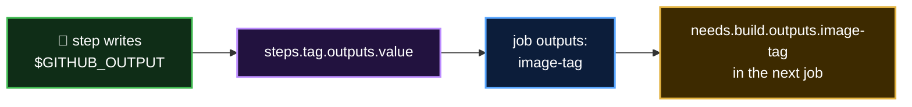

<p align="center">
  <a href="README.md">📂 <b>Working with Variables</b></a> &nbsp;·&nbsp; Lesson 11 · Part 7 of 14 &nbsp;·&nbsp; ⏱️ 13 min
</p>

# 🧠 Inside `${{ }}`: the expression language and its contexts

`${{ }}` isn't the shell. It's **GitHub's own expression language**, evaluated by GitHub before anything reaches the runner. It doesn't know your variable names directly. It only knows a fixed set of top-level objects called **contexts**, and every value you read must start with one of them:

```yaml
run: echo "${{ IMAGE_NAME }}"       # ❌ Unrecognized named-value: 'IMAGE_NAME'
run: echo "${{ env.IMAGE_NAME }}"   # ✅ context.name
```

The prefix isn't red tape. The same name can exist in several places at once, and the context says which one you mean:

```yaml
${{ env.TOKEN }}       # from env: in this YAML
${{ vars.TOKEN }}      # from Settings → Variables
${{ secrets.TOKEN }}   # from Settings → Secrets, masked in logs
```

## 📚 The contexts you'll use

| Context | Holds | Example | Example value |
|---|---|---|---|
| 🐙 `github` | Facts about the run and what triggered it | `${{ github.sha }}` | `ffac537e6cbb...` |
| 🌱 `env` | Variables from `env:` (all levels) and `$GITHUB_ENV` | `${{ env.IMAGE_NAME }}` | `dragon-web` |
| ⚙️ `vars` | Configuration variables from Settings | `${{ vars.DOCKER_USERNAME }}` | `octocat` |
| 🔐 `secrets` | Encrypted secrets from Settings, plus `GITHUB_TOKEN` | `${{ secrets.DOCKER_PASSWORD }}` | `***` in logs |
| 🖥️ `runner` | The machine running the job | `${{ runner.os }}` | `Linux` |
| 📦 `job` | The current job's status, container and services | `${{ job.status }}` | `success` |
| 👣 `steps` | Outputs and results of earlier steps **that have an `id`** | `${{ steps.version.outputs.tag }}` | `v1.4.2` |
| 🔗 `needs` | Outputs and results of the jobs listed in `needs:` | `${{ needs.build.outputs.version }}` | `1.0.42` |
| ✖️ `matrix` | The current job's matrix values | `${{ matrix.os }}` | `windows-latest` |
| 🧮 `strategy` | Matrix settings for the job | `${{ strategy.job-index }}` | `2` |
| 🔘 `inputs` | Values typed into **Run workflow**, or passed to a reusable workflow | `${{ inputs.fail_tests }}` | `true` |

A closer look at each:

- **`github`**: the one you'll use most. `github.sha` (commit), `github.ref_name` (branch or tag), `github.actor` (who triggered it), `github.event_name` (`push`, `pull_request`...), `github.repository` (`owner/repo`), `github.run_number`, and `github.event`, the full webhook payload, such as `github.event.pull_request.title`.
- **`env`**: everything in `env:` that applies at this point, after the step-beats-job-beats-workflow rule, plus values written to `$GITHUB_ENV` by earlier steps. Same values the shell sees as `$NAME`.
- **`vars`**: configuration variables, already resolved as environment > repository > organisation. An unset name gives an empty string.
- **`secrets`**: like `vars`, but encrypted and printed as `***`. Always has `secrets.GITHUB_TOKEN`, the token GitHub creates for each run. Not available inside actions you call unless you pass it in with `with:` or `env:`.
- **`runner`**: `runner.os` (`Linux`, `Windows`, `macOS`), `runner.arch` (`X64`, `ARM64`), `runner.temp` (a temp folder cleaned after the job).
- **`job`**: mostly `job.status`, handy in a final step that reports how the job went.

The last four work differently: their values are **created by your workflow as it runs**, not set up in advance. Each gets a closer look below.

## 👣 `steps`: what earlier steps in this job produced

A step can hand values to the steps after it by writing `name=value` to `$GITHUB_OUTPUT`. To read them, the step needs an **`id:`**, because that's the name you look it up by:

```yaml
steps:
  - name: Work out the version
    id: version                                     # 👈 the name steps.<id> uses
    run: echo "tag=v1.4.${{ github.run_number }}" >> "$GITHUB_OUTPUT"

  - name: Use it
    run: echo "Building ${{ steps.version.outputs.tag }}"   # → Building v1.4.42
```

| Property | Meaning | Values |
|---|---|---|
| `steps.<id>.outputs.<name>` | A value the step wrote to `$GITHUB_OUTPUT`, or an output of the action it ran | Any text |
| `steps.<id>.outcome` | What happened, **before** `continue-on-error` is applied | `success`, `failure`, `cancelled`, `skipped` |
| `steps.<id>.conclusion` | The final result, **after** `continue-on-error` | Same four values |

`outcome` vs `conclusion` matters for steps that may fail without failing the job:

```yaml
  - name: Optional lint
    id: lint
    continue-on-error: true      # a failure here won't fail the job
    run: npm run lint

  - name: Warn if lint failed
    if: steps.lint.outcome == 'failure'     # outcome is 'failure', conclusion is 'success'
    run: echo "::warning::Lint failed, but we carried on"
```

> [!IMPORTANT]
> `steps` only sees steps **earlier in the same job**, and only those with an `id:`. A step without an `id`, a later step, or a step in another job all read as empty.

## 🔗 `needs`: what earlier jobs produced

`steps` stops at the edge of the job. To pass values to **another job**, the job declares `outputs:` mapped from its steps, and a later job reads them through `needs`:

```yaml
jobs:
  build:
    runs-on: ubuntu-latest
    outputs:
      image-tag: ${{ steps.tag.outputs.value }}     # 👈 job output ← step output
    steps:
      - id: tag
        run: echo "value=${GITHUB_SHA::7}" >> "$GITHUB_OUTPUT"

  deploy:
    needs: build                                     # 👈 opens needs.build
    runs-on: ubuntu-latest
    steps:
      - run: echo "Deploying ${{ needs.build.outputs.image-tag }}"
```

| Property | Meaning | Values |
|---|---|---|
| `needs.<job>.outputs.<name>` | A value the job declared under `outputs:` | Any text |
| `needs.<job>.result` | How that job ended | `success`, `failure`, `cancelled`, `skipped` |



> [!IMPORTANT]
> `needs` only covers jobs listed **directly** in this job's `needs:`. A "grandparent" job two steps up the chain reads as empty. List it too: `needs: [build, test]`. [Lesson 9](../09-executing-jobs-in-sequence/README.md) covers `needs.<job>.result` in depth.

## ✖️ `matrix` and 🧮 `strategy`: which copy of the job am I?

A matrix runs **one job definition many times** with different values. Inside each copy, `matrix` says which values *this* copy got:

```yaml
jobs:
  test:
    strategy:
      matrix:
        os: [ubuntu-latest, windows-latest]
        node: [20, 22]
    runs-on: ${{ matrix.os }}                       # 👈 matrix works in runs-on
    name: test (${{ matrix.os }}, node ${{ matrix.node }})
    steps:
      - uses: actions/setup-node@v7
        with:
          node-version: ${{ matrix.node }}
      - run: echo "I am copy ${{ strategy.job-index }} of ${{ strategy.job-total }}"
```

That's 2 × 2 = **4 jobs**. Each sees a different `matrix`:

| Copy | `matrix.os` | `matrix.node` | `strategy.job-index` |
|---|---|---|---|
| 1 | `ubuntu-latest` | `20` | `0` |
| 2 | `ubuntu-latest` | `22` | `1` |
| 3 | `windows-latest` | `20` | `2` |
| 4 | `windows-latest` | `22` | `3` |

| `strategy` property | Meaning |
|---|---|
| `strategy.job-index` | This copy's position, starting at `0` |
| `strategy.job-total` | How many copies there are in total |
| `strategy.fail-fast` | Whether one failure cancels the other copies (`true` by default) |
| `strategy.max-parallel` | How many copies may run at once |

Matrix values can be objects too, read with more dots: `matrix.config.node`. A common use is giving each copy a **unique artifact name**: `name: results-${{ matrix.os }}`, as in [Lesson 10](../10-storing-workflow-data-as-artifacts/README.md).

> [!NOTE]
> `matrix` and `strategy` only exist in jobs that have a `strategy: matrix:`. Elsewhere they're empty.

## 🔘 `inputs`: values a person or another workflow passes in

`inputs` holds values given to the workflow **when it starts**. They come from two places:

| Trigger | Who supplies the inputs |
|---|---|
| `workflow_dispatch` | A person, in the **Run workflow** form on the Actions tab (or `gh workflow run`) |
| `workflow_call` | Another workflow that calls this one as a **reusable workflow** |

```yaml
on:
  workflow_dispatch:
    inputs:
      environment:
        description: Where to deploy
        type: choice
        options: [staging, production]
        default: staging
      dry_run:
        description: Only print what would happen
        type: boolean
        default: true

jobs:
  deploy:
    runs-on: ubuntu-latest
    environment: ${{ inputs.environment }}           # 👈 inputs works almost everywhere
    steps:
      - if: ${{ inputs.dry_run }}
        run: echo "Would deploy to ${{ inputs.environment }}"
      - if: ${{ !inputs.dry_run }}
        run: ./deploy.sh "${{ inputs.environment }}"
```

GitHub turns that into a form with a dropdown and a checkbox. Input types:

| `type:` | Form control | In `inputs` you get |
|---|---|---|
| `string` | Text box | Text |
| `boolean` | Checkbox | A real `true` / `false` |
| `number` | Number box | A number |
| `choice` | Dropdown of `options:` | One of the options |
| `environment` | Dropdown of your repo's environments | The environment's name |

> [!TIP]
> **Use `inputs`, not `github.event.inputs`.** Both exist, but `github.event.inputs` turns everything into text, so a boolean becomes the string `'false'`, which counts as true in an `if:`. `inputs` keeps the real type.

> [!NOTE]
> On any other trigger, such as `push`, `inputs` is empty. Give inputs a `default:` and your `if:`s will behave sensibly either way. The [Lesson 9 workflow](../../.github/workflows/04-needs-sequence.yml) uses a `fail_tests` checkbox exactly like this.

> [!NOTE]
> **Not every context is available everywhere.** GitHub fills them in at different moments. For example, `runs-on:` can read `github`, `vars`, `inputs`, `matrix` and `needs`, but not `env`, `secrets` or `steps`. Each key's allowed contexts are listed in the [contexts reference](https://docs.github.com/en/actions/reference/workflows-and-actions/contexts#context-availability). If you get "Unrecognized named-value" for a context you *did* write, it isn't available there.

## ✍️ Reading a value: dots, brackets and missing names

| You write | Use it when |
|---|---|
| `env.IMAGE_NAME` | Normally |
| `env['IMAGE_NAME']` | The same, with brackets |
| `env['my-image']` | The name has a dash or other special character |
| `matrix.config.node` | Values are nested: keep adding dots |
| `vars.MISSING` | A name that doesn't exist is an **empty string**, not an error |

## 🔧 More than lookups

The expression language can also compare, combine and call a few functions:

| Kind | Example | Result |
|---|---|---|
| Fallback | `${{ vars.REGION \|\| 'eu-west-1' }}` | The variable, or the default if it's empty |
| Compare | `${{ github.ref_name == 'main' }}` | `true` or `false` |
| Combine | `${{ github.event_name == 'push' && runner.os == 'Linux' }}` | `true` only if both are |
| Text search | `${{ contains(github.event.head_commit.message, '[skip deploy]') }}` | `true` if the text appears |
| Starts with | `${{ startsWith(github.ref, 'refs/tags/v') }}` | `true` for version tags |
| Build text | `${{ format('{0}/{1}:{2}', env.REGISTRY, env.IMAGE, github.sha) }}` | `docker.io/dragon-web:ffac53...` |
| Status | `${{ failure() }}`, `${{ !cancelled() }}` | Covered in [Lesson 9](../09-executing-jobs-in-sequence/README.md) |

In `if:` you can leave out the `${{ }}`, because GitHub always treats `if:` as an expression: `if: github.ref_name == 'main'` works.

> [!TIP]
> **Lost? Print the whole context.** `toJSON` turns any context into readable JSON in the log:
>
> ```yaml
> - run: echo '${{ toJSON(github) }}'
> - run: echo '${{ toJSON(env) }}'
> ```
>
> Never do this with `secrets`. They'd be masked, but there's no reason to risk it.

---

<p align="center">
  <a href="06-var-or-env-var.md">⬅️ `$VAR` or `${{ env.VAR }}`?</a>
  &nbsp;&nbsp;·&nbsp;&nbsp;
  <a href="README.md">📂 Topic overview</a>
  &nbsp;&nbsp;·&nbsp;&nbsp;
  <a href="08-variables-you-get-for-free.md"><b>Next: Variables you get for free ➡️</b></a>
</p>
