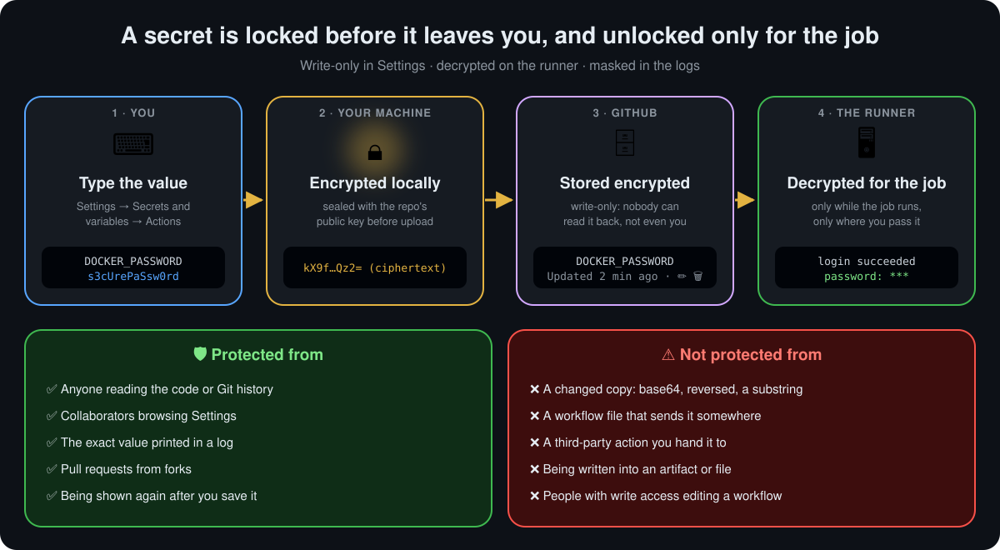

  <a href="README.md">📂 <b>Working with Repository-Level Secrets</b></a> &nbsp;·&nbsp; Lesson 12 · Part 1 of 10 &nbsp;·&nbsp; ⏱️ 2 min

# 💡 What a secret is

> **A secret is a variable that GitHub encrypts, never shows again, and hides from the logs.** You read it in a workflow with `${{ secrets.NAME }}`.

  

| Stage | What happens |
|---|---|
| ⌨️ **You save it** | In **Settings** or with `gh secret set` |
| 🔒 **Encrypted before upload** | Your browser or the CLI seals it with the repository's public key ([libsodium sealed box](https://libsodium.gitbook.io/doc/public-key_cryptography/sealed_boxes)), so it never travels in plain text |
| 🗄️ **Stored write-only** | Settings shows the name and when it was updated, never the value. You can **update** or **delete** it, not read it |
| 🖥️ **Decrypted for the job** | Only when a job runs, and only reaches the steps you pass it to |
| 🙈 **Masked in logs** | If the exact value appears in a log, GitHub prints `***` instead |

---

  <a href="README.md">⬅️ Overview</a>
  &nbsp;&nbsp;·&nbsp;&nbsp;
  <a href="README.md">📂 Topic overview</a>
  &nbsp;&nbsp;·&nbsp;&nbsp;
  <a href="02-creating-a-repository-secret-step-by-step.md"><b>Next: Creating a repository secret, step by step ➡️</b></a>

