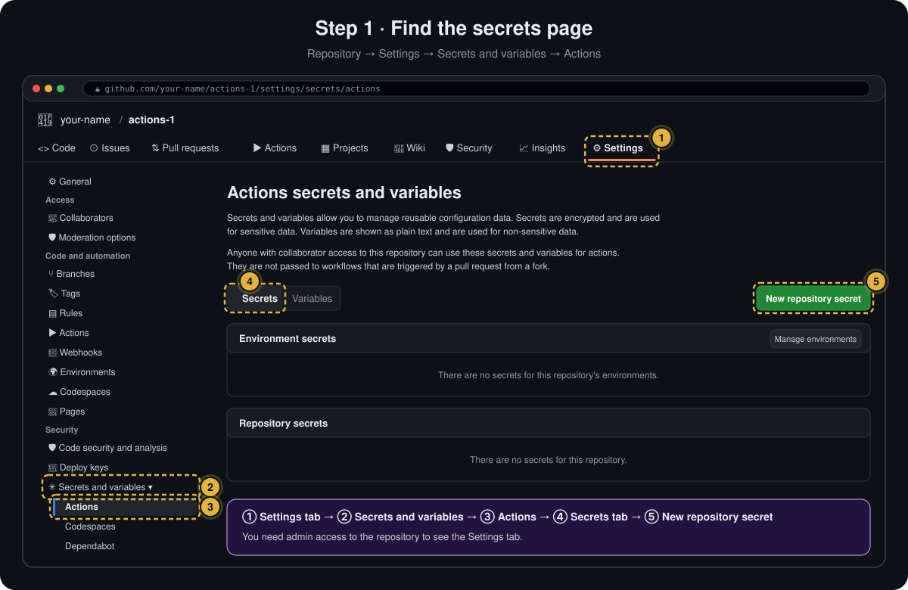
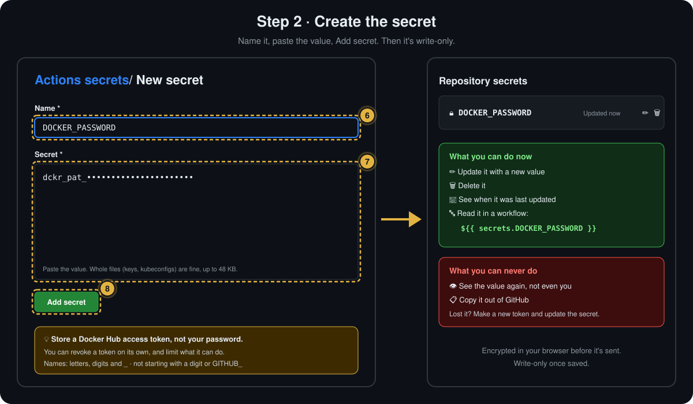
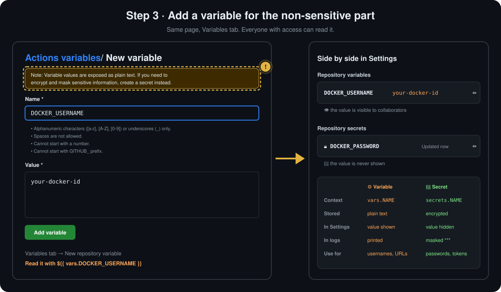
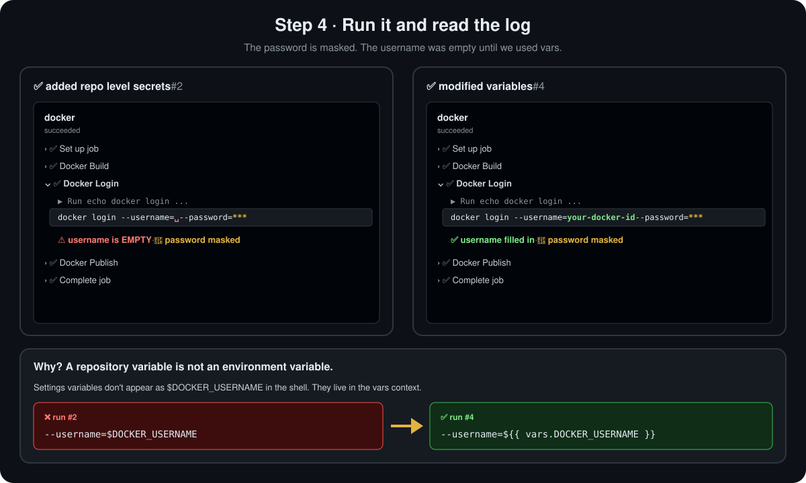

<p align="center">
  <a href="README.md">📂 <b>Working with Repository-Level Secrets</b></a> &nbsp;·&nbsp; Lesson 12 · Part 2 of 10 &nbsp;·&nbsp; ⏱️ 8 min
</p>

# 🛠️ Creating a repository secret, step by step

Secrets and variables can live at three levels: **organisation**, **repository** and **environment**. This lesson uses the **repository** level: one place, usable by every workflow in the repo.

## Step 1 · Find the secrets page

<p align="center">
  
</p>

| # | Click | What you'll see |
|:---:|---|---|
| 1️⃣ | **Settings**, the last tab of the repository | Repository settings. No Settings tab? You need **admin** access |
| 2️⃣ | **Secrets and variables** in the left sidebar, under *Security* | It expands into Actions, Codespaces and Dependabot |
| 3️⃣ | **Actions** | **Actions secrets and variables**. Each of the three has its own secrets; workflows read the **Actions** ones |
| 4️⃣ | The **Secrets** tab (it's selected by default) | Two lists: **Environment secrets** and **Repository secrets** |
| 5️⃣ | **New repository secret** | The form in step 2 |

> [!NOTE]
> Read the small print on that page: secrets and variables are usable by **anyone with collaborator access**, and **are not passed to workflows triggered by a pull request from a fork**.

## Step 2 · Create the secret

<p align="center">
  
</p>

| # | Do | Tip |
|:---:|---|---|
| 6️⃣ | **Name:** `DOCKER_PASSWORD` | Upper case with underscores is the convention. The name is how workflows find it |
| 7️⃣ | **Secret:** paste the value | Prefer a Docker Hub **access token** to your real password. Multi-line values such as SSH keys are fine |
| 8️⃣ | **Add secret** | It appears under **Repository secrets** with a 🔒 and *Updated now* |

From now on the value is **write-only**: ✏️ replaces it, 🗑️ deletes it, nothing shows it.

## Step 3 · Add a variable for the non-sensitive part

The username isn't secret, but it shouldn't be hard-coded either. On the same page, switch to the **Variables** tab → **New repository variable**:

<p align="center">
  
</p>

Notice GitHub's own warning at the top of the form: **"Variable values are exposed as plain text. If you need to encrypt and mask sensitive information, create a secret instead."** That one sentence is the whole rule for choosing between them.

## Step 4 · Use them in the workflow, run it, read the log

Replace the plain-text password and the hard-coded username:

```yaml
env:
  CONTAINER_REGISTRY: docker.io
  IMAGE_NAME: github-actions-nginx

jobs:
  docker:
    runs-on: ubuntu-latest
    steps:
      - name: Docker Login
        run: echo docker login --username=${{ vars.DOCKER_USERNAME }} --password=${{ secrets.DOCKER_PASSWORD }}
```

> [!NOTE]
> This demo only **`echo`es** the command, so you can see what reaches the log. The safe way to really log in is in [Using it](03-using-it-fixing-the-docker-login.md) below.

Push, open the run, and expand **Docker Login**:

<p align="center">
  
</p>

Two things to notice:

| | What you see | Why |
|---|---|---|
| 🔐 | `--password=***` | GitHub found the secret's value in the log and masked it |
| ⚠️ | In run #2, `--username=` is **empty** | The step still said `$DOCKER_USERNAME`. Once that name was removed from `env:` and moved to **Settings**, the shell had nothing called `DOCKER_USERNAME` |

> [!IMPORTANT]
> **A variable in Settings is not an environment variable.** It never appears as `$NAME` in the shell on its own. Read it with **`${{ vars.NAME }}`**, or map it into `env:` first (`DOCKER_USERNAME: ${{ vars.DOCKER_USERNAME }}`) and then use `$DOCKER_USERNAME`. The same goes for secrets with `${{ secrets.NAME }}`. Missing names don't cause errors; they just come out **empty**, so check the log.

> [!TIP]
> **"Context access might be invalid: DOCKER_PASSWORD"?** The GitHub Actions extension in VS Code shows this yellow warning when it can't see your repository's settings, for example before you sign in. The workflow still works, and you can ignore it. Once the extension is signed in, it checks secret and variable names against the repository.

## With the GitHub CLI

```bash
gh secret set DOCKER_PASSWORD                      # prompts, input hidden ✅
gh secret set DOCKER_PASSWORD < token.txt          # from a file
gh secret set KUBECONFIG < ~/.kube/config          # whole files work too
gh secret list                                     # names and dates only
gh secret delete DOCKER_PASSWORD
```

> [!WARNING]
> **Avoid `gh secret set NAME --body "value"`.** The value lands in your shell history. Let it prompt you, or read from a file.

## Naming rules

| Rule | ✅ OK | ❌ Not OK |
|---|---|---|
| Letters, digits and `_` only | `DOCKER_PASSWORD` | `docker-password` |
| Can't start with a digit | `AWS_KEY_2` | `2FA_SECRET` |
| Can't start with `GITHUB_` | `GH_DEPLOY_TOKEN` | `GITHUB_DEPLOY_TOKEN` |
| Not case-sensitive | `Docker_Password` and `DOCKER_PASSWORD` are the same secret | |

> [!TIP]
> **Store a token, not your password.** For Docker Hub, create a **personal access token** with only the permissions the workflow needs (Account settings → Personal access tokens) and store that. You can revoke it without changing your password, and it can do less damage if it leaks.

---

<p align="center">
  <a href="01-what-a-secret-is.md">⬅️ What a secret is</a>
  &nbsp;&nbsp;·&nbsp;&nbsp;
  <a href="README.md">📂 Topic overview</a>
  &nbsp;&nbsp;·&nbsp;&nbsp;
  <a href="03-using-it-fixing-the-docker-login.md"><b>Next: Using it: fixing the Docker login ➡️</b></a>
</p>
