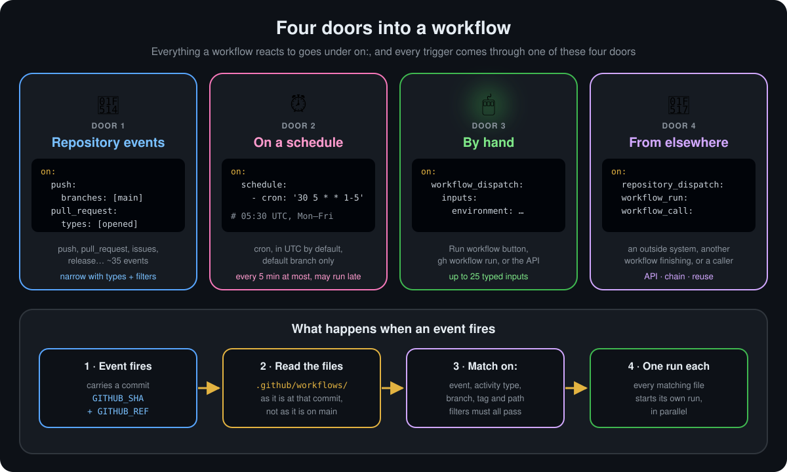

  <a href="README.md">📂 <b>Triggering Workflows in Detail</b></a> &nbsp;·&nbsp; Lesson 13 · Part 1 of 12 &nbsp;·&nbsp; ⏱️ 3 min

# 🚪 Four doors into a workflow

  

GitHub's docs list four sources of triggers:

| Door | What starts it | Typical use |
|---|---|---|
| 🔔 **Repository events** | Something happens in the repo: a push, a pull request, an issue, a release | CI on every push, labelling issues, publishing on release |
| ⏰ **Schedules** | A time, written as cron | Nightly builds, weekly dependency checks, cleaning stale issues |
| 🖱️ **Manual runs** | A person clicks **Run workflow**, or runs `gh workflow run` | Deploys, one-off maintenance, anything that needs a human decision |
| 🔗 **From elsewhere** | An outside system calls the API, or another workflow finishes or calls this one | A CMS publishing content, chaining workflows, reusable pipelines |

## 🔍 What GitHub does when an event fires

From the docs, in order:

1. **The event happens**, and it carries a **commit SHA** and a **Git ref**. The runner gets them as `GITHUB_SHA` and `GITHUB_REF`.
2. **GitHub reads `.github/workflows/`** at that SHA or ref. It uses the files **as they were at that commit**, not as they are on `main` now.
3. **Each workflow whose `on:` matches** the event, its activity type and its filters starts its own run.

> [!IMPORTANT]
> Step 2 explains a lot of confusing behaviour. Push a fix to a workflow on a feature branch and the next push to *that branch* uses the new file, while `main` keeps using the old one. And a pull request runs the workflow file **from the pull request**, so a contributor's change to the workflow is tested too.

> [!NOTE]
> Some events only look at the **default branch**. `workflow_dispatch`, `schedule`, `repository_dispatch`, `workflow_run` and events like `issues` and `release` use the workflow file on the default branch (`main`). A trigger you add on a feature branch does nothing for these until it is merged.

---

  <a href="README.md">⬅️ Overview</a>
  &nbsp;&nbsp;·&nbsp;&nbsp;
  <a href="README.md">📂 Topic overview</a>
  &nbsp;&nbsp;·&nbsp;&nbsp;
  <a href="02-repository-events-and-activity-types.md"><b>Next: Repository events and activity types ➡️</b></a>

