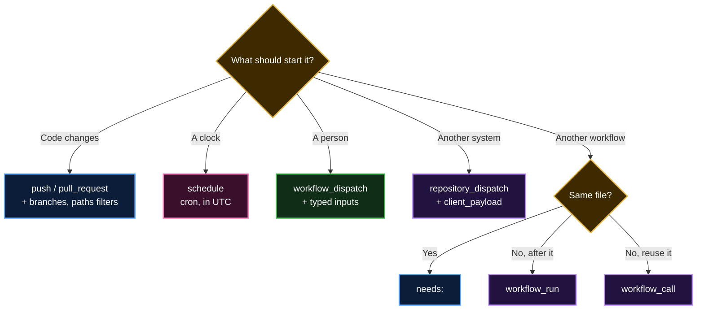

  <a href="README.md">📂 <b>Triggering Workflows in Detail</b></a> &nbsp;·&nbsp; Lesson 13 · Part 9 of 12 &nbsp;·&nbsp; ⏱️ 2 min

# 🧭 Which trigger do I need?

Real workflows often combine several, like the companion workflow: `push` for changes, `schedule` as a safety net, and `workflow_dispatch` so you can always run it by hand.

---

  <a href="08-pull-request-vs-pull-request-target.md">⬅️ `pull_request` vs `pull_request_target`</a>
  &nbsp;&nbsp;·&nbsp;&nbsp;
  <a href="README.md">📂 Topic overview</a>
  &nbsp;&nbsp;·&nbsp;&nbsp;
  <a href="10-common-mistakes.md"><b>Next: Common mistakes ➡️</b></a>

